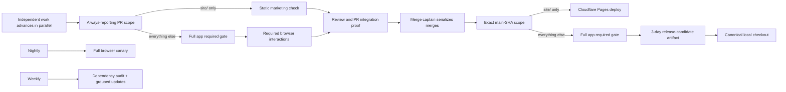

# DevOps operating system

Owner: the role currently responsible for delivery and DevOps.
The founder is deliberately hands-off: that role owns CI/CD design, operation,
failure triage, migration, and merge mechanics. Ask the founder only for money,
product behavior, real-data risk, or an unavoidable identity confirmation.

This is the clean-sheet standard. Historical workflows are evidence for the
numbers below, not a compatibility contract. New CI/CD work starts from these
lanes and the single `npm run ci:required` command.

## Decisions already made

1. **GitHub-hosted Actions is the primary runner.** It is fast enough, has no queue bottleneck in the measured sample, and avoids turning a personal machine into production infrastructure.
2. **One always-reporting required job protects ordinary PRs and main commits.** A change made entirely inside `site/` runs the small static marketing-site contract. Any mixed change or change outside `site/` installs, self-tests the CI tooling, type-checks/builds, enforces a bundle budget, and runs the fast behavior suite. Classification failure and manual dispatch fail open to the full app lane. Native desktop risk is the narrow additional exception: relevant changes also require the two supported operating-system jobs because Linux cannot prove either platform boundary. Owner-authorized, deterministically classified non-production publication uses the separate `docs-only-merge` lane and suppresses hosted CI at both PR-head and squash-commit identities.
3. **Focused browser interactions are a PR gate; the full suite remains a canary.** Every non-site-only PR runs startup health, focused interaction smoke, and the production-bundle regression. A proven `site/`-only PR reports the same check without app/browser work. The full interaction suite remains nightly/manual in four isolated shards because its historical flake evidence does not belong in the required path.
4. **Performance gates stay off shared hosted runners.** The deterministic bundle-size budget is required. Timing/fps work uses same-machine controls on a quiet host until a dedicated runner exists.
5. **There is no fake staging environment.** Every green app-relevant main commit produces a three-day release-candidate artifact; a marketing-only main commit deploys `site/` through Cloudflare Pages and does not rebuild the app. Eido remains local-first; the founder's canonical checkout is the current production lane.
6. **The spare machine is reserve capacity.** Activate it only when browser cost or queueing is a measured constraint. Do not make required CI depend on it.
7. **Actions spend is uncapped and unguarded.** The founder removed the repository spend cap on 2026-07-23 and the software budget guard was deleted with it. Compute efficiency still matters as an engineering goal — keep billed minutes per merge low — but no gate, freeze, or budget read blocks a merge.
8. **Experiments are opt-in evidence, not ambient CI.** Candidate and performance-evidence workflows run only by manual dispatch, use the ` (experimental)` suffix, and never enter Merge Captain's merge verdict. The required gate enforces this policy against future workflows.
9. **The founder is not a DevOps operator.** Never hand back logs, commands, runner choices, branch coordination, or CI judgment. The responsible delivery role decides, executes, verifies, and reports the business outcome.
10. **Non-production publication does not buy product evidence.** Research, reports, retros, skills, SOPs, and agent instructions use focused local validators when `docs-only-merge` proves the complete diff cannot affect shipped code, builds, workflows, dependencies, release artifacts, public sites, or runtime data. Mixed or ambiguous changes return to the ordinary pipeline.

## What the audit found (2026-07-14)

| Surface | Evidence | Decision |
| --- | --- | --- |
| Fast tests | 1,066 Vitest tests in 100 files; local suite about 7 seconds, recent GitHub step median about 33 seconds | Keep all in one required job. The count is not the bottleneck. |
| Type/build | CI ran `typecheck`, then `build`, although `build` runs TypeScript again | Delete the duplicate compiler pass; keep `build` as the type proof. |
| Required CI | Seven days ending 2026-07-14: 227 runs, 219 green, 4 real failures, 4 cancelled main runs; p50 70s, p95 87s; queue p95 0s | Optimize duration and cancellation semantics, not runner size. |
| Run amplification | 227 runs supported 67 merges: 3.39 runs and an estimated 6.5 billed minutes per merge | Cancel superseded PR runs; never cancel ordinary main proof; cancel and disclose only an accidental exact-SHA run from the qualified `docs-only-merge` lane; review amplification weekly. |
| Browser | 104 tests in 32 files were excluded from CI; issue #355 records the safety gap; issue #356 records the known flake | Automate smoke + nightly as visible non-blocking canaries; promote only after burn-in. |
| Performance | Retros repeatedly found fps results contaminated by host load; browser execution cannot launch on the managed Mac | Require deterministic bundle growth; use the spare unmanaged host later for controlled timing. |
| Security | `npm audit` was green, but no scheduled audit or dependency-update automation existed; Actions used floating major tags | Add weekly audit, grouped Dependabot updates, least-privilege permissions, and exact Action commit pins. |
| CD | No app staging/deploy target existed; the canonical local checkout was the production lane | Preserve an immutable build artifact on every app-relevant green main commit. Marketing-only main commits deploy through the separate Cloudflare Pages lane without rebuilding the app. |
| Enforcement | Resolved on 2026-08-20: provider-side protection is live on `main` | The five checks below are required, and force-push and deletion are blocked. Merge Captain no longer carries enforcement alone. Admin override is deliberately retained (`enforce_admins: false`) so a release or incident is never wedged by the gate itself. |

### Failure audit follow-up (2026-07-15)

The seven-day Actions audit contained 263 runs: 226 green, 27 failed, and 10
cancelled. Twenty failures were iterative candidate-evidence runs, five were
required CI, and two were browser smoke. The image-rendition sequence alone
contained nine expected development failures and three superseded cancellations
before its green evidence run. The nightly full browser run then accumulated 14
failures and hit the 15-minute job ceiling. These observations drove the
manual-only experiment policy, distinct experiment classification, browser
startup proof, fail-fast behavior, and four-way nightly sharding in this SOP.

The audit source is the repository, GitHub run history, open issues #355/#356, and the retros listed below. Re-run the numbers rather than treating this snapshot as permanent.

## Cost model

Actions spend is uncapped: the founder removed the repository budget on
2026-07-23, and the `npm run ci:budget` guard, its script, and its tests were
deleted at the same time. Nothing gates a merge on spend, and no freeze
threshold exists. GitHub's own billing page is the only place to look at cost.

Compute efficiency remains an engineering target rather than a gate. Planning
assumptions: 50 merges/day, 30 days/month. GitHub rounds each job up
independently to a billed minute. Standard list rates verified 2026-07-18 are
$0.006/minute for Linux, $0.010/minute for Windows, and $0.062/minute for macOS;
see GitHub's
[Actions runner pricing](https://docs.github.com/en/billing/reference/actions-runner-pricing)
and [standard hosted-runner labels](https://docs.github.com/en/actions/reference/runners/github-hosted-runners).

The controlling metric is **total billed minutes per merge**, not test count.
Hold the required pipeline near 5 billed minutes/merge and the total operating
figure at or below 6.5 including canaries. Sustained drift above that is a
signal to fix run amplification, flakes, and wide browser paths — the same
remediation the old amber/red bands prescribed, now applied on judgment during
an operating review rather than by a threshold.

## Pipeline



Scale parallel work to real dependencies, ownership boundaries, execution slots,
and shared compute. Reserve enough capacity for review, integration, diagnosis,
and recovery; implementation fan-out that starves those functions is not
throughput. The merge lane remains serial because composing individually green
changes is where production risk appears. The main gate was 90 seconds at p95
when that rule was written; measured over the last 60 pushes to `main` it is
300 seconds at the median and 333 at p95, almost all of it the fast behaviour
suite, which grew with the product. The serial merge lane can therefore verify
about 11 merges/hour rather than 40. At 50 merges/day CI is still not the
throughput bottleneck, but the headroom is roughly a fifth of what this
paragraph used to assume, so treat a further slowdown as a real constraint
rather than noise.

Sharding that suite across parallel runners is the only lever that would move
the number, and it is deliberately not taken: it contradicts the one-job-per-SHA
rule below, because GitHub rounds every job up to the minute and five jobs bill
five rounded minutes where one bills one. Revisit that trade only when the gate
actually blocks the merge lane.

### Required gate

The required-gate program used by hosted CI and local development is:

```sh
npm run ci:required
```

Run the gate with Node.js 24 or 26.9+ and npm 11 on your PATH. The gate checks
`package.json` for the supported ranges and `.github/node-version` selects the
Node.js line in GitHub Actions.

Rules:

- One aggregate verdict per SHA preserves the branch-protected `Required gate`
  check name. Its database-free scope job compares the PR merge base to the
  head, or the exact pushed range on `main`, before selecting one proof job.
- The full-app gate audits the installed production tree at high severity
  immediately after `npm ci`; an advisory blocks the release-shaped lane.
  If every changed path is inside `site/`, the database-free site job runs only
  `node --test scripts/ci/site-static.test.mjs`. Empty, malformed, unreadable,
  manual, mixed, release/update, CI, app, and classifier-error cases run the
  full canonical app command without a database service. Renames
  are considered as deletion plus addition, so moving a file across the
  `site/` boundary cannot enter the fast lane.
- New pushes cancel older runs for the same PR. The check attaches to that PR head, while the job intentionally tests GitHub's synthetic merge of the head with its base at run time; the workflow summary records all three identities.
- Main uses a SHA-specific concurrency key, so a later merge cannot cancel earlier main proof.
- The merge captain waits for the exact merged SHA before taking the next PR.
- Required status name: `Required gate`.
- A provider outage may be compensated only by the full canonical command at
  the exact current head and an explicit `pr-gate.sh` assertion. Genuine red
  required checks are never overridable.

The explicit `docs-only-merge` specialization is the sole non-production
exception to the always-reporting gate. Its required checks are intentionally
absent rather than red. The owner-authorized admin override is valid only after
the skill's scope classifier and focused local proof pass, and only when
`[skip ci]` is preserved on both the PR head and GitHub's squash commit. Any
hosted run that starts is cancelled immediately and disclosed.

If a merge helper cannot establish a supported toolchain, fix the environment
and rerun the gate against the same lockfile. Once the runtime check passes, a
child command's nonzero exit is gate evidence. Other helper failures may use a
documented native equivalent that emits the same identity, status, and evidence
fields.

### Browser canary

- No PR path filter. `Browser interactions` is a required check, and a check
  held back by a path filter never reports a conclusion, which leaves a pull
  request permanently pending. The job uses the same in-job classifier as the
  required gate: `site/`-only changes report success without installing app
  dependencies or Chromium, while all other changes run the app interaction
  proof. Classification failure runs the full proof.
- PR suite: startup/hydration/rendering health, then the focused interaction smoke and production-bundle regression.
- Nightly/manual suite: all interaction browser tests split into four hosted jobs, each with its own port and scratch save file.
- Hosted test ceiling: 30 seconds per test. The PR lane stops after the first
  failure in each job, so a systemic defect produces one useful diagnostic per
  shard rather than a wall of repeated timeouts. The nightly shards set
  `EIDO_INTERACTION_MAX_FAILURES=0` and run to completion: they are the only
  run that sees every file, and stopping at the first wobble reported one
  failure while hiding the health of everything after it.
- Hosted runs retry twice. A hosted runner is slower and noisier than a
  developer machine and this suite drives a real browser, so without retries a
  timing wobble and a broken feature look identical. A test that passes on
  retry is reported as flaky and named in the run summary; a broken one fails
  three times and still fails the run. This is what makes the promotion rule
  below measurable: unexplained failure counts now exclude wobbles.
- Failure artifacts only: Playwright HTML report, traces, screenshots. Green runs do not upload browser artifacts.
- The PR job is `Browser interactions` and is blocking. Its burn-in is done: 29
  successes and zero genuine failures across 59 pull-request runs, with every
  other outcome a concurrency cancellation rather than a flake. A red is a
  merge blocker, not a triage note.
- The nightly shards keep the exact check-name suffix ` (non-blocking)`, which
  is what keeps them outside the required set; it does not erase the signal.
  Investigate a relevant red at the exact head and record its disposition. A
  known unrelated signature with an existing owner may be reported without
  starting a rerun campaign or blocking an otherwise proven change; an
  unexplained or relevant red cannot support the affected claim.
- Cancellation is its own state, not a failed test. A cancelled required run is
  absent proof and must be restored (or replaced only by the exact-head
  canonical mirror after provider unavailability is diagnosed). Pending,
  absent, or cancelled optional canaries and experiments remain informational
  and do not block landing.
- Promotion rule: a candidate smoke gate must have under 1% unexplained failures over 50 relevant runs, fail red under a deliberate control, and stay within the 6.5-minute/merge budget.

### Native desktop proof

- `CERTIFICATION_PROFILE_RUNTIME_PATHS` in
  `scripts/certification/certification-manifest.mjs` is the one literal that
  decides both what moves the packaged-certification fingerprint and what makes
  this gate do real work. `docs/agents/release-gates.json` publishes it to the
  merge captain and the `push` filter in `.github/workflows/desktop-proof.yml`
  spends native minutes on it; `scripts/ci/workflow-policy.test.mjs` pins all
  three to the same array. Broad renderer/UI changes do not pay for it; root
  `vite.config.ts` does because it controls the renderer assets consumed by the
  custom-protocol package.
- Both matrix jobs report a conclusion on **every** pull request, which is what
  lets them be required checks. The `pull_request` trigger carries no path
  filter. A `Native desktop proof scope` job compares the fingerprint of the
  merge base with the fingerprint of the head; when they match, both matrix
  jobs run on `ubuntu-24.04` with every step skipped. Measured on 2026-08-20,
  the scope job takes 18 seconds of execution and the legs start 4 seconds
  after it finishes, so the whole skip path is well under a minute of wall
  clock and costs three idle Linux minutes. An unrelated pull request never
  pays for a packaged build.
- PR jobs check out and verify the exact PR head. Main jobs verify the exact pushed SHA;
  Required continues to own the synthetic merge-ref integration proof.
- Merge Captain reads policy from the provider identities being judged, not its
  caller's checkout: PR classification unions full base/head OIDs, and main
  classification unions the exact SHA with its full first parent. A stale
  checkout or a policy-removal change therefore cannot erase an existing gate.
  Renames classify both the current and previous path, and unknown file statuses
  wait rather than hiding a protected old path. Malformed, duplicate, capped,
  or incomplete path inventories are absent proof.
- PR classification re-reads every consumed mutable verdict field, full ref
  identity, file count, and check rollup after path/policy classification. Any
  drift discards the mixed snapshot; freshness compares the exact full base and
  head OIDs rather than mutable branch names.
- Both exact native check names must exist and succeed. Absent, pending,
  cancelled, skipped, or neutral jobs are missing proof, and provider
  compensation cannot replace a native host boundary.
- Each job installs the clean lockfile, runs `npm run desktop:smoke`, and retains
  only `.local/electron-shell/proof-evidence.json` for three days. That one
  composed artifact records the packaged security/signing boundary plus a real
  renderer mutation, normal close checkpoint, and an offline-emulated exact-window
  Session reopen/query through the installed SQLite Profile. It also records the
  platform MCP package entry and, under the declared GitHub-hosted ephemeral OS
  user, a tools-only read/preview/apply session through the unmodified fixed-path
  production entry. The explicit proof root and the exact owned native `Eido`
  root are removed before evidence publication. The proof is unpacked, non-promotable, never
  publisher-signed/notarized, and never accesses a real save.
- The first hosted observation used one rounded macOS minute and two rounded
  Windows minutes: about $0.082 per triggered SHA, or $0.164 for the PR plus its
  pushed-main proof before retries. Re-measure when job duration or rates change.

### Packaged release certification

- `Packaged certification` is an opt-in, `workflow_dispatch`, exact-current-main
  release-train gate. It creates real production-identity DMG plus macOS update
  ZIP and NSIS candidates, runs the smallest installed native journey, and binds
  both platform packets into one digest-addressed certification set. See
  [the evidence contract](packaged-certification.md).
- It is intentionally not a PR gate and is absent from
  `docs/agents/release-gates.json`; desktop proof remains the only conditional
  required native check. It is also not candidate/performance research, so its
  workflow and jobs do not use the experimental classification or suffix.
- Each native packet, sealed installer, paired manifest, and external reference
  is retained for three days. Release planning persists the small reference and
  exact manifest digest rather than treating an expiring artifact URL as
  identity.
- Run it after merge when a release train needs promotable unsigned-package
  evidence. A red or absent run means no certification claim exists, but does
  not retroactively fail the universal PR gate.

### Experimental evidence

- Candidate/performance experiments use `workflow_dispatch` only. Automatic
  `push`, `pull_request`, `schedule`, and `workflow_run` triggers are forbidden.
- Add `# ci-class: experimental` and suffix every job name with
  ` (experimental)`. The required gate runs `npm run ci:workflow-policy` so a
  feature branch cannot quietly bypass this standard.
- Red or pending experiments remain visible but do not block merging and do not
  require `--canary-reviewed`. They do mean the claimed experiment lacks valid
  evidence; run it deliberately when that claim is needed.
- A branch that changes an experimental workflow must refresh that affected
  workflow against this contract before merge. Historical gray/red checks stay
  attached to their old SHA; reprove the changed workflow lineage rather than
  rebuilding unrelated delivery evidence. The founder does not coordinate this
  migration.

### Performance

- Required now: 750 KiB maximum raw JavaScript chunk and 483 KiB total gzipped JavaScript. The single-chunk guard remains anchored to the 2026-07-14 audited 669.3 KiB maximum. On 2026-07-23 exact main measured 460.0 KiB total gzip and the integrated #711 bundle measured 471.8 KiB; sourcemap comparison attributed the 11.8 KiB delta to the required Agent run, live-authority, and mutation-barrier runtime, not vendor/editor drift. The 2026-07-29 Result follow-up refinement measured 478.1 KiB. On 2026-08-05 exact main measured 478.2 KiB and the v5 release line measured 482.4 KiB; module attribution placed the 4.2 KiB delta in expanded v5 Agent command contracts, delegated-run/session handling, and renderer authority rather than vendor/editor drift. The 483 KiB guard retains less than 1 KiB of measured headroom.
- Material PR-specific performance claims need a red-capable test/counter and a
  same-machine base control. Otherwise report performance as unmeasured; do not
  build host-cleanliness machinery merely to populate a metric.
- Browser fps is evidence, not a shared-runner merge gate.

### Security and maintenance

- Required production-only high-severity audit plus a weekly full-tree audit.
- Weekly npm patch/minor updates may be grouped. Major npm updates are isolated
  one dependency per PR so Zustand, TypeScript, and other migrations cannot hide
  one another. The tightly coupled React runtime/type ecosystem (`react`,
  `react-dom`, `@types/react`, and `@types/react-dom`) is the sole major-update
  group because splitting it creates structurally uninstallable PRs. GitHub
  Actions updates remain grouped.
- Workflow token permissions default to read-only.
- Third-party Actions are pinned to exact reviewed commits; Dependabot proposes updates.
- Do not add a new scanner to every PR unless a real incident/risk justifies its minute cost.

## CD without staging

CD starts with a trustworthy release object, not necessarily a server. The current stages are:

1. Green main SHA.
2. For an app-relevant commit, a reproducible `dist/` artifact retained for
   three days and verified by `main-ci-wait.sh` before the next merge. A
   `site/`-only commit has no app artifact because it did not rebuild the app.
3. Founder canonical checkout synced by the merge captain when clean.

Report merged, dependency-ready, artifact-ready, and locally promoted state
separately. Green exact-main proof plus its SHA-bound artifact may unblock
downstream technical work even when user-owned changes keep the canonical
checkout deliberately untouched and not locally promoted.

Do not invent hosted staging until Eido has a deployment destination or external testers. When that happens, add in this order: automatic preview deploy from a green main artifact, one smoke test, manual stable promotion, and a rollback to the previous artifact. The deployment provider should be chosen from product needs at that time, not precommitted now.

## Spare-machine activation rule

Use the spare machine only if either condition persists for two reviews:

- projected Actions overage exceeds $35 primarily because of browser jobs; or
- browser queue p95 exceeds two minutes or hosted execution cannot reproduce the required environment.

Then dedicate the machine to browser/performance canaries first. Use an isolated account, no private Eido save, no forked/untrusted PR execution, labels that required CI never requests, and a documented offline fallback. Hosted Actions remains the required gate.

## Account-owner controls (one time)

These settings require owner authority and cannot be committed as code. The
responsible delivery role executes them through an authorized session when
possible; the founder only handles an unavoidable login, identity, or payment
confirmation:

1. Actions spend is intentionally uncapped as of 2026-07-23. Do not re-create a repository Actions budget or spend cap unless the founder asks for one.
2. Keep squash merge enabled and automatic branch deletion enabled.
3. Done on 2026-08-20: `main` is protected. The five status checks below are
   required, and force-push and deletion are blocked. Linear history is not
   required, because deliberate stacked trains sometimes need merge commits.
   `enforce_admins` stays off on purpose, so a release or an incident is never
   wedged by the gate protecting it.

   Two parts of the original intent are deliberately still off, and are a
   decision rather than an oversight. Required pull requests and required
   conversation resolution both assume a second person. On a solo repository
   they only add a step the same person clears, while blocking the direct push
   that a broken `main` sometimes needs. Turn both on when a second committer
   arrives, not before.

   | Check | Workflow | Reports on every pull request because |
   | --- | --- | --- |
   | `Required gate` | `ci.yml` | No trigger path filter; an always-running aggregate reports after the database-free classifier selects static-site proof or fails open to full-app proof. |
   | `Browser interactions` | `browser-canary.yml` | No trigger path filter; the job always reports and skips app/browser work only for a proven `site/`-only diff. |
   | `Native desktop proof scope` | `desktop-proof.yml` | No path filter, one unconditional job. |
   | `Native desktop proof — macos-15 (arm64)` | `desktop-proof.yml` | No path filter; out of scope it passes on Linux with every step skipped. |
   | `Native desktop proof — windows-2025 (x64)` | `desktop-proof.yml` | Same. |

   Require the scope job as well as the two matrix legs. If scope ever fails,
   the matrix legs are skipped, and a skipped required check does not hold a
   pull request back. Requiring scope makes that failure red instead of silent.

   Do not require `Browser nightly ${{ matrix.shard }}/4 (non-blocking)`. It is
   skipped on pull requests by design, and it reports under its unexpanded
   template name.

4. Done on 2026-08-20: Cloudflare Pages project `eido-site` uses build watch
   include `site/*`. Only marketing-site changes create Pages previews,
   production deployments, and the provider's GitHub check. Cloudflare emits no
   check for a skipped build, so `Cloudflare Pages` must remain outside branch
   protection. This setting does not apply to the R2 release feed at
   `updates.eido.so`.

No spare-machine access or deployment credentials are needed now.

## Operating review

Run an operating review after a high-volume train, when billed minutes/merge
drift well above 6.5, when p95 gate time exceeds 90 seconds, when queue p95 exceeds 60 seconds, when
unexplained failures exceed 1%, or when the founder feels delivery slowing down.

The review must report: merges/day, runs/merge, billed minutes/merge, p50/p95 gate and queue time, failure taxonomy, current constraint, one decision, and the next measurement. Test count is context only.

## Retro validation

These recommendations preserve lessons demonstrated by real work:

- [Epic #247](../retros/epics/2026-07-07-epic-247-image-compression/RETRO.md): a checkless PR required expensive compensating proof; a later merge cancelled the prior main run; founder-relayed state went stale. This validates attached checks, SHA-specific main runs, and one merge captain.
- [Epic #236](../retros/epics/2026-07-07-epic-236-follow-up-threads/RETRO.md): stacked PRs had no provider CI and base deletion disrupted the train. This validates all-PR triggers and head-attached integration re-verification.
- [Epic #259 merge endgame](../retros/epics/2026-07-07-epic-259-connections-rework/RETRO-merge-endgame.md): `MERGEABLE` nearly substituted for full readiness; reconciliation introduced reviewable changes; un-draft attached no check. This validates stable required signals and reconciliation proof.
- [Epic #203](../retros/epics/2026-07-07-epic-203-canvas-interaction.md): 11 PRs and about 16 review rounds shipped with five blockers caught before merge despite runner/vendor failures. This validates parallel implementation plus adversarial review, with serialized landing.
- [Epic #182](../retros/epics/2026-07-06-epic-182-orchestrated-fanout.md): loaded-host fps gates failed identically on main and the fork point. This validates controlled performance baselines and keeping timing off noisy required CI.
- [Epic #300](../retros/2026-07-e300-zoom-bands.md): gates passed for the wrong path and timing was waived on the noisy host. This validates red-capable controls before promoting any test to a gate.
