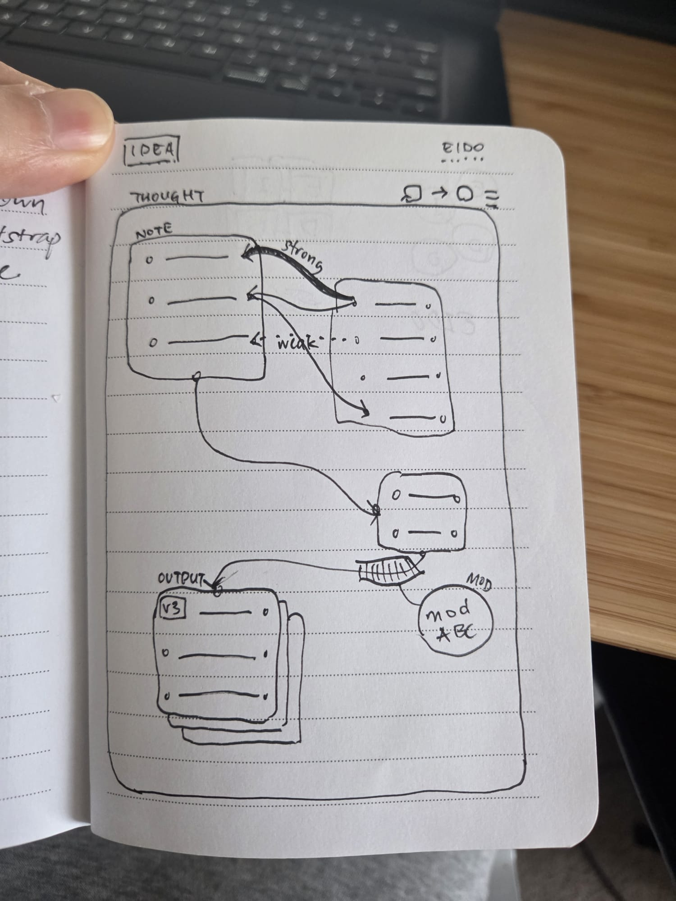

# Eido Research 2 — Brief & Plan

> Status: plan only. This document defines what I will research, why it matters, how I will inspect the four source projects, and what I will produce. It does not make technology decisions yet.

## 1. Purpose

Eido is a note-taking and idea-generation app where the canvas is not just a visual workspace. The canvas is the visible surface of a deeper graph: notes, thoughts, connections, weights, constraints, variants, execution paths, and AI context.

The core technical question for this research pass:

**Can Eido be modeled as one property graph with three views: a canvas graph, an execution graph, and a semantic graph?**

This research should help us understand the shape of a best-in-class system without prematurely choosing a stack. The four reference projects are not competitors to clone. They are technical donors:

| Project | What it teaches Eido |
| --- | --- |
| tldraw | Infinite canvas architecture, custom shapes, bindings, reactive stores, collaboration/sync patterns |
| Excalidraw | Lightweight drawing model, Canvas2D rendering, viewport culling, persistence, simple local-first UX |
| n8n | Visual workflow execution, node/edge runtime semantics, partial runs, branching, merging, expressions |
| Neo4j | Property graph modeling, relationship-rich data, traversal semantics, query language ideas, graph algorithms |

The goal is not to decide between them yet. The goal is to understand what each project proves, what it hides, what it makes easy, and what would be dangerous to import into Eido.

## 2. Eido-Specific Research Frame

I will evaluate every technology through Eido's product thesis:

- Eido is note-taking first, not a drawing tool first.
- The canvas must feel like shaping thought, not diagramming a system.
- AI should accelerate the user's thinking without taking over the act of thinking.
- Connections are not decorative arrows. They are context, constraints, taste, influence, execution order, and memory.
- Negative, weak, strong, hard, soft, directional, and typed relationships matter.
- The same base graph may need to support visual layout, AI context compilation, and execution playback.
- Complexity is a product risk. The best architecture is the one that preserves expressive power while keeping the user surface effortless.

That means this research is not only about rendering an infinite canvas. It is about whether an infinite canvas can become the interface for a living thought graph.

## 3. Wireframe Anchor

Reference image:



I will anchor the research against the concrete product shape in this wireframe, not a generic canvas app.

The sketch suggests these first-class Eido objects:

| Wireframe object | Research interpretation |
| --- | --- |
| **IDEA** | The project-level container or top-level goal. This is probably the workspace or document root. |
| **THOUGHT** | A bounded thinking space inside the idea. This may be a canvas frame, subgraph, topic, or working set. |
| **NOTE** | A card-like text object containing multiple line/block anchors. Notes are the main editable unit. |
| **Line / bullet ports** | Sub-note anchors. Individual lines, bullets, or paragraphs can receive and emit relationships. |
| **Strong / weak edges** | Weighted influence relationships. Visual thickness may map to semantic strength and context priority. |
| **Directional arrows** | Relationships have direction. Direction matters for context, causality, and execution. |
| **Small edge labels** | Edge metadata may be visible inline: strong, weak, negative, constraint, modulated, source, etc. |
| **Intermediate note/component** | A note can combine upstream influences and pass context forward. |
| **Output stack with `v3`** | Outputs are versioned artifacts, not just final text. Output history is part of the graph. |
| **MOD bubble** | A reusable modifier, lens, persona, constraint, rubric, prompt component, or execution module. |
| **Top-right view/action icons** | The same graph likely needs mode switches: capture, connect, generate, execute, inspect, or menu. |

The research should therefore answer not just "how do we draw nodes and arrows?" but:

**How do we model a thought workspace where card-level and line-level nodes, weighted edges, reusable modifiers, and versioned outputs all live in the same graph?**

### 3.1 Product Semantics Implied By The Sketch

The wireframe changes the research priorities in a few important ways:

- **Line-level anchors are core.** Eido cannot treat a note as only one blob of text if individual lines can connect to other notes or outputs.
- **Edges are expressive objects.** Strength, direction, type, and possibly sign must be stored and rendered. Edge UX is a core product problem.
- **Outputs are graph objects.** Generated text should become a versioned output node or stack, connected back to the context that produced it.
- **MODs are reusable thought operators.** A modifier may be a prompt, persona, constraint, rubric, automation node, or semantic lens.
- **A Thought may be a bounded subgraph.** The research must distinguish the infinite canvas as a whole from a framed working context.
- **Visual simplicity matters.** The sketch is sparse. Eido should not inherit clutter from node automation tools unless the execution mode explicitly needs it.

### 3.2 Wireframe-Driven Research Questions

These questions will be added to every project study:

- How would this project represent a bounded `Thought` container?
- How would it represent a `Note` with internal line or paragraph anchors?
- Can edges attach to sub-elements inside a card, not only to the card boundary?
- Can edge weight and type be both stored and visually expressed?
- Can generated outputs be stacked, versioned, collapsed, or compared?
- Can reusable `MOD` objects influence context without making the UI feel like a workflow builder?
- What does the project make easy that this wireframe clearly needs?
- What does the project make hard that this wireframe clearly needs?

## 4. Main Research Requirements

### 4.1 Unified Property Graph

Research whether Eido can use one underlying graph model for all three views.

Questions to answer:

- What is the minimum graph primitive Eido needs?
- Should notes, lines, paragraphs, generated outputs, prompts, files, voice notes, and reusable thought components all be nodes?
- Should connections be first-class relationship records with their own properties?
- What properties must an edge carry: weight, sign, type, direction, source anchor, target anchor, confidence, recency, user intent, execution mode?
- Is a `Thought` a graph node, a canvas frame, a saved subgraph query, or all three?
- Are `MOD` bubbles nodes, edge decorators, execution modules, or prompt components?
- Are output versions separate nodes, revisions of one output node, or a stack attached to an output target?
- Can layout coordinates be properties on graph nodes, or does canvas state need to live separately?
- Can execution state be layered on the graph without corrupting the thinking graph?
- How do we version and migrate long-lived thought graphs?

Likely source anchors:

- tldraw records, shapes, bindings, schema migrations
- n8n nodes, connections, workflow run data
- Neo4j property graph model and relationship properties
- Excalidraw element model and app state split

### 4.2 Infinite Canvas & Interaction Layer

Research what is required for a canvas where notes are the primary objects and edges are meaningful context.

Questions to answer:

- Is tldraw's custom shape/binding model a natural fit for Eido notes and weighted relationships?
- Is Excalidraw's simpler element model enough, or would Eido quickly outgrow it?
- How do mature canvases handle camera transforms, zooming, selection, pointer events, hit-testing, snapping, and culling?
- Should editable text live in DOM/HTML while edges and overlays use Canvas2D/WebGL?
- Can a card expose stable connection points for each line, bullet, paragraph, or generated block?
- Can a bounded `Thought` frame work as a scope for focus, context compilation, and output generation?
- How should thick/strong and thin/weak edges render without turning the canvas into a diagramming surface?
- How should Eido support hundreds or thousands of notes and relationships without feeling slow?
- What canvas features are essential for Eido v1, and what can be safely deferred?

Important distinction:

Eido probably does not need the full power of a visual design editor. It needs the right subset of canvas behavior for thought capture, rearrangement, connection, focus, and AI action.

### 4.3 Note Editing & Thought Components

Research how Eido should treat text as structured thought, not flat strings.

Questions to answer:

- Does each note contain rich-text blocks, plain text, or a structured document tree?
- Can individual lines or paragraphs become linkable graph anchors?
- How do we model a reusable "thought component" that can influence many future outputs?
- Is the wireframe's `MOD` a kind of thought component, a prompt module, a graph node type, or a special execution node?
- What does it mean to drag a paragraph into another idea as a hard or soft context connection?
- How do canvas-level nodes relate to document-level blocks?
- How do we preserve history of an idea as it transforms?

Source anchors:

- tldraw text shapes and custom shapes
- Excalidraw bound text/container patterns
- n8n reusable nodes/sub-workflows as an analogy
- Neo4j-style node labels and relationship types

### 4.4 Context Compiler

Research the technical requirements for turning a focused graph area into useful AI context.

Questions to answer:

- Given a selected node or output goal, how should Eido traverse the graph?
- How should edge weights, negative connections, recency, distance, and relationship type affect context selection?
- How should the compiler treat card-level connections versus line-level connections?
- How should a `MOD` alter compilation: include constraints, transform style, simulate persona, run rubric, or change traversal?
- How should a versioned output stack preserve which graph context produced each version?
- What should be deterministic and explainable versus AI-assisted and fuzzy?
- How does the compiler avoid over-generation and context bloat?
- Can the user see why a piece of context was included?
- What algorithms are relevant: shortest path, weighted traversal, Personalized PageRank, centrality, community detection, subgraph expansion?
- Does Eido need a graph database, an embedded graph engine, a vector database, or just in-memory graph algorithms over local data?

Source anchors:

- Neo4j graph traversal and graph algorithm concepts
- n8n expression/reference model
- tldraw or Excalidraw store snapshots as compiler input

Research posture:

This is likely Eido's core IP. We should study mature systems but expect to design this ourselves.

### 4.5 Execution Graph & Playback

Research how Eido could support automations and simulations without becoming "an automation tool."

Questions to answer:

- What is the smallest execution model needed for Eido's examples: series validation, parallel perspectives, debate loops, and branch generation?
- How does n8n determine execution order in a graph?
- How does n8n represent run state, partial execution, errors, retries, branching, merging, and waiting?
- How could Eido run a thought path while preserving the feeling of a thinking tool?
- Is the wireframe's chain from notes to intermediate component to output an execution path, a semantic context path, or both?
- How do MODs participate in playback: passive context modifiers, executable nodes, or reusable subgraphs?
- Should execution operate on a snapshot of the graph or on live reactive state?
- How do execution results become new graph nodes without flooding the user?
- What is the difference between Eido playback and ordinary agent/tool chaining?

Source anchors:

- n8n workflow execution engine
- n8n node/connection data model
- n8n partial runs and run-data threading
- tldraw store snapshots and event model

### 4.6 Local-First Storage, Sync, and History

Research what persistence model supports instant capture, idea evolution, and future collaboration.

Questions to answer:

- Should Eido be local-first from the beginning?
- What parts of state need CRDT semantics?
- How do tldraw and Excalidraw persist, restore, and migrate documents?
- How does Eido keep a useful history of idea transformation without making every edit noisy?
- How should AI-generated nodes be labeled, versioned, accepted, rejected, or collapsed?
- How should output stacks like `v3` be stored: full versions, diffs, branches, or snapshots tied to generation context?
- How should line-level anchors survive text edits when lines move, merge, or split?
- What storage layer works for a user-owned thought graph on desktop/web/mobile?

Source anchors:

- tldraw snapshots, store schema, sync architecture
- Excalidraw restore/local persistence
- n8n workflow persistence model
- Neo4j's durable graph model as a conceptual reference, not a shipping dependency

### 4.7 Licensing, Build-vs-Borrow, and Product Risk

Research what can be reused, what can only be studied, and what should be avoided.

Questions to answer:

- Which parts of tldraw are safe to adopt, and what does its license imply for a commercial Eido?
- Which Excalidraw patterns or code are reusable under MIT?
- What n8n architecture can be studied without copying restricted implementation?
- Why should Eido probably not embed Neo4j directly?
- What permissive alternatives should be evaluated only if the research points to a real need?
- Which systems are too heavy for Eido's actual first product?

This section should be written in plain language, because it is both a technical and business decision.

## 5. Per-Project Research Plan

### 5.1 tldraw

Research role:

Canvas engine candidate and reference architecture for a reactive document store.

What I will inspect:

- Top-level package structure and dependency graph
- Store and record model
- Shape and binding extension APIs
- Camera, viewport, selection, hit-testing, and culling behavior
- Snapshot, schema migration, and sync architecture
- Custom shape examples and docs

Questions to answer:

- Can Eido's note node be a custom tldraw shape without fighting the framework?
- Can weighted, typed, signed relationships be represented as bindings?
- Can a note expose line-level or paragraph-level connection anchors?
- Can a `Thought` boundary be modeled as a frame-like shape that scopes context and actions?
- Can output stacks and `MOD` bubbles be custom shapes with special behavior rather than generic notes?
- How much of tldraw's product assumptions come along if Eido adopts it?
- What would Eido gain immediately, and where would it become constrained?

Expected output:

`01-tldraw-source-study.md`

### 5.2 Excalidraw

Research role:

MIT reference for a simpler, performant, local-first canvas.

What I will inspect:

- Element and scene model
- Renderer structure
- Static versus interactive canvas split
- Viewport culling and render caching
- Text/container/bound element behavior
- Persistence, restore, and export model

Questions to answer:

- Is Excalidraw's data model too drawing-oriented for Eido?
- What can we learn from its simplicity?
- How does it achieve good performance without an overly complex architecture?
- Could Eido borrow its rendering/culling patterns while using a richer graph model underneath?
- Can Excalidraw-style bound elements teach us how to attach edges to internal note blocks?
- How would Excalidraw's simple local-first model handle versioned output stacks?
- What does Excalidraw intentionally not solve that Eido must solve?

Expected output:

`02-excalidraw-source-study.md`

### 5.3 n8n

Research role:

Reference for graph execution, playback, and visual workflow state.

What I will inspect:

- Workflow data model
- Node and connection interfaces
- Execution engine entry points
- Execution order, branching, merging, fan-out/fan-in, and loops
- Expression/reference system
- Partial execution and run-from-node behavior
- Editor canvas run-state overlays

Questions to answer:

- What is the smallest useful execution engine Eido could build?
- How does n8n separate graph definition from graph execution?
- How does run data move through a graph?
- How are parallel branches and merge nodes handled?
- Which n8n ideas map cleanly to Eido's "playback of thought"?
- Can MODs be understood as reusable n8n-like node definitions while still feeling like thought modifiers?
- Can versioned outputs be modeled like execution results tied to a specific run context?
- Which n8n ideas would make Eido feel too technical or automation-heavy?

Expected output:

`03-n8n-source-study.md`

### 5.4 Neo4j

Research role:

Conceptual reference for property graph modeling, traversal, and graph algorithms.

What I will inspect:

- Property graph concepts from source and docs
- Node, relationship, label, type, and property semantics
- Traversal model and Cypher/GQL-style pattern matching
- Weighted path and graph algorithm concepts
- Storage/indexing concepts only at the level needed to understand tradeoffs

Questions to answer:

- What parts of Neo4j's graph model are directly relevant to Eido?
- Does Eido need graph database semantics or only graph data structures?
- What would a Cypher-like query unlock for a context compiler?
- Which graph algorithms are useful for ranking thought context?
- How would Neo4j-style relationships model strong/weak, positive/negative, and card/line-level connections?
- How would labels or relationship types represent `Idea`, `Thought`, `Note`, `Block`, `MOD`, and `Output`?
- At what scale would an embedded graph database become justified?
- What licensing and operational risks make Neo4j unsuitable as a direct embedded dependency?

Expected output:

`04-neo4j-source-study.md`

## 6. Cross-Project Synthesis Questions

After the four source studies, I will synthesize across them.

The main synthesis questions:

- Can Eido truly be one property graph with three views?
- What is the proposed Eido graph schema?
- What objects from the wireframe become first-class records: Idea, Thought, Note, Block, Edge, MOD, Output, OutputVersion?
- How should canvas nodes, execution nodes, and semantic nodes differ, if at all?
- What is the right abstraction for an edge?
- How do canvas layout, semantic meaning, and execution order coexist?
- How do line-level anchors remain stable enough to be useful?
- How do MODs remain powerful without making Eido feel like n8n?
- How do output stacks avoid over-generation while preserving useful alternatives?
- Should the AI context compiler read the same graph as the canvas?
- Should execution runs create temporary state, permanent graph state, or both?
- Which subsystem should be bought, borrowed, built, or avoided?
- What is the simplest architecture that can test the product thesis?
- What should a nontechnical founder understand before choosing a stack?

Expected output:

`05-synthesis-one-graph-three-views.md`

## 7. Research Method

I will use a source-reading approach rather than running applications.

For each repo:

1. Map the repository structure.
2. Identify the subsystem spine: the small set of files that actually implement the relevant idea.
3. Trace one representative flow end to end.
4. Extract the technical pattern in plain English.
5. Translate that pattern into Eido terms.
6. Document tradeoffs, risks, and open questions.

Examples of representative flows:

- tldraw: create/edit a custom shape, bind it to another shape, persist the result.
- Excalidraw: element change -> scene update -> viewport culling -> render.
- n8n: simple workflow -> execution order -> node run data -> branch/merge behavior.
- Neo4j: focus node -> relationship traversal -> weighted relevance ranking.
- Eido wireframe: line-level note block -> strong/weak edge -> intermediate note or MOD -> versioned output stack.

Tools I will use:

- Local source inspection under `research/repos`
- `rg` for symbol tracing
- Package manifests and dependency maps
- Official documentation when source alone is not enough
- No app builds, no runtime testing, and no Neo4j compilation

I may use web documentation where it helps explain public APIs or current licensing. I will cite external sources when I do.

## 8. Depth Control

To avoid unnecessary rabbit holes, I will keep each repo study scoped to Eido's needs.

I will not:

- Read every package in each monorepo.
- Study every n8n integration node.
- Build or run Neo4j.
- Benchmark rendering systems.
- Decide the final stack.
- Produce implementation code.

I will:

- Read enough source to understand the architecture, not just the marketing docs.
- Follow the files that define each system's core model.
- Prefer plain-English explanation over framework jargon.
- Call out where a donor project is solving a problem Eido does not actually have.
- Flag when a technology is powerful but product-dangerous.

## 9. Planned Folder Structure

All outputs for this second pass will live in:

```text
research/02-source-studies/
  00-research-brief-and-plan.md
  01-tldraw-source-study.md
  02-excalidraw-source-study.md
  03-n8n-source-study.md
  04-neo4j-source-study.md
  05-synthesis-one-graph-three-views.md
  06-founder-cto-summary.md
```

The original wireframe remains canonical at `docs/archive/product-intent/eido-wireframe-01.png` and is linked from this brief.

The final summary will be written for you as the founder: high-level, tradeoff-driven, and explicit about what choices matter now versus later.

## 10. Output Style

Each project study will use this template:

```text
# Project Name — Eido Source Study

## What This Project Teaches Eido
## Repository Map
## Core Files Inspected
## Wireframe Implications
## Architecture Pattern
## Eido Translation
## What To Borrow
## What To Avoid
## Licensing / Adoption Risk
## Open Questions
```

The synthesis will use this template:

```text
# Eido Architecture Synthesis — One Graph, Three Views

## Plain-English Thesis
## Proposed Eido Graph Model
## Canvas View
## Execution View
## Semantic View
## Context Compiler Requirements
## Build / Borrow / Buy Matrix
## Major Tradeoffs
## Recommended Next Research or Prototype
```

## 11. Open Questions Before Research Starts

These are the questions I recommend you answer before I begin the deeper source study:

1. Should I treat **tldraw as a serious adoption candidate**, or only as a source of architectural lessons because of licensing uncertainty?
2. Should the research assume **web-first TypeScript** as the likely product direction, or should native desktop/mobile remain equally open at this stage?
3. How important is **handwriting or sketching** to the long-term vision? I can keep it out of v1 thinking, but it changes how seriously we evaluate drawing-tool internals.
4. Should Eido's execution/playback be treated as a **future advanced capability**, or as core enough that the first architecture must make room for it?
5. Do you want the final synthesis to include a **recommended stack hypothesis**, or should it remain purely exploratory with no recommendation?
6. In the wireframe, is `MOD` closer to a reusable prompt/taste component, an executable workflow node, a persona/rubric, or intentionally all of those?
7. Are output stacks meant to show alternative generations, chronological versions, branches from different contexts, or all of these depending on mode?
8. Should the large `Thought` boundary behave like a visible frame on an infinite canvas, or is it more like a focused workspace/view into a larger idea graph?

## 12. My Starting Hypotheses, Not Decisions

These are the assumptions I will test, not conclusions:

- Eido's core should be a property graph, not a drawing document with metadata attached.
- Canvas layout, execution paths, and semantic context should be views over the same graph.
- The context compiler is more strategically important than the renderer.
- Rich text and paragraph-level anchors may matter more than freehand drawing.
- n8n is most useful as a model for execution semantics, not as code to reuse.
- Neo4j is most useful as a conceptual model and algorithm source, not as a dependency.
- tldraw may provide the fastest path to a polished canvas, but licensing and model fit must be understood early.
- Excalidraw may provide the clearest example of simplicity and performance, even if its product model is less aligned with Eido.

The research will try to prove, disprove, or refine these hypotheses.
