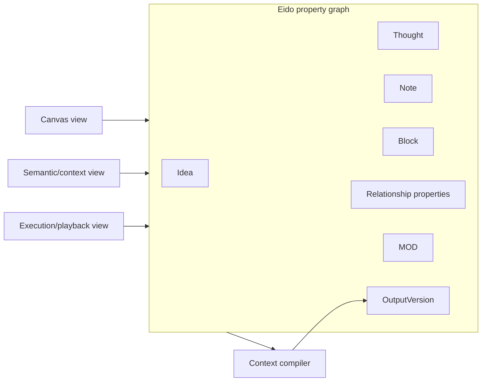

# Eido Research 2 - Synthesis: One Graph, Three Views

## Thesis

The "one property graph with three views" thesis is technically viable and should guide Eido's architecture.

The three views should not be three separate products glued together:

- **Canvas view:** where the user sees notes, thoughts, edges, MODs, and outputs.
- **Semantic view:** where Eido compiles context, ranks relevance, resolves constraints, and explains why something matters.
- **Execution view:** where Eido runs or re-runs a path through the graph to produce outputs.

The important architectural move is this:

**The canvas should render the graph. It should not be the graph.**

That is the main lesson across tldraw, Excalidraw, n8n, and Neo4j.

## What Each Project Contributes

| Project | Best role for Eido | Why |
| --- | --- | --- |
| tldraw | Possible canvas/editor foundation | Shapes, bindings, records, migrations, culling, rich text, and custom extensions map well to the wireframe. |
| Excalidraw | Rendering and simplicity reference | Great lessons in lightweight scene rendering, canvas overlays, JSON persistence, and restore/repair. |
| n8n | Execution architecture reference | Strong model for authored graph vs run state, partial execution, item lineage, and output provenance. |
| Neo4j | Data model and graph algorithm reference | Best conceptual match for relationship-rich thought graphs. |

## Proposed Core Eido Records

This is not a final schema. It is a research-derived starting vocabulary.

```ts
type Idea = {
  id: string
  title: string
  createdAt: string
}

type Thought = {
  id: string
  ideaId: string
  title: string
  layout: Rect
  focusRules?: FocusRule[]
}

type Note = {
  id: string
  thoughtId: string
  richText: unknown
  layout: Rect
  style?: NoteStyle
}

type Block = {
  id: string
  noteId: string
  path: string
  kind: 'paragraph' | 'bullet' | 'heading' | 'quote' | 'generated'
  textHash?: string
  stableKey: string
}

type Edge = {
  id: string
  from: Anchor
  to: Anchor
  type: 'supports' | 'contradicts' | 'constrains' | 'feeds' | 'modulates' | 'derived_from'
  weight: number
  polarity: 'positive' | 'negative' | 'neutral'
  hardness: 'soft' | 'hard'
  label?: string
  contextMode?: 'include' | 'boost' | 'suppress' | 'constraint'
  executionMode?: 'none' | 'input' | 'sequence' | 'dependency'
}

type Anchor = {
  nodeId: string
  blockId?: string
  side?: 'left' | 'right' | 'top' | 'bottom'
}

type MOD = {
  id: string
  name: string
  kind: 'persona' | 'constraint' | 'rubric' | 'style' | 'tool' | 'workflow' | 'lens'
  body: string
  inputs?: string[]
}

type Output = {
  id: string
  thoughtId: string
  title: string
  layout: Rect
}

type OutputVersion = {
  id: string
  outputId: string
  version: number
  content: string
  graphSnapshotId: string
  compilerTraceId: string
  model?: string
  accepted?: boolean
}
```

## The Three Views

### 1. Canvas View

Canvas view cares about:

- Coordinates, frames, zoom, selection, text editing, hit-testing, edge rendering, culling, grouping, and visual clarity.
- Notes as editable cards.
- Thoughts as bounded working areas.
- Outputs as visible stacks.
- MODs as visible, reusable thought operators.
- Strong/weak edges rendered with thickness, labels, or emphasis.

tldraw is strongest here. Excalidraw is the best reference if Eido builds this layer itself.

### 2. Semantic View

Semantic view cares about:

- What should count as context?
- What should be ignored?
- Which weak edges are still useful?
- Which negative/constraint edges should shape the answer?
- Which note blocks influenced an output?
- Can Eido explain why it included something?

Neo4j is strongest conceptually here. The product should use property-graph ideas even if it does not use Neo4j.

### 3. Execution View

Execution view cares about:

- What can be run?
- What has already been run?
- What changed since the last run?
- Which output version came from which graph snapshot?
- Can Eido re-run a branch without losing accepted work?

n8n is strongest here. Eido should adopt the authored-graph vs run-state split, not the workflow-builder feel.

## The Context Compiler

The context compiler is likely Eido's core technical product.

A first-pass algorithm could be:

1. Start from a focus anchor: selected note, note block, thought frame, MOD, or output goal.
2. Include hard constraints directly connected to the focus.
3. Traverse positive/supporting/feed edges outward by depth.
4. Score candidates by edge weight, edge type, distance, recency, user-created priority, and whether a MOD references them.
5. Treat contradictory or negative edges separately as warnings, counterpoints, or exclusion rules.
6. Budget context into tiers: must-include, likely-include, optional, excluded.
7. Produce a compiler trace so an output version can explain its sources.

This does not require a graph database at first. It requires clean graph records and deterministic traversal over a graph snapshot.

## The Critical Tradeoffs

### tldraw adoption vs custom canvas

tldraw could accelerate Eido dramatically because it solves many hard editor problems. The tradeoff is license/business dependency and fitting Eido's line-level note anchors into its shape/binding model.

### Internal note blocks vs block shapes

Internal block anchors keep note editing pleasant. Block-as-shape makes graph semantics cleaner. The best starting hypothesis is internal block anchors with stable IDs, plus graph records that can refer to those IDs.

### Semantic graph vs execution graph

If every semantic edge becomes executable, the product becomes too mechanical. If execution is completely separate, Eido loses the beauty of one graph. The likely answer is typed edges: some edges affect context, some affect execution, some do both.

### MOD as prompt vs node

A MOD could be a prompt fragment, persona, rubric, constraint, tool call, or reusable sub-workflow. Eido should avoid deciding too early that MOD equals automation node. The wireframe suggests MODs should feel lighter than n8n nodes.

### Output as text vs graph object

Generated output must be a graph object. Otherwise Eido loses provenance. The `v3` in the wireframe is a strong signal that outputs are versioned, traceable artifacts.

## Build/Borrow/Study Matrix

| Area | Recommended posture |
| --- | --- |
| Infinite canvas | Strongly consider tldraw if license works; otherwise study tldraw and Excalidraw before building. |
| Drawing/rendering patterns | Study Excalidraw deeply; borrow only where it matches Eido. |
| Graph data model | Design in-house using property-graph principles from Neo4j. |
| Execution runtime | Design in-house using n8n as a reference. |
| Context compiler | Build in-house. This is Eido's likely core IP. |
| Rich note editing | Use a structured document model with stable block IDs. TipTap/ProseMirror-style data is promising. |
| Persistence/history | Use explicit records, migrations, snapshots, and output provenance from day one. |

## What This Means For Eido

Eido is not "Notion plus arrows." It is also not "tldraw plus AI." The deeper architecture is:



The research implication is clear: before committing to a UI engine, Eido needs confidence in its graph vocabulary. The canvas can only be best-in-class if it is rendering the right underlying objects.

## Next Research Questions

- Should Eido pay for tldraw and adopt it as the first editor foundation?
- How should stable line/block anchors survive text edits?
- What are the minimum edge types for the first usable product?
- Is `MOD` primarily a semantic lens, a reusable prompt module, or an executable node?
- What should an output version store so it can be explained and regenerated?
- Does Eido need collaborative sync in v1, or just a local-first store designed for later sync?

