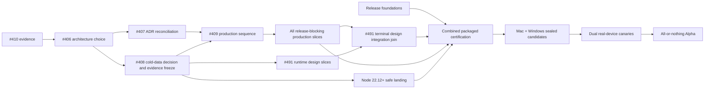

# Autonomous desktop release operations: adversarial production research

Date: 2026-07-16

Scope: Eido's private source repository, a proposed public GitHub binary/update
repository, Electron + `electron-builder`/`electron-updater`, macOS and Windows,
and an AI-agent-operated release process for a nontechnical founder.

## Executive finding

The proposed direction is practical for a Friends Alpha, but only after four
important corrections:

1. **"Friends-only, no login, automatic GitHub updates, and no managed service"
   cannot all be true.** `electron-updater` documents that private GitHub update
   repositories require a `GH_TOKEN` on each user's computer and explicitly says
   this mode is not suitable for ordinary users. A public release repository
   avoids client credentials, but anyone who discovers it can download the
   binaries. Eido must call the first release **public-but-unadvertised**, not
   access-controlled. If real access control is required, Eido must accept GitHub
   accounts/tokens or add a distribution service.
   [electron-builder auto-update docs](https://www.electron.build/docs/features/auto-update/)

2. **Percentage rollout and immutable GitHub releases conflict.**
   `electron-updater` implements percentage rollout by editing
   `latest.yml`/`latest-mac.yml`, while GitHub immutable releases prevent release
   assets from being changed after publication. A bad staged update also requires
   a *higher* new version; republishing the same version does not recover clients
   already running it. For a small offline cohort with no telemetry, percentage
   rollout is weak anyway. Friends Alpha should use an exact candidate artifact,
   one explicit human canary confirmation, then immutable publication of the same
   bytes to everyone. Do not use `stagingPercentage` in phase 1.
   [electron-updater staged rollout](https://www.electron.build/docs/features/auto-update/),
   [GitHub immutable releases](https://docs.github.com/en/code-security/concepts/supply-chain-security/immutable-releases)

3. **Rollback must be forward recovery, not an older app binary.** Updater channel
   changes can enable downgrades, and `generateUpdatesFilesForAllChannels` turns
   downgrade support on automatically. An older binary may not understand data
   already migrated by a newer one. Eido should keep `allowPrerelease=false` and
   `allowDowngrade=false`, never reuse a version, and recover a bad release with a
   higher hotfix that can read both the old and new save formats. Restoring a
   pre-update save snapshot is a separate, explicit data-recovery action.
   [electron-builder channel semantics](https://www.electron.build/docs/tutorials/release-using-channels/),
   [`AppUpdater` defaults and downgrade behavior](https://www.electron.build/docs/api/electron-updater.class.appupdater/)

4. **The first release cannot be fully autonomous because publisher identity is
   legally anchored to the founder.** Apple requires verified enrollment, legal
   agreements, payment, and Developer ID; membership is USD 99/year. In the
   current Microsoft documentation, Azure Artifact Signing public trust is not
   available to Australian organizations or individuals. An Australian direct-
   download Windows publisher therefore needs a third-party OV certificate/cloud
   HSM (or the Microsoft Store), plus identity verification and payment. Agents
   can perform every technical step after the founder completes these one-time
   identity actions.
   [Apple enrollment](https://developer.apple.com/programs/enroll/),
   [Microsoft Artifact Signing availability](https://learn.microsoft.com/en-us/azure/artifact-signing/faq),
   [Microsoft Windows signing options](https://learn.microsoft.com/en-us/windows/apps/package-and-deploy/code-signing-options)

The pragmatic launch is therefore: **Apple Silicon macOS plus Windows x64 on the
same day; public-but-unadvertised GitHub binaries; a single updater feed; signed
exact-SHA candidates; one named canary per required platform; immutable
promotion; and forward-only hotfixes coupled to verified save backups.** The
native lanes run independently, but either red lane blocks publication of that
version.

## What the current Eido repository already gets right

The existing DevOps operating system is a solid base:

- one executable required contract (`npm run ci:required`);
- exact-main-SHA proof before the next merge;
- Actions pinned to full commit SHAs;
- least-privilege `contents: read` by default;
- GitHub-hosted runners rather than a personal production machine;
- three-day green-main web artifacts; and
- an explicit rule that agents, not the founder, own logs, CI routing, and
  incident diagnosis.

GitHub says a full-length commit SHA is the only immutable way to pin an Action,
so the current pinning discipline should extend to every release workflow.
[GitHub Actions secure-use reference](https://docs.github.com/en/actions/reference/security/secure-use)

The existing three-day `dist/` artifact is not yet a desktop release candidate:
it contains the browser build, has no OS installer, signature, notarization,
updater metadata, install/update smoke result, release manifest, or durable
retention. Desktop release artifacts need a separate sealed candidate object.

## Cross-epic dependency contract

#410 owns renderer selection and implementation fan-out; this release program
owns persistence, shell security, signing, updater safety, publication, and
founder coaching. #409 is a planning deliverable, not production implementation.
When #409 publishes its slices, each must be classified release-blocking,
optional, or deferred. Every release-blocking issue becomes a native blocker of
the combined packaged-certification ticket. The design-system epic #491 must
publish one terminal integration issue blocked by every Alpha-required design
slice and the release-blocking #409 slices; that terminal issue also becomes a
native blocker of certification. Release preflight discovers these relationships
from the live tracker and fails closed on an empty, unresolved, or stale fan-out,
a missing/stale #491 terminal join, a selected renderer or design system that is
disabled at runtime, or evidence recorded against any SHA other than the exact
candidate SHA. The Node 22.12+ transition is blocked by #408 so it cannot mutate
the Node-20 comparison environment while evidence is active.

## Reality-grounded constraints

### 1. Public binaries from private source

The source repository's built-in `GITHUB_TOKEN` is scoped to that repository, so
the source workflow should use it to read its own candidate artifact. Only the
write into the separate public binary repository needs cross-repository
authority. Use a GitHub App installed **only** on the public repository, with
release-content write permission there; keep its App ID/private key in the
private source repository's protected release environment. Do not install that
publisher App on the private source repository: an App's maximum permissions
apply across every selected repository. Installation tokens can be limited to
the named public repository and permissions and expire after one hour.
[GitHub `GITHUB_TOKEN` scope](https://docs.github.com/en/actions/concepts/security/github_token),
[GitHub App authentication from Actions](https://docs.github.com/en/enterprise-cloud@latest/apps/creating-github-apps/authenticating-with-a-github-app/making-authenticated-api-requests-with-a-github-app-in-a-github-actions-workflow),
[installation token restrictions](https://docs.github.com/en/apps/creating-github-apps/authenticating-with-a-github-app/generating-an-installation-access-token-for-a-github-app)

Recommended split:

- **Private source repository:** tests, native platform builds, signing,
  notarization, updater metadata generation, SBOM generation, candidate manifest,
  and internal logs. Signing credentials never enter the public repository.
- **Public release-only repository:** README, license/disclosure, machine-readable
  release-manifest commits, prerelease candidate assets, final release assets,
  checksums, release notes, and update feed. No private source or save data.
- **Cross-repo adapter:** the source-scoped `GITHUB_TOKEN` reads the private
  candidate artifact; a separate least-privilege GitHub App installation has
  release-content write access only to the public binary repository.

The public repository's tag points to a public release-manifest commit, not the
private source commit. That manifest must record the private source SHA and every
artifact digest. This is useful traceability, but it is not public proof that the
binary came from that private source.

GitHub artifact attestations would provide build provenance, but on Free, Pro,
and Team they are available only to public repositories; private repositories
need Enterprise Cloud. A GitHub immutable-release attestation in the public
binary repository proves that its tag, manifest commit, and assets are the
published release. It does **not** retroactively prove the private build lineage.
Do not market it as reproducible/open-source provenance.
[GitHub artifact-attestation availability](https://docs.github.com/en/actions/how-tos/secure-your-work/use-artifact-attestations/use-artifact-attestations),
[GitHub immutable-release attestation](https://docs.github.com/en/code-security/concepts/supply-chain-security/immutable-releases)

### 2. Build once means once per target platform and architecture

`electron-builder` explicitly warns not to expect all platforms to build on one
host: macOS signing only works on macOS, and native dependencies generally need
their target platform. Eido should build each supported platform/architecture
once, from the same full source SHA and lockfile, then promote those exact signed
bytes without rebuilding.
[electron-builder multi-platform builds](https://www.electron.build/docs/features/multi-platform-build/)

The sealed candidate is a set, not a single file:

- installer/archive for every declared platform and architecture;
- the updater metadata generated in the same build (`latest.yml` and
  `latest-mac.yml`, plus any blockmaps);
- SHA-256 release manifest and the builder's SHA-512 update checksums;
- platform signature/notarization verification results;
- install, launch, persistence, restart, and previous-version update results;
- CycloneDX or SPDX SBOM; and
- source SHA, app version, data-envelope version, readable schema range,
  migration IDs, runner image, Node/npm/Electron/builder versions, and CI run IDs.

Updater binaries and metadata must travel as one sealed bundle. The builder's own
troubleshooting guide identifies checksum mismatch when metadata and binaries
from different builds are mixed.
[electron-builder update troubleshooting](https://www.electron.build/docs/troubleshooting/)

### 3. Signing is part of correctness, not a publishing decoration

#### macOS

Direct distribution requires Apple Developer Program enrollment, Developer ID
signing, notarization, and a stapled ticket. Apple recommends testing the final
distribution on a different Mac, and stapling lets Gatekeeper validate while the
user is offline. Automatic updates on macOS require a signed application.
[Apple Developer ID](https://developer.apple.com/support/developer-id/),
[Apple packaging/notarization/stapling](https://developer.apple.com/documentation/xcode/packaging-mac-software-for-distribution),
[Electron code signing](https://www.electronjs.org/docs/latest/tutorial/code-signing),
[Electron auto-updater](https://www.electronjs.org/docs/latest/api/auto-updater/)

The workflow must set `forceCodeSigning: true`: `electron-builder` otherwise can
silently continue with an unsigned build when credentials are missing. CI must
verify `codesign`, Gatekeeper assessment, notarization, and the stapled ticket
before candidate publication.
[electron-builder signing and `forceCodeSigning`](https://www.electron.build/docs/features/code-signing/),
[electron-builder notarization verification](https://www.electron.build/docs/notarization/)

#### Windows

Every installer should be Authenticode-signed and updater signature verification
must remain enabled. The NSIS updater verifies the expected publisher by default.
Signing identifies the publisher and protects integrity, but it does not remove
the initial SmartScreen experience: Microsoft states that each new file hash
starts without reputation, and since 2024 EV certificates no longer bypass that
process. A signed Friends Alpha can still show an "unrecognized app" warning.
[electron-builder Windows update signature verification](https://www.electron.build/docs/win/),
[Microsoft SmartScreen reputation](https://learn.microsoft.com/en-us/windows/apps/package-and-deploy/smartscreen-reputation)

For an Australian founder, Microsoft's current public-trust Artifact Signing
service is unavailable. The practical direct-download option is a third-party OV
certificate delivered via its compliant hardware/cloud key mechanism. The
Microsoft Store would remove SmartScreen download warnings and handle MSIX
signing, but it changes the chosen GitHub-only release channel.
[Artifact Signing geography](https://learn.microsoft.com/en-us/azure/artifact-signing/faq),
[Windows signing choices](https://learn.microsoft.com/en-us/windows/apps/package-and-deploy/code-signing-options)

### 4. An offline app has no rollout observability

Without telemetry or a server, the release captain cannot know who checked for an
update, downloaded it, installed it, launched successfully, migrated a save, or
crashed. A time-based "24-hour soak" is meaningless if nobody ran the candidate.
For Friends Alpha, progression needs one explicit canary acknowledgement containing:

- installed version and platform;
- app launched while online and while offline;
- an existing Board loaded;
- one edit persisted across restart;
- update from the previous public version succeeded; and
- a local diagnostic bundle reported no recovery or migration warning.

The diagnostic bundle must be local, redact card/save contents and secrets, and
be shared deliberately by the tester. This is the minimum unavoidable human
signal. Percentage rollout should not be added until the cohort is large enough
to make percentages meaningful and Eido has an explicit, consented observability
model.

### 5. Updater defaults are unsafe for unflushed local data

`electron-updater` defaults both `autoDownload` and `autoInstallOnAppQuit` to
`true`. Its `quitAndInstall()` path has a different quit-event order from normal
shutdown. Therefore Eido must not rely on generic window-close handlers to flush
the only copy of a user's ideas.
[electron-updater `AppUpdater` defaults](https://www.electron.build/docs/api/electron-updater.class.appupdater/)

Recommended behavior:

- update checks are single-flight, rate-limited, and nonfatal while offline;
- background download is optional, but `autoInstallOnAppQuit=false`;
- "Restart to update" first flushes and verifies the persistence commit;
- it then makes and verifies a pre-update data snapshot;
- it records the old app version, data version, and candidate version;
- only then may it call the updater install path;
- next launch runs migration/recovery before opening the Board and writes a
  post-start health marker only after read/write/restart checks succeed.

This is not theoretical overengineering: Electron fixed a 2026 auto-updater race
where repeated checks could race orphan cleanup and delete a directory still in
use. Eido should deduplicate update checks and test the installed updater, not
just mock its API.
[Electron updater race fix](https://releases.electronjs.org/pr/51024)

## Recommended release state machine

The state machine is a deep operational module. Workflows and agents may request
transitions, but only one release service validates and records them. Every
command is idempotent, emits structured JSON, and fails closed with a stable
error code. Human-readable workflow prose is not the system of record.

| State | Entry proof | Automated action | Exit |
| --- | --- | --- | --- |
| `PLANNED` | unique monotonic app version; full main SHA; release notes; declared data compatibility | classify product, security, and save risk | `PREFLIGHTED` or `BLOCKED` |
| `PREFLIGHTED` | exact SHA reachable from main; exact-main required CI green; no tag/version collision; signing identities healthy; #409 fan-out classified; every release-blocking production slice merged and green; live #491 terminal join closed and green; selected renderer and completed design system enabled; combined evidence current on this exact SHA; #408/Node handoff satisfied | freeze candidate inputs and manifest ID | `BUILDING` |
| `BUILDING` | frozen inputs | native macOS/Windows jobs build once; generate updater metadata + SBOM | `BUILT` or `BLOCKED` |
| `BUILT` | every supported platform present; digests recorded | sign/notarize, then seal artifact set | `SIGNED` or `BLOCKED` |
| `SIGNED` | expected publisher identity; mac ticket stapled; no unsigned executable | install/launch/offline/persistence/update/migration smoke on clean target OS | `VERIFIED` or `REJECTED` |
| `VERIFIED` | all technical and data-safety gates green | publish exact artifacts as a public GitHub **prerelease candidate** ignored by normal clients | `CANARY` |
| `CANARY` | named tester has candidate link/checklist | collect explicit canary acknowledgement + redacted diagnostic bundle | `APPROVABLE`, `REJECTED`, or `SUPERSEDED` |
| `APPROVABLE` | canary evidence and plain-language founder brief | ask only for product/data-risk/identity decision; technical recommendation already made | `PROMOTING` or `REJECTED` |
| `PROMOTING` | approval recorded | re-download sealed candidate, re-hash/re-verify signatures, create draft final release, attach complete assets, publish immutable release | `PUBLISHED` or `BLOCKED` |
| `PUBLISHED` | immutable tag/assets; normal updater can see version | update from previous public version on each OS; verify release attestation/digests and offline relaunch | `COMPLETE` or `INCIDENT` |
| `COMPLETE` | post-publication proof green | report outcome, archive manifest/evidence, schedule health checks | terminal |
| `BLOCKED` / `REJECTED` / `SUPERSEDED` | reason + evidence | no user-visible mutation; never reuse a candidate version once a human may have installed it | new version or explicit retry |
| `INCIDENT` | published-user impact possible | freeze promotion, preserve evidence, choose forward hotfix/data recovery path | incident SOP |

"Build once" means candidate and final installer digests are identical. Candidate
publication uses a separate prerelease tag; final publication copies the same
files under the app's actual `vX.Y.Z` tag. Normal clients stay on one internal
`latest` channel with `allowPrerelease=false` and `allowDowngrade=false`. The
product may call the experience "Friends Alpha" while the updater remains a
single, conservative feed.

The public release should be created as a draft, receive every asset, and only
then be published. This is GitHub's recommended immutable-release flow.
[GitHub immutable-release publishing flow](https://docs.github.com/en/code-security/concepts/supply-chain-security/immutable-releases)

## Release manifest: machine contract

At minimum, a release record must contain:

- release ID, app version, source repository identifier, full source SHA, and
  exact-main CI URL/result;
- current state, transition timestamps, actor identity, and supersession/incident
  links;
- Node, npm, Electron, builder/updater, OS runner image, and lockfile digest;
- supported platform/architecture set;
- every artifact name, size, SHA-256, builder SHA-512, Actions artifact digest,
  signature subject/team ID, notarization result, and smoke result;
- SBOM name/digest and dependency/license gate results;
- update channel, `allowPrerelease`, `allowDowngrade`, and compatibility range;
- save envelope version, minimum readable version, written version, migration IDs,
  fixture matrix result, and verified pre-update-backup capability;
- candidate URL, canary tester/evidence, final URL, and immutable-release
  verification result; and
- founder questions/answers only when product behavior, money, identity, or real-
  data risk required them;
- external dependency ledger: #410, #409, #491, the live #491 terminal
  integration issue, and every required production issue; optional/deferred
  issues and reasons; live state, merge SHA, evidence URL, re-derived timestamp,
  and the #408/Node-toolchain handoff; and
- selected renderer and design-system identifiers, runtime enablement state, and
  the exact source SHA covered by their combined evidence.

Actions artifacts expose a SHA-256 digest, but their default retention is finite;
they are internal evidence, not the durable release archive. Final signed assets,
manifest, checksums, SBOM, and notes live in the immutable public release. The
private build logs and candidate bundle need retention long enough to diagnose a
released version, not the current three days.
[GitHub `upload-artifact` digest and retention](https://github.com/actions/upload-artifact/blob/main/README.md)

`npm sbom` can generate SPDX or CycloneDX directly from Eido's npm dependency
tree. The SBOM must describe production and packaged dependencies, not merely the
web bundle.
[npm SBOM command](https://docs.npmjs.com/cli/commands/npm-sbom/)

## Supply-chain controls proportional to Friends Alpha

Required now:

- release workflows accept a full SHA and verify it is the already-green main
  SHA; tag pushes never implicitly build or publish;
- each supported OS builds natively from the same SHA using Node 22.12+ and the
  same npm-10 lockfile after the protected #408 handoff;
- workflows use least-privilege permissions and full-SHA-pinned Actions;
- no signing job runs for fork/PR code;
- signing credentials exist only in the private source repository's release
  environment, never the public repository or app bundle;
- the cross-repo GitHub App can write releases only in the public binary repo;
- `forceCodeSigning` fails closed; no unsigned/not-unnotarized fallback;
- signatures, stapling, update publisher identity, and artifact hashes are
  independently verified after build and again before promotion;
- dependency changes receive vulnerability/license review; weekly audit remains;
- each release contains an SBOM and checksums;
- release assets are immutable; version and tags are never reused; and
- Electron stays within its latest three supported stable releases, with urgent
  security updates treated as hotfix candidates.
  [Electron support policy](https://www.electronjs.org/docs/latest/tutorial/electron-timelines)

Deferred honestly:

- Public build provenance from private source is unavailable on the current
  GitHub plan. Retain the private evidence chain and revisit Enterprise Cloud or
  a public reproducible build when distribution grows.
- SLSA levels, external transparency logs, and a second signing authority are not
  necessary for a small friend cohort if platform signatures, immutable assets,
  exact-SHA records, and least-privilege credentials are correct.
- Do not add Linux until there is an actual Linux friend; Electron's built-in
  updater has no Linux support and Linux distribution adds package-manager and
  signing variations.
  [Electron `autoUpdater` platform support](https://www.electronjs.org/docs/latest/api/auto-updater/)

GitHub environment reviewers are available to public repositories on Free/Pro/
Team, but not to private repositories on those plans. The final promotion gate
can therefore live in the public release repository, while sensitive signing
already completed in the private source job. The approval job should receive no
signing key—only permission to copy verified artifacts and publish the release.
[GitHub environment availability](https://docs.github.com/en/actions/reference/workflows-and-actions/deployments-and-environments)

The current documented environment REST update schema can machine-verify
reviewers, self-review, and branch policy, but does not expose the environment's
administrator-bypass control. Bootstrap verification must therefore keep those
signals separate: API-derived evidence for the exposed controls, plus a
timestamped owner capture from the provider settings UI for disabled
administrator bypass. Absence of either signal is not a pass.
[GitHub environment REST API](https://docs.github.com/en/rest/deployments/environments?apiVersion=2026-03-10),
[GitHub deployment environment reference](https://docs.github.com/en/actions/reference/workflows-and-actions/deployments-and-environments)

## Required autonomous SOPs and agent tooling

Create one deep `desktop-release-captain` skill rather than several overlapping
release agents. It owns the state machine end to end, calls existing Merge
Captain only for main/CI truth, calls Eido save-safety for real-data or migration
proof, and presents one founder-facing decision when policy requires it.

### Executable commands

The precise names can change during implementation, but these capabilities must
exist as stable JSON-emitting contracts:

- `release:preflight --sha <full-sha> --version <semver> --json` — derive live
  main/CI/version/signing/data-compatibility state plus native #410/#409 blocker
  relationships and #491's terminal integration join; fail closed on an empty,
  unresolved, stale, or assumed fan-out, a missing/stale join, disabled selected
  renderer/design paths, or evidence whose source SHA differs from `<full-sha>`;
  no writes.
- `release:candidate --manifest <id> --json` — idempotently run native build,
  signing, notarization, sealing, and candidate publication.
- `release:verify --manifest <id> --stage candidate|published --json` — verify
  hashes, signatures, metadata coupling, install/update/offline/save behaviors,
  and the combined renderer/design evidence on both packaged targets.
- `release:promote --manifest <id> --json` — reverify exact bytes, create complete
  draft, publish immutable final release; never rebuild.
- `release:status --version <semver> --json` — re-derive state from GitHub, CI,
  signatures, and manifest instead of trusting agent memory.
- `release:incident --version <semver> --json` — freeze further transitions,
  capture evidence, classify data migration exposure, and generate the forward
  recovery plan.

Every command must be restart-safe. A timeout after uploading three of five
assets resumes by verifying those assets; it must not overwrite an existing tag,
change an immutable asset, rebuild the same version, or create a second state
record. Error codes distinguish missing proof, technical red, provider outage,
identity/payment, product choice, and real-data risk.

### Documentation the agents must own

1. **Desktop Release SOP** — routine state-machine transitions, evidence, exact-
   SHA rules, platform completeness, candidate/canary/final process, and founder
   brief template.
2. **Update Compatibility SOP** — app-version/data-version matrix, pre-update
   flush and backup, migration gates, forward-fix rules, and prohibition on
   opening newer data with an older binary.
3. **Signing and Identity SOP** — certificate subjects, owner, expiry, renewal
   thresholds, Apple/API keys, Windows provider, rotation, revocation, and
   founder-only identity/payment steps; never secret values.
4. **Release Incident SOP** — failure classes below, stop conditions, user
   messaging, evidence retention, and safe recovery authority.
5. **Canary SOP** — exact candidate link, human checklist, redacted diagnostic
   bundle, acknowledgement schema, and what blocks promotion.
6. **Founder Release Brief** — at most: what changes for friends, save-file risk,
   reversibility, canary evidence, cost/identity implications, agent
   recommendation, and one approve/decline question.
7. **Public Release Repository Policy** — public-but-unadvertised disclosure,
   license/source status, supported platforms, checksums, privacy/no telemetry,
   issue reporting, and explicit statement that public downloads are not access-
   controlled.
8. **Cross-Epic Dependency and Hotspot SOP** — dynamic #409 blocker discovery,
   classification and native-link updates; discovery and freshness checks for
   #491's terminal integration join; #408/Node handoff; shared-file and workflow
   ownership; rebase sequencing; runtime flag verification; exact-SHA combined
   renderer/design evidence; and prohibition on treating planning, prototype, or
   browser-only completion as production implementation.

### Scheduled autonomous checks

- daily while a release is active: re-derive candidate state, provider health,
  #409 fan-out, #491 terminal join, native blocker links, merge SHAs, runtime
  enablement, and exact-SHA evidence freshness;
- weekly: updater endpoint smoke from the previous version, certificate/notary
  credential health, Electron support/EOL, dependency audit, and release-repo
  permission drift;
- certificate/identity expiry: alert agents at 60/30/14 days and block new
  candidates before expiry; and
- after every publication: verify public downloads, hashes, signatures,
  immutable status, normal-client visibility, update from previous version, and
  offline relaunch.

The founder never receives logs or commands. The release captain decides whether
the issue is technical and handles it. It asks the founder only for a product
tradeoff, real-save recovery authority, payment/legal identity, or the final
release-risk decision.

## Incident runbooks and fail-safe actions

| Failure | Why the naive plan fails | Required response |
| --- | --- | --- |
| Candidate build/sign/notary fails | Publishing unsigned or one-platform-only converts an outage into user risk | Remain `BLOCKED`; no release mutation; retry same sealed inputs only if no artifact changed |
| Candidate is bad before final publication | Editing a candidate in place destroys evidence and may mix metadata/binaries | Mark `SUPERSEDED`; keep evidence; allocate a new version if any external tester installed it |
| Bad final release, no data migration | Updater clients do not reliably go backward; immutable assets cannot be fixed | Freeze promotion messaging; build a higher hotfix from last-good code; re-run complete pipeline |
| Bad final release with data migration | Old binary may corrupt or reject new data; app rollback and data rollback are not the same | Freeze; determine which schema each user may have; ship a higher dual-reader hotfix or explicitly restore verified pre-update save under save-safety authority |
| Save fails during update restart | `quitAndInstall` has nonstandard quit ordering | Abort install; keep app running; preserve downloaded update; expose save/recovery result; never close on unverified flush |
| Update feed is 404/offline/GitHub down | An offline app must not treat update infrastructure as a startup dependency | Launch normally; rate-limited retry later; local status says update check unavailable, not data failure |
| Wrong/mixed `latest.yml` and installer | Checksum failure or, worse, wrong client selection | Treat installer+metadata as inseparable sealed set; verify builder checksum and release-manifest digest before upload and after download |
| Public release repo/GitHub App compromised | Attackers may publish metadata/assets; code signing limits but does not eliminate disruption/replay | Revoke App key, stop publication, preserve immutable releases, audit tag/assets, rotate credentials, publish advisory/higher clean release only after restored control |
| Apple signing key revoked | Apple states revoked Developer ID apps can stop installing and may stop launching | Stop releases, contact Apple, rotate identity, assess installed-user impact, publish recovery guidance; never silently switch publisher |
| Certificate expires/identity validation lapses | New builds cannot be trusted/signed; late discovery blocks security hotfixes | 60/30/14-day health checks; renew before block threshold; founder handles identity/payment only |
| Windows shows SmartScreen | Signing does not give a new hash reputation; telling users to disable security is unsafe | Confirm displayed publisher and release digest; give a short expected-warning guide; never recommend disabling SmartScreen; consider Store later |
| Canary produces no acknowledgement | Time elapsed is not evidence in an offline/no-telemetry product | Do not promote; ask one named tester for the checklist/diagnostic bundle |
| Release is partly published | GitHub immutable publication locks whatever is attached | Always upload to a draft, verify complete asset inventory/digests, then publish once |
| Secret appears in logs/artifact | Redaction is not guaranteed for transformed secrets | Stop, revoke/rotate immediately, delete exposed transient artifacts where possible, audit downstream use, then create a new candidate |

Apple documents that a revoked Developer ID certificate can prevent already
installed apps from launching, making signing-key compromise a business
continuity incident, not merely a CI problem.
[Apple Developer ID revocation behavior](https://developer.apple.com/support/developer-id/)

## Feasible phased recommendation

### Phase A — one-time founder and repository bootstrap

1. Founder decides whether "public-but-unadvertised" satisfies the Friends Alpha.
2. Founder chooses personal or legal-entity publisher identity. This identity
   must stay stable; changing it affects trust and update publisher matching.
3. Founder enrolls/pays Apple and completes legal/identity steps.
4. Founder buys and validates an Australian-eligible Windows OV/cloud signing
   service and accepts that initial signed builds may still show SmartScreen.
5. Agent creates/configures the public release-only repository, immutable
   releases, GitHub App, environment gate, secrets, and credential-expiry record.

### Phase B — release system without real users

1. Implement the release manifest/state machine and idempotent commands.
2. Add native packaged builds and strict signing/notarization.
3. Add sealed updater metadata, SBOM, checksums, and cross-repo candidate/final
   publication.
4. Test install, offline start, save, restart, update, and migration against only
   synthetic/scratch saves and save-safety-approved copies.
5. Prove negative controls: unsigned build, mismatched metadata, bad signature,
   missing platform, failed save flush, provider outage, and migration failure all
   block or recover as designed.

### Phase C — Friends Alpha

1. Create an exact-SHA public prerelease candidate that normal clients ignore.
2. One named Apple Silicon friend and one named Windows x64 friend install the
   exact platform artifacts and submit explicit canary evidence.
3. The release captain produces a plain-language recommendation and asks one
   founder question only if policy requires product/data-risk approval.
4. Promote the identical bytes to an immutable `v0.x.y` release.
5. Verify the previous public version updates successfully on every supported OS.
6. All subsequent clients receive automatic checks/downloads, but installation
   occurs only after verified save flush + backup and an explicit safe restart.

### Phase D — only after evidence

- add a second channel or percentage rollout only after the cohort and consented
  observability make it measurable;
- add Intel macOS, Windows ARM64, or Linux only with actual demand and a complete
  packaging/update/support matrix;
- consider Microsoft Store/Mac App Store only if trust/discovery outweighs direct
  release control; and
- consider public reproducible builds or GitHub Enterprise attestations when
  users need cryptographic private-source provenance.

## Verdict

This system can be largely autonomous and is realistic for a fleet of AI agents,
provided it does not pretend away the human boundaries. Agents can own version
selection checks, exact-SHA gates, native builds, signing orchestration,
notarization, artifact sealing, updater metadata, public repository publication,
cross-platform smoke, save-compatibility evidence, incident classification,
hotfix creation, and founder coaching.

They cannot autonomously supply the founder's legal identity, accept contracts,
pay signing providers, make a private GitHub feed work anonymously, or observe an
offline friend's successful launch without a deliberate human signal. Designing
those facts into the state machine is what makes the plan production-grade.
