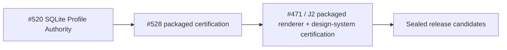
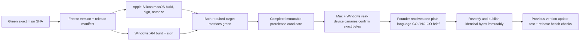
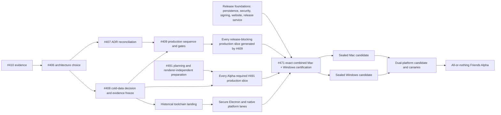
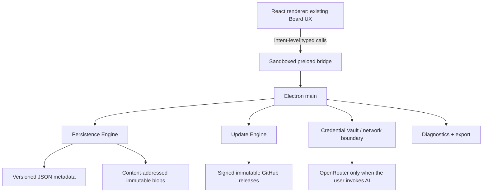

# Spec: Ship Eido as an autonomously operated local-first macOS + Windows Friends Alpha

> **Supersession — 2026-07-22.** This 2026-07-16 synthesis is preserved as
> historical adversarial evidence. It is superseded where it conflicts with the
> live native blocked-by graph and the canonical #448 issue body. #410, #491,
> #408, and #409 are closed/resolved and no longer gate release work; the SQLite
> Profile Authority (#520) is the live storage engine, #464 is retired, and the
> repository manifest is the sole authority for the toolchain it pins.

Research and repository review date: 2026-07-16 (Australia/Sydney)

## Current reconciliation

The current release specification is [#448](https://github.com/limweili/eido/issues/448),
including its **Execution fan-out map**, not this historical synthesis. Storage is the landed SQLite Profile Authority
(#520; ADR 0025/0029), not the retired JSON-first plan. The only live external
tracker dependency is #520's packaged certification gate **#528**, which feeds
the packaged renderer and design-system certification slice (#471/J2) on the
exact candidate SHA. Renderer and design-system work (#410 and #491) are
delivered and frozen inputs, while #408 and #409 remain historical evidence.
Release work must read the toolchain pinned by the repository manifest rather
than repeat a version in prose. The current ownership boundary and start/hold
matrix live in the reconciled
[`06-cross-epic-dependency-contract.md`](06-cross-epic-dependency-contract.md).

## Historical 2026-07-16 synthesis and adversarial evidence (superseded)

### Historical problem

Eido is not yet distributable as a trustworthy desktop product. The current
React/Vite application can be built as static browser assets, but its durable
disk adapter exists only as Vite development/preview middleware. A production
browser bundle silently falls back to origin-scoped IndexedDB when that
middleware is absent. There is no installable shell, platform signature,
notarized installer, durable update feed, packaged-app test, release manifest,
or autonomous desktop release process.

The current disk store is also not a safe production authority for ideas that
may exist nowhere else:

- the complete store is parsed, serialized, and replaced for ordinary changes;
- temporary-file rename is used without a durable flush and post-write proof;
- overlapping read-modify-write operations can lose the newer state;
- the debounced saver forgets the exact dirty snapshot after a failed attempt;
- ordinary loading silently filters malformed Ideas and Boards instead of
  entering an explicit recovery state;
- the store and Board both use an ungoverned `version: 1`, with no migration
  registry, reader/writer compatibility range, or future-version refusal;
- backups exist for one import-conflict path, not as a coherent recovery model;
  and
- image data URLs dominate the measured production-shaped payload, making every
  whole-store write, snapshot, and migration unnecessarily expensive.

The founder has made the product decisions that shape the solution:

- Eido should be a standalone Electron app whose UI is still the existing
  browser application running in bundled Chromium.
- "Offline" means local-first and offline-capable, not air-gapped. Opening,
  editing, and saving a Board must work without a network. OpenRouter, model-list
  refresh, update checks, and a future marketplace may use the internet.
- Alpha users should not log in. The waitlist/download link is a discovery gate,
  not cryptographic access control. A forwarded public link will work.
- Source remains private and all rights reserved. Selected contributors may be
  invited to the private source repository later; Alpha users receive binaries,
  not source rights.
- Friends Alpha launches on **Apple Silicon macOS and Windows x64 on the same
  day**. Both targets are required release gates; neither may be omitted from a
  day-one candidate or final release.
- The website is downloads, waitlist, release notes, support, and documentation
  only. It does not host a browser editor or become a second persistence product.
- Direct-download production artifacts must be signed. The founder supplies the
  stable legal publisher identity and payment only when the release captain
  coaches each required step. Early signed SmartScreen prompts are accepted and
  explained honestly; agents never recommend bypassing operating-system security.
- One named Apple Silicon canary and one named Windows x64 canary must confirm the
  exact candidate on real hardware before the founder receives GO / NO-GO.
- The app checks for updates automatically, offers **Update now** and **Remind me
  later**, and offers an explicit preference for future automatic download. No
  Alpha update may install over dirty or unverified data.
- There is no automatic telemetry. Users may deliberately export a redacted
  diagnostic bundle that excludes Card text, prompts, assets, API keys, and
  private paths.
- Recovery should be as small and quiet as safety permits, but preventing loss of
  irreplaceable ideas outranks eliminating recovery files. Same-disk recovery plus
  a verified one-click export is sufficient for Friends Alpha. Eido warns clearly
  about device-loss risk but does not block use on Time Machine, File History,
  external backup, or a prior export.
- Agents may establish a separately measured native-release CI and signing budget,
  then present the founder with one bounded spending proposal; release gates may
  never be silently skipped to save money.

Independent production research found that Electron is a practical choice, but
that a minimal wrapper plus GitHub Releases is not a production system. VS Code,
Joplin, Signal Desktop, and Element Desktop all add target-OS builds, signing,
post-sign verification, packaged executable tests, updater state machines,
operating-system compatibility checks, release qualities, cache cleanup, and
promotion controls. Real upstream incidents include clients being updated onto
unsupported macOS versions, update/restart failures, stale installers consuming
hundreds of megabytes, native package failures, and profiles that cannot be
downgraded after migration.

Several constraints cannot be automated away:

- Anonymous GitHub downloads must be public. "Friends only, no login, GitHub
  updates, and real access control" cannot all be true.
- Apple Developer ID requires the founder's verified identity, legal acceptance,
  and annual payment. Windows direct-download signing also requires verified
  publisher identity and payment; Microsoft's current public-trust cloud signing
  is not available to an Australian publisher, so Eido needs an eligible
  third-party OV/cloud signing service or later Store distribution.
- A newly signed Windows binary may still show SmartScreen's low-reputation
  warning. Signing proves publisher and integrity; it does not guarantee a
  warning-free first download.
- With no telemetry, an agent cannot know whether a friend installed, migrated,
  launched, or crashed. Promotion needs one deliberate acknowledgement from each
  required platform's named real-device canary, not merely elapsed time or hosted
  CI.
- Electron ships Chromium and Node, and officially supports only its latest three
  stable majors on an eight-week cadence. Desktop distribution creates a
  permanent security-maintenance lane.

The active [performance epic #410](https://github.com/limweili/eido/issues/410)
and [design-system implementation epic #491](https://github.com/limweili/eido/issues/491)
are external producers, not blanket prerequisites for this release program.
Storage, recovery, shell security, signing, updater foundations, website, founder
coaching, release-state work, and #491 planning may proceed while #410 evidence
work continues. Design-system documentation, ticketing, and renderer-independent
preparation may also proceed, but #491 runtime slices that change fonts, card or
Board geometry, painter palettes, themes, or other measured renderer behavior
must not land until [#408](https://github.com/limweili/eido/issues/408) closes its
protected evidence boundary.
[#409](https://github.com/limweili/eido/issues/409) produces the selected
renderer implementation sequence and gates; it does not implement that sequence.
Therefore #409 closure alone never proves production readiness. Packaged-renderer
certification, both sealed platform candidates, both canaries, and final
publication wait for every release-blocking production slice generated by #409
and every Alpha-required #491 production slice to land, be default-on, and pass
together on the exact combined candidate SHA.

At the evidence cut, #410 comparison workflows used the then-current toolchain.
The historical release-toolchain ticket was externally blocked by
[#408](https://github.com/limweili/eido/issues/408), the last measurement lane
downstream of the candidate comparison. Release agents must not alter the
package/lockfile, Node configuration, or #410 performance workflows before that
evidence boundary closes. After the transition, canonical CI and every affected
performance contract are rerun on the new exact head.

### Historical solution

Ship Eido as a local-first Electron desktop application with a private source
repository and a public-but-unadvertised binary release repository. Keep the
current React/Vite renderer and `SavedBoard` semantics. Put all privileged work
behind narrow main-process modules and a typed preload bridge. Replace the Vite
middleware as the production authority with one durable Persistence Engine,
while retaining browser/in-memory adapters for development and tests.

For Friends Alpha, use **versioned JSON metadata plus content-addressed immutable
asset blobs**, not a full SQLite rewrite. The measured reference profile is
approximately 84.7 MB, of which approximately 72.8 MB is inline image data; its
non-image metadata is approximately 11.9 MB and remains below the repository's
existing 25 MB investigation threshold. Moving assets behind the persistence
adapter removes the current dominant write-amplification and backup cost while
preserving the renderer-facing Board shape. SQLite remains the prepared next
adapter when metadata, serialization, history, querying, or write-contention
triggers justify it.

Use `electron-builder` and `electron-updater` behind an Eido-owned update module.
The updater automatically checks, never blocks offline startup, never installs on
ordinary quit, and never exposes raw updater APIs to the renderer. Installation
requires a verified save flush and pre-update recovery point. A higher-version
forward hotfix is the default response to a bad release; automatic binary or data
downgrade is forbidden.

Build Apple Silicon macOS and Windows x64 natively from the same exact source SHA
in parallel. Friends Alpha is a coupled two-target launch: candidate, canary, and
final publication require both platform lanes to pass their signing, install,
offline, update, migration, recovery, packaged-performance, and real-device
checks. Set the target matrix at planning and lock it at preflight. If either
target is not ready, the whole version remains blocked or is superseded rather
than publishing a partial immutable release. Defer Intel macOS, Windows ARM64,
and Linux until measured demand justifies their separate package and verification
matrices.

Every release is an exact-SHA, build-once-per-target promotion:

#### Historical cross-epic dependency and ownership contract

The ownership and handoff rules below were binding at this evidence cut:

- #410 owns renderer residency, representation, runtime image renditions, and any
  cold-data loading decision. #491 owns design tokens, primitives, typography and
  font delivery, light/dark themes, and production design-system adoption. #448
  owns desktop distribution, disk durability and blobs, shell security, updater
  safety, release operations, website, and founder coaching; the now-retired
  migration ticket [#464](https://github.com/limweili/eido/issues/464) then owned
  durable schema and data transformations.
- #491 could consume the renderer and persistence interfaces but could not select
  a #410 architecture or mutate saves directly. Its P5 palette-value mapping was
  planned as an ordered, copy-first #464 migration under `eido-profile-safety`.
  Its P7 Light/Dark/Match-system choice is a device-local preference, not a Board
  or future-sync entity, and never enters `SavedBoard` or portable Board exports.
- Release tickets may preserve and hydrate the current renderer-facing
  `SavedBoard` contract, but may not select a #410 candidate, enable an
  experimental flag, change Board Scene behavior, or persist renderer cache state.
- When #409 creates its production issues, its team must classify each as
  **release-blocking**, **optional**, or **deferred**, with a reason. The release
  team then adds every release-blocking issue as a native GitHub blocker of the
  packaged-renderer certification ticket. An empty or unresolved fan-out fails
  closed.
- #491 must classify each production slice as **Alpha-required** or **deferred**.
  Every Alpha-required slice becomes a native blocker of #471 and must be merged,
  default-on, and green on the same exact SHA as the selected renderer. Design
  documentation or a prototype alone never satisfies this gate.
- Before starting a blocked ticket, agents re-derive the live issue, pull request,
  exact-head CI, and native dependency state. Dated prose, a green prototype, or
  a closed planning issue is never substitute evidence.
- Shared hotspots are serialized: package manifest and lockfile; Node and common
  workflows; Board Scene and performance harnesses; design tokens and painter
  palettes; font and CardShell geometry; `SavedBoard`, asset, and hydration
  contracts; Electron-builder policy; and release-policy scripts. A ticket must
  declare ownership before editing one of these seams.
- Persistence owns authoritative on-disk asset blobs. #410 owns rebuildable
  runtime renditions, decoded-surface residency, warming, and eviction. Neither
  lane may silently implement the other's architecture.
- The macOS and Windows candidate jobs build artifacts from one frozen source SHA.
  Any source, version, lockfile, dependency-ledger, selected-renderer, or required
  design-system change supersedes both artifacts and requires a new candidate
  version.

GitHub's repository-scoped `GITHUB_TOKEN` cannot publish to the separate binary
repository. Use the private source repository's own `GITHUB_TOKEN` for source and
candidate-artifact reads, and a least-privilege GitHub App installed only on the
public binary repository for publication. Never install the publisher App on the
private source repository: App maximum permissions apply to every selected
repository. A fine-grained PAT is a documented temporary fallback, not the
target. Signing stays in the private repository. Final promotion in the public
repository receives only sealed, already-signed artifacts and can use its public
protected environment for the founder approval gate.

Create one `desktop-release-captain` agent skill and one machine-readable release
state machine. They sit downstream of Merge Captain: Merge Captain establishes
green exact-main truth; Desktop Release Captain turns an approved main SHA into
a candidate, canary, and published desktop release; `eido-profile-safety` owns every
operation involving real data, migrations, or recovery rehearsal.

#### Historical target modules and seams

- **Module:** Persistence Engine. **Interface:** inspect, load, commit, flush,
  export, import, list recovery points, restore, and migrate. **Seam:** establish
  one renderer/domain-facing `PersistencePort`, initially matching the current
  CRUD-shaped persistence behavior. Electron, browser-development, in-memory, and
  fault-test adapters implement the port; the Electron adapter maps product
  intents through the typed bridge to the main-process Persistence Engine. The
  current name collision in which `IdeaStore` describes both a CRUD interface
  and a raw legacy save DTO is removed by expand-contract; legacy DTOs remain
  internal migration inputs. **Depth:** callers do not know paths, temporary
  files, blobs, checksums, revisions, backup retention, or migrations.
  **Leverage:** one production implementation controls every durable mutation and
  later SQLite adoption. **Locality:** all compatibility and recovery rules live
  here.
- **Module:** Desktop Bridge. **Interface:** explicit, typed product intents only.
  **Seam:** sandboxed preload to main. It never exposes `ipcRenderer`, arbitrary
  channels, paths, Node, shell, or filesystem primitives.
- **Module:** Update Engine. **Interface:** check, status, choose later, download,
  prepare safe restart, and install. **Seam:** `electron-updater` is an adapter,
  not the renderer contract. The module serializes checks, enforces OS/arch/data
  compatibility, caps update cache, and coordinates persistence.
- **Module:** Release Service. **Interface:** preflight, candidate, verify,
  promote, status, and incident. **Seam:** stable JSON-emitting commands used by
  GitHub Actions and agents. Workflows do not reimplement transition policy.

#### Historical persistence and recovery contract

The authoritative metadata envelope records a format identifier, schema version,
minimum reader and writer versions, monotonically increasing revision, writing
app version, timestamp, payload digest, and blob references. A future or
incompatible version is never normalized to version 1. Normal open is strict and
fail-closed; local salvage is an explicit import path with a report, preserving
ADR 0005's separation between recovery and authoritative truth.

Every durable change—save, create, rename, delete, active-Idea change, import,
migration, and restore—uses one commit queue. A dirty snapshot remains owned
until verified commit. The engine validates the complete candidate, writes and
flushes new immutable blobs, writes and flushes a same-directory metadata
candidate, re-reads and validates it, preserves a verified previous-good
generation, atomically promotes it, and confirms the active revision before
reporting `saved`. Known transient Windows rename/locking errors receive bounded
retry; disk-full, permission, conflict, or verification errors retain dirty data
and block quit/update.

Electron's single-instance lock prevents two packaged apps from owning the same
profile; the engine queue prevents overlapping writes inside that process.
External modification is detected by revision/hash and becomes a visible
conflict, never an automatic opaque merge.

Asset blobs are SHA-256-addressed, immutable, and verified before metadata may
reference them. The adapter may hydrate existing data URLs to keep `SavedBoard`
and active #410 work unchanged. Garbage collection occurs only after proving
that no active generation, recovery point, pre-migration backup, or export
references a blob. Import/export is lossless and packages metadata plus all
referenced assets into a portable Eido archive; API keys are never included.

Recovery is deliberately bounded:

1. one previous-good generation for interrupted or immediately bad commits;
2. seven daily plus four weekly metadata snapshots, deduplicating immutable
   assets rather than copying the measured 72.8 MB repeatedly; and
3. verified full pre-migration backups, retained under the existing Save File SOP
   until explicit deletion.

This replaces the current twenty full import/recovery copies with a coherent,
smaller model. It is the minimum recommended compromise for ideas that may exist
nowhere else. Same-disk recovery does not protect against device loss, theft, or
ransomware; the app must offer a one-click verified export and accurately state
that limitation. An optional user-selected external backup folder is a later
enhancement, not a claim of cloud backup.

Migrations are ordered, deterministic, idempotent, and operate on a verified new
generation. They compare stable IDs, entity counts, semantic invariants, and
asset hashes before promotion. The original remains recoverable. An older app
opening a newer writer version is read-only for export or refuses safely; it may
never write.

The **Alpha v1 compatibility floor** is the current pre-Alpha
`~/.eido/eido-v3-ideas.json` storage shape captured at cutover as a scrubbed,
synthetic fixture. Friends Alpha ships one verified, copy-first migration from
that floor into `0.1.0-alpha.1`, preserving the source and a verified
pre-migration backup. Abandoned v1/v2 formats and unidentified prototype shapes
older than that cutover are unsupported; this release does not require format
archaeology. Every format delivered to an Alpha tester beginning with Alpha v1
remains forward-migratable by future versions, including when the user skips
releases.

#### Historical sync-ready local persistence foundation

Friends Alpha implements no cloud service or synchronization, but local
persistence must not introduce assumptions that make later optional sync unsafe.
The Persistence Engine owns a machine-readable identity inventory that classifies
each persisted structure as a durable entity, an ordered/value object, or a
rebuildable cache. Every independently meaningful durable entity has an opaque,
globally collision-resistant ID that survives save, reload, reorder, migration,
restore, normal export/import, and moving the profile between computers. IDs
never derive from array position, filename, device path, JSON order, timestamp
alone, or a local counter. Existing valid IDs are preserved. Local salvage may
assign a missing legacy ID once through an idempotent migration with an explicit
mapping/repair report; future strict sync admission may reject ambiguous records.

In the current one-Idea/one-Board model, the Idea ID is the owning Board identity;
do not add a competing second Board identity unless a later domain decision
separates them. Cards, independently referenced Blocks, Connections, logical
assets, Outputs and Output Versions, Runs, Highlights and tags, Intent Log Events,
and every other independently referenceable durable record follow the same
identity and explicit-owner-reference contract. Derived caches such as image
renditions and rebuildable indexes do not become sync entities merely because
they are persisted.

A logical asset ID is distinct from its SHA-256 blob content identity. Multiple
logical assets may legitimately reference identical deduplicated bytes. The hash
proves content equality and integrity; it does not prove ownership,
authorization, trust, or logical record identity.

The metadata envelope distinguishes the profile-local generation revision,
storage-envelope version, logical store/Board schema version,
asset-reference/manifest version, and writing application version. It records an
opaque generation/commit identity and the included ADR 0016 logical-commit
high-water mark. The ADR 0016 commit funnel creates logical board commits; the
downstream Persistence Engine queue may durably batch them into one generation.
A monotonically increasing generation revision orders writes only inside one
profile and is explicitly not a future cross-device clock. Device IDs, change
IDs, vector clocks, CRDT metadata, server ordering, and conflict policy remain
future Sync Engine decisions.

Metadata integrity uses a Persistence-Engine-owned canonical representation and
digest. Object keys have stable encoding; semantically unordered entity
collections canonicalize by durable ID; user-meaningful order is represented by
explicit fields or explicitly ordered value collections. The digest excludes its
own field and changes with logical persisted content, not incidental JSON
property order. Asset hashes are verified separately before a generation is
accepted.

Portable archive operations have three distinct meanings: restore/import
preserves every identity; **Duplicate as new** remaps every affected identity and
reference consistently and reports the mapping; merge is reserved and forbidden
for Friends Alpha. A clean-profile import reconstructs the same logical graph,
IDs, compatibility data, and asset hashes. Renderer/domain code never depends on
JSON ordering, filenames, directories, Electron paths, blob names, or future
database tables. A future Sync Engine may consume logical identities and revisions
only through a separate strict interface; it may never synchronize raw
persistence internals.

#### Historical release and update contract

The application version uses SemVer beginning at `0.1.0-alpha.1`; every artifact
that may reach a tester has a unique monotonically increasing version and no
version/tag is reused. Data schema versions are independent integers. The release
manifest states the app version, full source SHA, lockfile digest, toolchain and
runner versions, platform/architecture, minimum OS, every artifact digest,
signature identity, notarization result, update metadata, SBOM, readable/write
schema range, Alpha-v1 compatibility-floor identifier, migrations, fixture
results, canary evidence, and state history. Its external-dependency ledger
records #410, #409, #491, every release-blocking production issue generated by
#409, every Alpha-required #491 production issue, every optional/deferred issue
and reason, current live state, merge SHA, evidence URL, last re-derived time,
and the #408/Node-toolchain handoff. A missing, empty, stale, or manually assumed
ledger is a release error.
At `PLANNED`, the manifest sets `requiredTargets = [darwin-arm64,
win32-x64]`; successful preflight locks that set for the version. `VERIFIED`,
`CANARY`, `APPROVABLE`, `PUBLISHED`, and `COMPLETE` require evidence for
both targets. Immutable release records are complete only when every required
asset and updater metadata file is attached before publication. A missing
platform cannot be appended later; the whole version blocks or is superseded.

Only after #408 closed could the repository's canonical build/CI contract move
from its historical toolchain to a supported line. That transition is now
superseded: build and release work read the toolchain pinned by the repository
manifest. Build-time tooling is distinct from the runtime embedded in Electron.
The transition exclusively
owns its package, lockfile, Node configuration, and common-workflow changes,
reruns canonical CI and affected performance contracts, and records any drift.
It is a serialized cross-epic handoff, not a hidden package-ticket side effect.

The release state machine is:

`PLANNED -> PREFLIGHTED -> BUILDING -> BUILT -> SIGNED -> VERIFIED -> CANARY -> APPROVABLE -> PROMOTING -> PUBLISHED -> COMPLETE`

`BLOCKED`, `REJECTED`, `SUPERSEDED`, and `INCIDENT` are explicit states. Every
transition is idempotent and re-derived from GitHub, CI, signatures, and manifest
evidence rather than agent memory. A promotable `PREFLIGHTED` state additionally
requires #409's fan-out to be explicit, every release-blocking production slice
and every Alpha-required #491 slice to be merged, default-on, and green on the
exact SHA, the packaged-renderer certification evidence to be current, and the
Node/toolchain handoff to be satisfied. Earlier shell or platform smoke builds
are explicitly non-promotable.

Candidate and final are distinct immutable GitHub release records with distinct,
never-reused tags but byte-identical signed application artifacts. The release
manifest records `candidateTag`, `finalTag`, and the one product/app version.
Each record begins as a complete draft containing both required targets. The
candidate draft is published once as a prerelease; normal clients explicitly set
`allowPrerelease=false` and must ignore it, including clients whose installed
app version is itself a SemVer prerelease. Promotion re-downloads every candidate
asset, verifies its digest and platform signature, copies those exact bytes into
the complete final draft with updater metadata containing no candidate-only URL,
and publishes the final record once. It never rebuilds, replaces, deletes, or
mutates candidate assets.

A disposable repository must prove this exact candidate/final and updater
contract, immutable re-verification, incomplete-upload retry, and normal-client
behavior before production. One Apple Silicon tester and one Windows x64 tester
then install the exact candidate and each confirm launch online/offline, existing
Board load, one edit persisted across restart, previous-version update, and no
storage warning in redacted diagnostics. Only when both pass does the founder
receive one plain-language GO / NO-GO choice. Percentage rollout is not used:
mutable cohort metadata conflicts with immutable releases and is meaningless for
a tiny, unobserved cohort.

The app automatically checks for updates, but update errors are nonfatal and
rate-limited while offline. For Alpha, `autoInstallOnAppQuit` and downgrade are
disabled. **Update now** first flushes and verifies the dirty state, creates and
verifies a pre-update recovery point, records compatibility, and only then
installs. **Remind me later** performs no data mutation. The automatic-update
preference may download in the background, but installation still occurs only on
a safe intentional restart and is always announced.

A bad published release is repaired by pausing further promotion and shipping a
higher-version forward hotfix. If data was migrated, the preferred hotfix reads
both old and new formats. Restoring the pre-migration generation is a distinct,
explicit recovery action that quarantines the current profile and explains that
post-migration edits will not exist in the restored copy. Never point ordinary
clients at an older binary and assume that app rollback also rolls data back.

### Security and privacy contract

- Serve packaged content from a path-safe custom `eido:` protocol, not raw
  `file://`.
- Keep `nodeIntegration` off, context isolation and sandbox on, a restrictive CSP,
  navigation/window/permission handlers allowlisted, IPC senders and arguments
  validated, and Electron security fuses locked (`runAsNode` off, ASAR integrity
  and ASAR-only loading where supported).
- Treat Card Markdown, imported content, links, images, and future marketplace
  data as untrusted. Never execute downloaded mods or remote code in the
  privileged renderer.
- Store the OpenRouter key through the OS credential facility, not in Board data,
  exported archives, logs, release artifacts, or diagnostics. Keep it out of the
  renderer's persistent storage. The network adapter is the only component
  allowed to attach it to OpenRouter requests.
- Allowlist current network egress: OpenRouter/model metadata when requested and
  the signed update endpoints. Editing and persistence have no network
  dependency.
- No automatic analytics, crash upload, Board upload, or silent diagnostic
  transmission. Local crash/update/storage logs are bounded and redacted.
- Release mode fails closed when signing/notarization credentials or verification
  are absent. Local unsigned builds are mechanically distinct and cannot be
  promoted.
- Build natively per target OS from the same exact main SHA and npm-10 lockfile;
  pin Actions to full SHAs, keep permissions least-privilege, generate checksums,
  a third-party license inventory, and an SPDX/CycloneDX SBOM, and publish only
  complete immutable releases.

### Autonomous agent operating system

The `desktop-release-captain` skill owns routine and incident releases end to
end. It calls stable commands equivalent to:

- `release:preflight --sha <full-sha> --version <semver> --json`
- `release:candidate --manifest <id> --json`
- `release:verify --manifest <id> --stage candidate|published --json`
- `release:promote --manifest <id> --json`
- `release:status --version <semver> --json`
- `release:incident --version <semver> --json`

Exact command names may be refined during implementation; the capabilities,
structured results, stable error classes, idempotence, and fail-closed behavior
are fixed. The skill never asks the founder to interpret commands, logs, runner
choices, signatures, updater metadata, or migration mechanics.

The implementation includes these agent-owned documents:

1. Desktop Release SOP: state transitions, evidence, exact-SHA rules, platform
   completeness, candidate/canary/final flow, and founder brief.
2. Update Compatibility SOP: app/data matrix, safe restart, backups, migration,
   future-version refusal, and forward-fix rules.
3. Signing and Identity SOP: publisher subjects, owners, renewal thresholds,
   revocation, Apple and Windows procedures, and founder-only identity/payment
   actions—never secret values.
4. Release Incident SOP: bad candidate, bad publication with/without migration,
   failed save restart, provider outage, compromised release repo/key, revoked or
   expired certificate, partial publication, and secret exposure.
5. Canary SOP: exact candidate, human checklist, diagnostic schema, and promotion
   blockers.
6. Founder Release Brief: user-visible change, data risk, reversibility, canary
   result, cost/identity implication, agent recommendation, and one decision.
7. Public Binary Repository Policy: public-but-unadvertised status, private
   source/all-rights-reserved status, supported systems, checksums, privacy,
   issue reporting, and expected Windows warning guidance.
8. Persistence Foundation and Save File SOP update: authoritative paths, formats,
   stable-identity inventory, logical-versus-generation commit semantics,
   canonicalization, fixtures, backup classes, migrations, agent inspection/export
   commands, and prohibition on using real saves as fixtures.
9. Founder Setup Coach: just-in-time Apple and Windows enrollment, identity,
   payment, certificate-provider, GitHub App, and canary instructions. It asks one
   plain-language question at a time, explains why the action is unavoidable,
   links the authoritative portal and expected screen, states current expected
   price/timing, verifies completion automatically where possible, covers renewal
   and revocation, never asks the founder to paste a private key, and resumes the
   release state machine afterward.
10. Historical Cross-Epic Dependency and Hotspot SOP: historical blocker discovery,
    #409 fan-out classification, native-link synchronization, #408/toolchain handoff, shared-file
    ownership, rebase sequencing, exact-SHA evidence, and the prohibition on
    treating planning or prototype completion as production implementation.

Scheduled automation checks updater availability, certificate expiry at
60/30/14 days, Electron support/EOL, dependency and license risk, release-repo
permission drift, previous-version update, immutable public artifacts, native
runner/signing spend against a separately approved release reserve, and live
external blockers while a release is active. Release preflight re-derives #409's
fan-out and fails closed when it is empty, unresolved, stale, or represented only
by manual prose. A technical
failure is handled or reported as blocked by the agent. Founder input is reserved
for one bounded money approval, legal identity, product behavior, real-data
recovery authority, the two named canaries' human confirmations, and the final
Alpha GO/NO-GO.

### Historical user stories

1. As an Alpha user, I want Eido to install as a normal desktop app, so I never
   need Node, npm, a terminal, or a local server.
2. As an Alpha user, I want the existing browser-like UI in a standalone window,
   so the product feels familiar without depending on Chrome or Safari.
3. As an Alpha user, I want every Board to open, edit, and save while offline, so
   a network or GitHub outage cannot block my ideas.
4. As an Alpha user, I want AI features to explain when they need the internet,
   so local-first is not confused with air-gapped.
5. As an Alpha user, I want an update prompt with Update now and Remind me later,
   so I control interruption.
6. As an Alpha user, I want an explicit automatic-update preference, so downloads
   may become convenient without permitting unsafe surprise restarts.
7. As an Alpha user, I want Eido to prove my latest edit is durable before an
   update or quit, so the updater cannot erase the only copy.
8. As an Alpha user, I want a clear saved/saving/failed state that retains failed
   work for retry, so a disk or permission error is not silently dismissed.
9. As an Alpha user, I want malformed or newer data to open in recovery/read-only
   mode instead of an empty Board, so incompatibility cannot masquerade as loss.
10. As an Alpha user, I want a recovery preview with dates, versions, counts, and
    validation status, so I can choose without reading files.
11. As an Alpha user, I want restore to preserve the damaged/current profile in
    quarantine, so recovery does not destroy evidence or newer edits.
12. As an Alpha user, I want a one-click portable export and verified fresh-profile
    import, so my work is not trapped in an opaque application folder.
13. As an Alpha user, I want images to round-trip byte-for-byte through storage,
    migration, recovery, and export, so payload optimization never degrades them.
14. As an Alpha user, I want old signed installers retained with honest data
    compatibility guidance, so support has a safe recovery option.
15. As a waitlist user, I want a direct download without an account, so joining
    the Alpha is low-friction.
16. As a waitlist user, I want the download page to say that the link is public
    and forwardable, so invitation is not misrepresented as security.
17. As a Windows user, I want the expected publisher and SmartScreen guidance,
    so I can distinguish low reputation from an unknown/unsigned executable.
18. As a macOS user, I want a signed, notarized, stapled application that launches
    offline, so Gatekeeper trust does not depend on a live service.
19. As a privacy-conscious user, I want diagnostics to remain local unless I
    export them, so my Board content is never silently transmitted.
20. As a privacy-conscious user, I want my OpenRouter key in OS-protected storage
    and excluded from exports, so ordinary data sharing cannot leak it.
21. As the founder, I want one plain-language release recommendation, so I decide
    product/data risk without operating CI or signing tools.
22. As the founder, I want agents to tell me exactly when identity or payment is
    unavoidable, so setup work is bounded and not disguised as automation.
23. As the founder, I want Apple Silicon macOS and Windows x64 to launch together,
    so every first friend receives the same Friends Alpha generation on day one.
24. As the founder, I want the waitlist to capture OS/architecture, so platform
    investment follows evidence rather than my guess.
25. As a canary tester, I want a short behavioral checklist and automatic redacted
    diagnostic export, so my confirmation is useful without technical skill.
26. As a release agent, I want one idempotent state machine and machine-readable
    manifest, so a timeout or handoff cannot duplicate or mutate a release.
27. As a release agent, I want every transition re-derived from exact external
    evidence, so stale conversation state cannot publish the wrong SHA.
28. As a release agent, I want platform signing to fail closed and be independently
    verified, so a green builder command cannot conceal an unsigned artifact.
29. As a release agent, I want candidate and final digests to be identical, so
    canary evidence applies to the bits users receive.
30. As a release agent, I want explicit OS, architecture, app, and schema
    compatibility in the manifest, so an unsupported client is not auto-updated.
31. As an incident agent, I want to know whether a bad release migrated data, so
    I choose forward repair or explicit restore safely.
32. As an incident agent, I want a higher-version repair path, so immutable
    releases and already-updated clients are not "fixed" by mutating history.
33. As a storage agent, I want synthetic historical and adversarial fixtures, so
    migrations and recovery can be proven without private saves.
34. As a storage agent, I want fault injection after every commit phase, so a
    passing happy path does not hide power-loss, disk-full, permission, or rename
    failures.
35. As an AI agent inspecting Eido intent, I want a safe read-only inspection and
    redacted export command, so future storage adapters do not require direct
    private-file parsing.
36. As a renderer engineer working on #410, I want storage to preserve the
    runtime `SavedBoard` contract and keep experimental candidates default-off,
    so release work does not preselect rendering architecture.
37. As a performance agent, I want #409 to define the packaged gates and every
    release-blocking production slice it creates to land before those gates run,
    so the release measures the selected implementation rather than a prototype
    or the old renderer.
38. As a #410 evidence owner, I want the historical comparison environment protected
    until #408 closes, so a release-toolchain upgrade cannot invalidate candidate
    evidence.
39. As a maintainer, I want scheduled Electron support and certificate checks,
    so a security hotfix is not blocked by an expired runtime or identity.
40. As the founder, I want a setup coach to ask for identity, payment, and canary
    actions only when needed, so I never have to interpret signing or CI systems.
41. As a Mac or Windows Alpha user, I want both required installers published from
    the same exact source generation, so platform does not determine product age.
42. As a future migrating user, I want every durable object to retain its stable ID
    through save, migration, and normal import/export, so references remain portable.
43. As a user duplicating an Idea, I want Duplicate as new to remap the entire
    identity/reference graph deliberately, so the copy cannot collide with its source.
44. As a storage agent, I want local generation revision, logical commit identity,
    app version, Board schema, envelope format, and asset-reference format recorded
    separately, so compatibility and provenance are explicit.
45. As a future Sync Engine, I want logical records independent of JSON order,
    filenames, paths, and storage technology, so optional sync can be added without
    replacing Eido's domain model.
46. As a user, I want metadata and every referenced asset verified by canonical
    digests before use, so modification or incomplete writes are detected.
47. As a privacy-conscious user, I want sync readiness to introduce no account,
    upload, server, networking, or telemetry, so local ownership remains unchanged.
48. As a Windows or Mac user, I want the public website to contain only verified
    downloads and documentation, so I never confuse an incidental browser fallback
    with the durable desktop product.

### Historical implementation decisions

- Treat Eido as a desktop application built with browser technology, not as a
  PWA, localhost companion, or hosted web application.
- Retain the React/Vite renderer and existing Board domain model. Electron is a
  privileged adapter and release boundary, not a second product core.
- Use a supported stable Electron version pinned exactly at implementation time;
  Electron 43 is current on the research date. After #408 closes, move the
  canonical build/CI toolchain through the historical transition, rerun
  affected performance contracts, then add Electron dependencies. Upgrade one
  Electron major at a time and never allow the pinned line to leave Electron's
  latest-three support window.
- Use electron-builder/electron-updater behind project-owned modules. Do not
  expose a library updater directly to UI code.
- Friends Alpha requires Apple Silicon macOS and Windows x64 on day one. Develop
  the native lanes in parallel but publish no candidate or final version until
  both are green. Intel macOS, Windows ARM64, and Linux are not promised.
- Keep the website limited to downloads, waitlist, release notes, support, and
  documentation. Do not ship or imply a hosted/PWA editor in this release.
- Keep source private and binaries public-but-unadvertised. Do not call the Alpha
  open source or technically friends-only.
- Use a separate public binary repository and a least-privilege GitHub App
  installed only there; source reads use the private repository's own
  `GITHUB_TOKEN`. The private source SHA is recorded for traceability, but
  private-source provenance is not marketed as publicly reproducible.
- Deepen, do not duplicate, the current persistence seam. Packaged desktop must
  never silently fall back to IndexedDB when its disk adapter fails.
- Use strict versioned JSON metadata plus content-addressed blobs for Alpha.
  Preserve existing Board hydration at the adapter boundary. Defer SQLite until
  a recorded trigger fires: metadata above roughly 25 MB, serialization above
  roughly 50 ms, history above 5x live Board data, visible write contention,
  partial-query/loading needs, or multiple legitimate writers.
- Treat the current pre-Alpha `eido-v3-ideas.json` shape at cutover as the Alpha
  v1 compatibility floor and importable source, not as a real-data fixture.
  Maintain a scrubbed synthetic floor fixture; migrate a user's source only from
  a verified copy and leave a verified pre-migration backup. Abandoned v1/v2 and
  unidentified older prototype formats are unsupported.
- Maintain separate application, profile-local generation revision, opaque
  generation/logical-commit identity, metadata-envelope, logical
  store/Board-document, and asset-reference/manifest versions. Never overload one
  `version` field or treat a local revision as cross-device order.
- Classify persisted structures as durable entities, ordered/value records, or
  rebuildable caches. Preserve globally collision-resistant IDs for every durable
  entity across migration and normal import/export; restore preserves identity,
  Duplicate as new remaps the complete reference graph, and merge remains forbidden.
- Keep logical asset identity separate from content-blob hash. Own canonicalization
  and metadata digests inside the Persistence Engine. Explicit fields represent
  meaningful order; filenames, property order, array positions, and device paths
  never provide identity.
- Preserve all shipped forward migrations. No automatic down-migration.
- Bound ordinary recovery to previous-good, seven daily, four weekly, and
  pre-migration generations. Deduplicate blobs. Do not claim same-disk recovery
  protects against device loss.
- Store application data under Electron's OS-appropriate user-data directory,
  with an Open Data Folder action and portable export. Migrate the current
  `~/.eido/eido-v3-ideas.json` path explicitly on macOS; tests use scratch paths.
- Use a custom application protocol and the full Electron security baseline:
  sandbox, context isolation, no Node integration, restrictive CSP, validated
  IPC, bounded navigation/windows/permissions, and reviewed fuses.
- Keep API credentials outside Board persistence and diagnostics. The future mod
  marketplace remains data-only until a separate security decision authorizes
  executable code.
- Use SemVer `0.x` prereleases. Never reuse a version that reached a tester.
- Set `requiredTargets = [darwin-arm64, win32-x64]` at planning and lock it at
  preflight. Build natively once per target from the same exact green main SHA.
  Package, sign, verify, exercise, canary both, then promote identical bytes. Never
  publish a partial target set, append a platform later, reuse a tag/version, or
  rebuild at promotion.
- Use distinct immutable candidate and final release records with distinct tags
  and byte-identical app artifacts. Contract-test candidate ignoring, updater URL
  portability, exact-byte copy, and immutable final publication in a disposable
  repository. Do not use percentage rollout or downgrade in phase 1.
- Make update checks automatic and nonfatal; make update installation explicit
  and persistence-gated. Automatic download preference does not bypass safe
  restart or user notice.
- Prefer forward hotfix over binary rollback. Data restore is an explicit,
  quarantining action under save-safety authority.
- Extend the existing DevOps operating system rather than replacing it. The
  canonical PR/main gate remains `npm run ci:required`; desktop release begins
  only after exact-main proof. First measure unsigned and signed dry runs on both
  native targets, then present one proposal covering per-release/monthly runner
  spend, annual Apple/Windows identity costs, storage/retention, and an upper cap.
  Release preflight blocks above the approved cap; agents may never omit a safety
  gate or required platform to save cost.
- Keep release policy in one service and one `desktop-release-captain` skill.
  Workflows and prose call the service; they do not become competing sources of
  truth.
- #410 did not block persistence, shell security, release-state machinery,
  signing, updater foundations, website, or founder coaching.
- #491 planning, ticketing, and renderer-independent preparation could run beside
  #410, but its font, Board/card geometry, painter-palette, theme, and other
  renderer-sensitive runtime slices could not land before #408 froze evidence.
  #491 owned tokens, primitives, typography, and themes; #410 owned renderer
  architecture; #448 and retired #464 then owned durability and migrations.
- The retired #464 historically routed P5's saved palette-value mapping through an
  ordered, copy-first migration. Keep P7's theme preference device-local and outside `SavedBoard`,
  portable Board exports, and future-sync entities.
- #408 historically blocked the toolchain transition because it was the final
  measurement lane.
- #409 defined packaged-performance policy but did not implement it. #409, #410,
  every release-blocking production slice generated by #409, #491, and every
  Alpha-required #491 production slice then blocked #471's exact combined renderer
  and design-system certification and therefore both sealed platform candidates.

### Historical testing decisions

- The highest-value storage tests run at the Persistence Engine interface with an
  in-memory/fault-injecting filesystem adapter. Production Electron and browser
  adapters must pass the same observable contract.
- Commit tests inject failure or termination after blob write, blob flush,
  metadata write, metadata flush, candidate validation, backup, promotion,
  directory sync, and read-back. Restart must load the newest complete verified
  revision or its predecessor—never an empty normalized store or mixed revision.
- Cover overlapping saves and other mutations, out-of-order completions, dirty
  retry, quit/update while dirty, disk full, read-only directory, transient
  Windows `EBUSY`/`EPERM`, corrupt active/temp/backup combinations, external file
  changes, and second-instance contention.
- Maintain one scrubbed synthetic fixture for the pre-Alpha v3 compatibility
  floor and one for every storage version shipped from Alpha v1 onward, plus
  future-version, malformed, semantically invalid, missing-blob, duplicate-ID,
  permission, image-heavy, and interrupted-migration cases. Real saves never
  become fixtures; abandoned v1/v2 and unidentified prototype formats are not
  added to the support matrix.
- Assert lossless round trips for Ideas/Boards, Cards, independently referenced
  Blocks, Connections, logical assets, Outputs and Output Versions, Runs,
  Highlights/tags, Intent Log Events, settings, and references. Save/reload,
  semantically irrelevant reordering, migration, restore, and normal export/import
  preserve stable IDs; Duplicate as new remaps every affected ID and reference.
  Moving the whole profile does not break assets.
- Assert canonical metadata digests ignore incidental object-key and unordered
  entity-array order, cover explicit meaningful order, exclude the digest field,
  and reject changed metadata or missing/modified blobs. Assert generation
  revisions are monotonic only within one profile and never presented as
  cross-device order. Assert that API keys and excluded secrets never enter
  Board/export/diagnostic data and that sync readiness creates no network request.
- Rehearse the pre-Alpha-v3-floor -> `0.1.0-alpha.1`, N -> N+1, and Alpha-v1 ->
  current migrations, interruption at each phase, newer-data refusal by N,
  pre-migration restore, and portable export/import into a fresh profile. P5's
  palette mapping was planned only through this now-retired #464 migration path.
- Record metadata bytes, blob bytes, serialization time, durable commit time,
  recovery time, and export/import time for smoke, medium, large, and image-heavy
  fixtures. Thresholds trigger architecture work; they never truncate user data.
- Test packaged executables on their target OS after signing. At minimum: clean
  install, launch, custom protocol, offline launch, create/edit/save, restart,
  prior-version update, reminder path, automatic-download preference, migration,
  recovery, uninstall/reinstall without data loss, spaces/Unicode paths, and
  update-cache cleanup.
- Verify macOS with code-signature, hardened-runtime, Gatekeeper, notarization,
  stapling, and offline-ticket checks. Verify Windows Authenticode, expected
  publisher, installer signature, updater publisher match, and expected
  SmartScreen documentation. Missing verification is red, not absent evidence.
- Exercise negative release controls: unsigned package, missing notarization,
  mixed updater manifest/binary, wrong SHA, reused version, missing platform,
  unsupported OS/architecture, failed save flush, provider outage, partial asset
  upload, and migration failure must all fail closed.
- Release commands have unit/contract tests for state transitions, idempotent
  retry, stable JSON/errors, partial external state, and re-derivation. A mocked
  green publish is insufficient; test a disposable release repository before
  real Alpha publication.
- The canary gate is behavioral, not time-only. One named Apple Silicon tester
  and one named Windows x64 tester each supply the required acknowledgement and
  redacted diagnostic result; neither platform nor hosted CI can substitute for
  the other.
- Browser/UI tests remain on hosted runners under the existing canary policy.
  Shared-runner FPS is not a merge gate. #409 supplies the selected same-machine
  environment, interactions, fidelity, accessibility, memory, image, and
  repetition policy. The packaged renderer gate runs only after every
  release-blocking production slice generated by #409 and every Alpha-required
  #491 production slice has landed. It covers light, dark, and match-system theme
  behavior, offline self-hosted font loading, token-to-painter palette parity,
  card/editor geometry, and #409's final performance gates on both packaged OSes.
- Final package tests prove that the exact same candidate SHA on macOS and Windows
  contains both the production implementation selected by #410 and the complete
  Alpha-required #491 design system, default-on. P7 remains device-local and is
  absent from Board/export data. #405, design prototypes, or any other experiment
  remain inert unless selected and implemented through their production fan-out;
  a green experimental flag is not release evidence.
- Release artifacts contain checksums, SBOM, license inventory, release manifest,
  and verification reports. A release is complete only after both required
  platform assets are published together, publicly re-downloaded, signature/hash
  verified, updated from the previous version, and relaunched offline.

### Historical out of scope

- Cloud storage, accounts, login, sync, collaboration, server databases, or an
  Eido-owned application backend.
- True anonymous access control for waitlist downloads; a public link is
  deliberately forwardable.
- Public source licensing, an OSI-approved license, community governance, or open
  contribution. Invited private contributors are later repository policy.
- PWA installation, a browser editor, a localhost companion service, or keeping
  the app in the user's existing browser window. The website is distribution and
  documentation only.
- Intel macOS, Windows ARM64, or Linux packaging/updating in the initial Alpha.
- Mac App Store or Microsoft Store distribution; revisit if discovery or
  SmartScreen friction outweighs direct-release control.
- Full SQLite/record/event-journal migration unless the recorded post-blob
  triggers fire. SQLite remains an adapter choice, not a renderer concern.
- Migration archaeology or support for abandoned v1/v2 and unidentified
  prototype save formats older than the pre-Alpha-v3 compatibility floor.
- Changing the Board graph meaning, LOD meanings, or selecting the renderer
  architecture owned by #410. Additive stable identity, ownership, compatibility,
  and version fields required by the Sync-Ready Persistence contract are in scope
  but may not change current runtime graph behavior. Production renderer slices
  are delivered by #409-generated external issues and production design-system
  slices by #491 rather than this release epic, but both remain mandatory blockers
  for packaged certification and sealed candidates. “Out of scope” does not mean
  “optional for release.”
- On-demand cold-data loading before #408/#409 establishes its measured ROI and
  seam.
- Executable mods, remote code loading, or marketplace implementation.
- Automatic telemetry, crash upload, update adoption metrics, or Board content
  collection.
- Automatic app/data downgrade. A future emergency recovery utility may be
  added only through a separate compatibility decision.
- Custom at-rest encryption of Board data. Eido relies on OS account/disk
  security for Alpha; API credentials use OS-protected storage.
- Cross-device or off-device disaster recovery. Portable export is included;
  managed backup/sync is not.
- General-availability/stable launch, marketing, billing, or support operations
  beyond the Friends Alpha.

### Historical further notes

#### Historical adversarial verdict

The architecture is technically sound **and practically feasible** for a coupled
Apple Silicon macOS plus Windows x64 public-but-unadvertised Alpha if agents own
the operating system described above and the founder completes the coached
identity/payment gates. Both native lanes can be built in parallel, but the
day-one product decision deliberately makes the slower lane block publication.
The plan fails if Electron is treated as eliminating platform differences, an
immutable partial release is expected to accept another platform later, GitHub is
treated as private distribution, a rename is treated as complete durability, a
logical commit or profile revision is treated as a future cross-device clock,
percentage rollout is combined with immutable assets, or binary rollback is
treated as data rollback.

The plan intentionally spends complexity on two deep modules—Persistence Engine
and Release Service—because they hide more complexity than they expose. It avoids
a premature normalized database, Linux support, telemetry backend, custom update
server, and multiple release-agent skills. Maximum parallel execution happens
around stable seams; package-lock, persistence-interface, and workflow hotspots
remain explicitly serialized.

#### Historical relationship to active work

- Historical performance epic: https://github.com/limweili/eido/issues/410
- Architecture choice: https://github.com/limweili/eido/issues/406
- ADR reconciliation: https://github.com/limweili/eido/issues/407
- Cold-data decision and protected evidence boundary:
  https://github.com/limweili/eido/issues/408
- Production sequence and gate definition:
  https://github.com/limweili/eido/issues/409
- Production design-system implementation:
  https://github.com/limweili/eido/issues/491
- Dependency chain: #410 evidence -> #406 -> #407/#408 -> #409 -> every
  release-blocking renderer slice; #491 planning may proceed in parallel, but
  #408 -> every renderer-sensitive Alpha-required #491 slice. Both production
  streams join the release foundations at #471 on one exact combined macOS and
  Windows SHA, then feed both sealed platform candidates.
- #410 owned renderer selection and its production fan-out. #491 owned design
  tokens, primitives, typography, themes, and production UI adoption. This spec
  then owned desktop distribution, persistence/recovery, update safety, and
  release operations; retired #464 was the planned route for P5's durable palette
  mapping, while P7 remains a device-local preference.
- Storage's blob split is payload-transparent and does not authorize rendering or
  cold-loading behavior. #409 closure alone never satisfies the release gate.
  Design documentation alone does not satisfy #491 either. Agents add native
  blockers as soon as #409 or #491 creates required production issues and
  re-derive both sets before every promotable preflight.

#### Historical published execution graph

- All 34 implementation tickets are native sub-issues of this spec:
  [#449](https://github.com/limweili/eido/issues/449) through
  [#482](https://github.com/limweili/eido/issues/482).
- Immediate executable frontier: [#449 contracts](https://github.com/limweili/eido/issues/449),
  [#451 storage fixtures](https://github.com/limweili/eido/issues/451), and
  [#452 binary repository](https://github.com/limweili/eido/issues/452).
- [#450 historical toolchain transition](https://github.com/limweili/eido/issues/450)
  was natively blocked by #408.
- [#471 packaged renderer certification](https://github.com/limweili/eido/issues/471)
  was natively blocked by #409, #410, #491, and its release-internal prerequisites.
  The current #471/J2 gate instead follows #520 → #528 on the exact candidate
  SHA; use #448's Execution fan-out map and the reconciled cross-epic contract
  rather than this historical graph.
- Both sealed platform candidates inherit the external join through #471, and
  [#482](https://github.com/limweili/eido/issues/482) remains the all-or-nothing
  day-one release join.
- GitHub native blocked-by links are the executable dependency truth. This prose
  and local diagrams explain intent but never override live tracker state.

#### Historical research evidence

- Local evidence file: `research/05-production-release/01-electron-reference-projects.md`
- Local evidence file: `research/05-production-release/02-storage-migration-recovery.md`
- Local evidence file: `research/05-production-release/03-autonomous-release-operations.md`
- Local execution map: `research/05-production-release/05-ticket-fanout.md`
- Local cross-epic contract: `research/05-production-release/06-cross-epic-dependency-contract.md`
- [Electron security checklist](https://www.electronjs.org/docs/latest/tutorial/security)
- [Electron release support policy](https://www.electronjs.org/docs/latest/tutorial/electron-timelines)
- [Electron autoUpdater platform behavior](https://www.electronjs.org/docs/latest/api/auto-updater/)
- [electron-builder auto-update and staged rollout](https://www.electron.build/docs/features/auto-update/)
- [GitHub immutable releases](https://docs.github.com/en/code-security/concepts/supply-chain-security/immutable-releases)
- [GitHub repository-scoped token](https://docs.github.com/en/actions/concepts/security/github_token)
- [GitHub deployment environments](https://docs.github.com/en/actions/reference/workflows-and-actions/deployments-and-environments)
- [Apple Developer ID](https://developer.apple.com/support/developer-id/)
- [Apple notarization](https://developer.apple.com/documentation/security/notarizing-macos-software-before-distribution)
- [Microsoft SmartScreen reputation](https://learn.microsoft.com/en-us/windows/apps/package-and-deploy/smartscreen-reputation)
- [Microsoft Windows signing options](https://learn.microsoft.com/en-us/windows/apps/package-and-deploy/code-signing-options)
- [Node filesystem durability options](https://nodejs.org/api/fs.html)
- [SQLite atomic commit](https://www.sqlite.org/atomiccommit.html)

#### Historical founder setup boundaries

Agents can implement and operate every technical part, but the first coupled
release has five unavoidable founder actions, each presented one at a time by the
Founder Setup Coach:

1. accept that no-login GitHub distribution is public-but-unadvertised;
2. choose the stable personal/company publisher identity, then enroll and pay for
   Apple Developer ID;
3. buy/verify an eligible Windows signing identity and accept that early signed
   builds may still show SmartScreen;
4. nominate one real Apple Silicon canary and one real Windows x64 canary; and
5. approve the Alpha only after both canaries and the release captain's plain-
   language recommendation.

Everything else—versioning, exact-SHA proof, build routing, signing invocation,
notarization, checksums, manifests, release notes draft, canary package,
verification, incident classification, hotfix sequencing, and founder coaching—
belongs to agents and executable SOPs.
