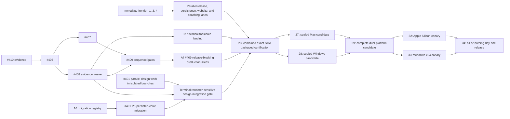

# Draft ticket fan-out for spec #448

> **Supersession — 2026-07-22.** This pre-baked ticket graph was closed as
> superseded by #448's r2 consolidation. It is retained as historical planning
> evidence only: #410, #491, #408, and #409 are closed/resolved; the SQLite
> Profile Authority (#520) is live; #464 is retired; and the repository manifest
> is the sole toolchain authority. The current fan-out source is the **Execution
> fan-out map** in the canonical #448 issue body.

Status: historical fan-out snapshot; do not publish or revive these tickets from
this document.

Source specification: https://github.com/limweili/eido/issues/448

## Current fan-out authority

This document has no live ticket instructions. Use the **Execution fan-out map**
in #448's canonical issue body and the live native blocked-by graph. The sole
live external dependency is #520's #528 packaged certification gate, which feeds
#471/J2 on the exact candidate SHA; the repository manifest is the toolchain
authority. The graph below remains only as evidence of the pre-r2 planning model.

## Historical published issue map (superseded)

All tickets are native sub-issues of #448. GitHub blocked-by relationships are
the executable DAG; prose below explains the intent but never overrides live links.

| Plan | GitHub issue |
| --- | --- |
| 1 | [#449: Freeze the Friends Alpha desktop and sync-ready persistence contracts](https://github.com/limweili/eido/issues/449) |
| 2 | [#450: Historical toolchain transition](https://github.com/limweili/eido/issues/450) |
| 3 | [#451: Freeze synthetic storage fixtures and sync-readiness invariants](https://github.com/limweili/eido/issues/451) |
| 4 | [#452: Bootstrap the public binary-release repository](https://github.com/limweili/eido/issues/452) |
| 5 | [#453: Implement release planning, immutable target declaration, and status](https://github.com/limweili/eido/issues/453) |
| 6 | [#454: Create the Founder Setup Coach](https://github.com/limweili/eido/issues/454) |
| 7 | [#455: Prove candidate-to-final promotion in a disposable repository](https://github.com/limweili/eido/issues/455) |
| 8 | [#456: Build the download-and-documentation website surface](https://github.com/limweili/eido/issues/456) |
| 9 | [#457: Launch Eido in a secure Electron shell](https://github.com/limweili/eido/issues/457) |
| 10 | [#458: Introduce the sync-ready Persistence Port and Engine contract](https://github.com/limweili/eido/issues/458) |
| 11 | [#459: Commit one canonical, digest-verified local generation](https://github.com/limweili/eido/issues/459) |
| 12 | [#460: Route normal durable mutations through one serialized commit queue](https://github.com/limweili/eido/issues/460) |
| 13 | [#461: Move immutable assets into content-addressed blobs](https://github.com/limweili/eido/issues/461) |
| 14 | [#462: Recover and retain verified generations safely](https://github.com/limweili/eido/issues/462) |
| 15 | [#463: Provide portable restore, duplicate-as-new, export, import, and diagnostics](https://github.com/limweili/eido/issues/463) |
| 16 | [#464: Implement ordered, identity-preserving migrations](https://github.com/limweili/eido/issues/464) |
| 17 | [#465: Make Electron main the only packaged persistence authority](https://github.com/limweili/eido/issues/465) |
| 18 | [#466: Protect credentials and constrain packaged network egress](https://github.com/limweili/eido/issues/466) |
| 19 | [#467: Implement serialized update discovery and consent](https://github.com/limweili/eido/issues/467) |
| 20 | [#468: Gate update restart on verified persistence safety](https://github.com/limweili/eido/issues/468) |
| 21 | [#469: Bootstrap the macOS arm64 packaging and signing lane](https://github.com/limweili/eido/issues/469) |
| 22 | [#470: Bootstrap the Windows x64 packaging and signing lane](https://github.com/limweili/eido/issues/470) |
| 23 | [#471: Certify #410's selected production renderer on both packaged targets](https://github.com/limweili/eido/issues/471) |
| 24 | [#472: Create the autonomous Desktop Release Captain and routine SOPs](https://github.com/limweili/eido/issues/472) |
| 25 | [#473: Automate release incidents and maintenance checks](https://github.com/limweili/eido/issues/473) |
| 26 | [#474: Measure native CI and signing costs](https://github.com/limweili/eido/issues/474) |
| 27 | [#475: Produce the sealed macOS arm64 release candidate](https://github.com/limweili/eido/issues/475) |
| 28 | [#476: Produce the sealed Windows x64 release candidate](https://github.com/limweili/eido/issues/476) |
| 29 | [#477: Publish one complete dual-platform prerelease candidate](https://github.com/limweili/eido/issues/477) |
| 30 | [#478: Prove the installed macOS N-to-N+1 path](https://github.com/limweili/eido/issues/478) |
| 31 | [#479: Prove the installed Windows N-to-N+1 path](https://github.com/limweili/eido/issues/479) |
| 32 | [#480: Complete the Apple Silicon human canary](https://github.com/limweili/eido/issues/480) |
| 33 | [#481: Complete the Windows x64 human canary](https://github.com/limweili/eido/issues/481) |
| 34 | [#482: Run the all-or-nothing Friends Alpha day-one release](https://github.com/limweili/eido/issues/482) |

Recommended granularity: **34 one-context tracer-bullet tickets**. The original
24-ticket draft became too coarse after the founder required a coupled macOS
arm64 + Windows x64 day-one launch and added Sync-Ready Local Persistence.

Release policy:

- `requiredTargets = [darwin-arm64, win32-x64]` is set at planning and locked at
  preflight;
- no candidate or final Friends Alpha release may omit either target;
- the website contains downloads and documentation, never a browser editor;
- [design-system epic #491](https://github.com/limweili/eido/issues/491) is an
  external producer alongside #410. It may execute in parallel, but its
  renderer-sensitive work must not land before #408 freezes the comparison
  evidence, and its Alpha-required production result blocks ticket 23;
- #409 defines packaged-performance policy but does not implement it; ticket 23
  is blocked by #410/#409 and every release-blocking production slice generated
  by #409;
- ticket 2 was externally blocked by #408 so the historical toolchain transition
  could not invalidate the active comparison environment;
- package/lockfile/Node configuration, #410 workflows and Board Scene files,
  `SavedBoard`/asset/hydration contracts, Electron-builder policy, and release
  policy are serialized hotspots while safe lanes run in parallel.

### Historical immediate frontier

Tickets 1, 3, and 4 are immediately executable. Ticket 2 is deliberately outside
the frontier until #408 closes. #491 work may also begin in isolated worktrees
and draft PRs, but changes to fonts/text metrics, Board/CardShell/card geometry,
connections, canvas palettes, theme-dependent rendering, camera motion, or #410
fixtures remain on a merge hold until #408 closes and the evidence baseline is
frozen.

#### 1. Historical persistence-contract ticket

**What to build:** Accepted ADR/foundation documentation defines Electron,
macOS arm64 + Windows x64 as one mandatory release matrix, the download-only
website, the Persistence Port/Engine seam, stable identities, independent
versions, recovery policy, and explicit cloud-sync non-goals without changing
#410 renderer behavior. The contract includes an external dependency ledger and
assigns renderer residency, runtime renditions, and cold-data choice exclusively
to #410 while persistence owns disk durability and authoritative blobs. It also
records #491 as the design-system owner, the post-#408 renderer-sensitive landing
rule, and the compatibility boundary: the current pre-Alpha
`~/.eido/eido-v3-ideas.json` format receives one verified migration into Alpha
v1; Alpha v1 onward remains forward-migratable; removed or unidentified prototype
formats carry no support promise.

**Blocked by:** None — can start immediately.

#### 2. Historical toolchain transition

**What to build:** This historical ticket described a toolchain transition. The
current toolchain is pinned solely by the repository manifest; package/runtime
constraints and workflows must read it rather than repeat a version here.

**Blocked by:** https://github.com/limweili/eido/issues/408. Audit notes may be
prepared earlier, but implementation must not edit or land package, lockfile,
toolchain configuration, or shared workflow changes while #410's historical evidence was
active. After landing, rerun canonical CI and every affected performance contract
and record any drift.

#### 3. Historical storage-fixture ticket

**What to build:** Scrubbed fixtures cover every durable entity, the one supported
current pre-Alpha `eido-v3-ideas.json` source, Alpha v1, every subsequently shipped
Alpha schema, future/malformed formats, reordered serialization, missing assets,
duplicate or missing IDs, image-heavy data, and interrupted writes without
private saves. Unidentified removed prototype formats are deliberately outside
the fixture ledger. These are persistence fixtures and must not fork or redefine
#402's canonical renderer performance fixture.

**Blocked by:** None — can start immediately.

#### 4. Historical binary-repository ticket

**What to build:** The public-but-unadvertised repository has immutable-release
policy, protected promotion, least-privilege cross-repo authentication, retention,
permissions, and secret boundaries that are machine-verifiable; no product
binary is published.

**Blocked by:** None — can start immediately.

### Historical planning, coaching, website, and shell

#### 5. Historical release-planning ticket

**What to build:** An exact SHA and unique SemVer create an idempotent manifest
whose required targets lock to macOS arm64 and Windows x64; missing, extra,
replaced, reused-version, or mixed-SHA evidence fails closed. The manifest owns a
machine-readable external dependency ledger, and promotable BUILD/CANDIDATE
transitions require fresh ticket-23 renderer-readiness evidence. Internal smoke
builds remain explicitly non-promotable.

**Blocked by:** 1, 2.

#### 6. Historical founder-setup ticket

**What to build:** One readiness command asks for one plain-language founder
action at a time, explains publisher identity and OS trust, guides Apple and
Windows enrollment, GitHub access, budget approval, and canary nomination,
verifies completion where possible, and never asks the founder to manage secrets
or interpret logs.

**Blocked by:** 1, 4.

#### 7. Historical promotion-proof ticket

**What to build:** A rehearsal proves distinct immutable candidate/final tags,
byte-identical signed assets, normal-client prerelease rejection, portable updater
metadata, exact-byte final copying, partial retry, and one-time final publication.

**Blocked by:** 4, 5.

#### 8. Historical website ticket

**What to build:** A staged site offers platform-specific instructions and
disabled-until-verified Mac/Windows downloads, states links are public and
forwardable, and contains no editor, PWA, service worker, IndexedDB product
fallback, or hosted application route.

**Blocked by:** 1, 4.

#### 9. Historical Electron-shell ticket

**What to build:** A non-promotable development package opens the current main
renderer through a path-safe custom protocol with sandbox, context isolation, no
Node integration, typed IPC, restrictive CSP, navigation controls, and reviewed
Electron fuses. It establishes the shared platform-neutral packaging seam without
editing Board Scene or selecting/enabling a #410 candidate.

**Blocked by:** 1, 2.

### Historical persistence and security

#### 10. Historical persistence-port ticket

**What to build:** One unambiguous domain-facing port hides files and Electron;
production, browser-development, in-memory, and fault-test adapters sit behind it.
The durable-entity inventory, ownership, stable-ID policy, independent envelope/
Board/asset/app versions, and profile-local revision semantics are executable.
The renderer-facing `SavedBoard` contract remains stable and this ticket does not
select #408 cold-data loading.

**Blocked by:** 1, 3.

#### 11. Historical canonical-generation ticket

**What to build:** One edit produces a revisioned generation with canonical
metadata digest, logical-commit high-water mark, durable flush, reread validation,
and atomic promotion; irrelevant serialization order cannot change identity and
an injected failure retains the exact dirty snapshot.

**Blocked by:** 10.

#### 12. Historical commit-queue ticket

**What to build:** Create, edit, rename, delete, active-Idea changes, and
overlapping saves cannot lose a newer revision; external modification becomes a
visible conflict and failed work remains retryable.

**Blocked by:** 11.

#### 13. Historical blob-storage ticket

**What to build:** Legacy inline assets migrate to verified SHA-256 blobs,
logical asset IDs remain distinct from content hashes, identical bytes dedupe,
moving the data directory preserves references, corrupt/missing blobs fail, and
runtime `SavedBoard` behavior remains compatible with #410. This ticket owns
authoritative disk blobs only: it cannot choose runtime image renditions,
residency, warming, eviction, or cold loading; derived renditions stay rebuildable.
Shared asset/hydration contract edits require explicit #410 coordination.

**Blocked by:** 11.

#### 14. Historical recovery ticket

**What to build:** Corrupt active data enters recovery rather than an empty Board;
previous-good plus bounded daily/weekly generations retain reachable blobs, and
restore quarantines the current profile before creating a new highest revision.

**Blocked by:** 13.

#### 15. Historical portable-operations ticket

**What to build:** A verified archive reconstructs the same graph, identities,
compatibility data, and asset hashes; restore/import preserves IDs, Duplicate as
new remaps every ID and reference with a report, merge is forbidden, and
diagnostics reveal only approved redacted metadata. The archive always contains
the complete logical Board even if #408 later chooses lazy runtime loading.

**Blocked by:** 12, 14.

#### 16. Historical migration ticket

**What to build:** One verified migration carries the supported current pre-Alpha
`eido-v3-ideas.json` source into Alpha v1. Alpha-v1-to-N, N-to-N+1, and
oldest-shipped-Alpha-to-current migrations are deterministic, idempotent,
interruption-safe, preserve or assign missing IDs exactly once, retain a verified
source, and refuse unsupported future or abandoned prototype data without
rewriting or silently normalizing it. They preserve one-graph `SavedBoard`
compatibility and never persist renderer-selection, rebuildable cache state, or
P7's device-local theme preference. #491 owns P5's color mapping; this migration
registry owns its durable, backup-first application under the Save File SOP.

**Blocked by:** 15.

#### 17. Historical packaged-authority ticket

**What to build:** The packaged app loads, edits, restarts, migrates, and recovers
through the typed bridge and OS user-data profile; IndexedDB fallback is impossible
in packaged mode and a second process cannot own the profile. Representation and
runtime hydration behavior remain #410-owned.

**Blocked by:** 9, 16.

#### 18. Historical credential-boundary ticket

**What to build:** OpenRouter credentials move into OS-protected storage, never
enter Boards, archives, logs, or diagnostics, and only allowlisted AI/update
adapters can use the network; offline editing remains complete.

**Blocked by:** 9, 15.

### Historical updater and native platform lanes

#### 19. Historical update-discovery ticket

**What to build:** Automatic checks are rate-limited and nonfatal offline,
explicitly ignore prerelease candidates for ordinary users, reject downgrade and
incompatible targets, offer Update now/Remind later, retain the automatic-download
preference, and bound cached downloads.

**Blocked by:** 5, 9.

#### 20. Historical update-safety ticket

**What to build:** Installation cannot close Eido until dirty data, a pre-update
recovery point, and compatibility are verified; every injected save, migration,
or updater failure leaves the old application and data usable.

**Blocked by:** 17, 19.

#### 21. Historical macOS packaging ticket

**What to build:** A native non-promotable smoke artifact proves Developer ID
signing, hardened runtime, notarization, stapling, Gatekeeper, installation, and
offline launch on real Apple Silicon. The artifact is non-promotable and cannot
count as ticket-23 or sealed-candidate renderer evidence.

**Blocked by:** 4, 6, 9, plus coached Apple enrollment.

#### 22. Historical Windows packaging ticket

**What to build:** A native non-promotable smoke artifact proves expected-publisher
Authenticode signing, NSIS install/uninstall, launch, updater publisher matching,
and honest SmartScreen guidance on Windows x64. The artifact is non-promotable
and cannot count as ticket-23 or sealed-candidate renderer evidence.

**Blocked by:** 4, 6, 9, plus coached Windows publisher verification.

#### 23. Historical combined-certification ticket

**What to build:** Both packaged applications are built from the same exact
release SHA and contain both the implemented production renderer selected by
#410 and the completed Alpha-required production design system from #491. The
combined head consumes #409's canonical interaction, fixture, fidelity,
never-blank, activation, accessibility, search/selection/clipboard, image,
memory, repeated-traversal, environment, and repetition gates plus #491's
token/painter parity, packaged-offline-font, Light/Dark/Match-system, keyboard,
accessibility, screenshot, and performance gates. Both required paths are
default-on and rejected prototypes are inert. A prototype branch, living gallery,
experiment flag, stale-SHA result, single-platform result, or #409/#491 planning
closure alone cannot pass.

**Blocked by:** 17, 21, 22, https://github.com/limweili/eido/issues/409,
https://github.com/limweili/eido/issues/410,
https://github.com/limweili/eido/issues/491, and every issue #409 classifies as
release-blocking. #491 is the immediate fail-closed native blocker. When #491 is
fanned out, its terminal renderer-sensitive integration gate must also become a
native blocker; that gate is blocked by #408, every Alpha-required design slice,
and the P5 migration ticket, which is itself blocked by ticket 16. When either
epic publishes production issues, update this ticket's body and native GitHub
links before work begins. An explicit no-production-change decision still
requires packaged no-change validation against the applicable gates.

### Historical autonomous operations and cost controls

#### 24. Historical Desktop Release Captain ticket

**What to build:** A fresh agent can re-derive state and operate exact-SHA
preflight, native builds, candidate verification, dual canary, promotion, and
completion without asking the founder for commands or logs; every SOP is
executable or mechanically checkable. It discovers and classifies #409's dynamic
fan-out and #491's Alpha-required design fan-out, synchronizes their native
blockers, coordinates hotspot ownership, and refuses candidate commands when
combined ticket-23 renderer/design evidence is absent, stale, flag-disabled,
single-platform, or from another SHA.

**Blocked by:** 5, 6, 7.

#### 25. Historical incident-automation ticket

**What to build:** Runbooks and commands handle partial publication, bad migration,
failed safe restart, provider outage, compromised credentials/repository, and
revoked certificates; scheduled checks cover certificate expiry, Electron support,
updater health, permissions, licenses, dependencies, and public integrity.

**Blocked by:** 7, 18, 20.

#### 26. Historical cost-controls ticket

**What to build:** Unsigned and signed dry runs produce per-release/monthly Mac and
Windows runner, signing, notarization, storage, retention, and certificate costs,
recommended ceilings, and one bounded founder proposal. Automation blocks above
the approved cap without dropping required evidence.

**Blocked by:** 21, 22.

### Historical sealed release train

#### 27. Historical macOS candidate ticket

**What to build:** The exact release SHA builds once on macOS, is signed,
notarized, and stapled, passes packaged install/offline/persistence/security tests,
and emits checksums, compatibility metadata, SBOM, licenses, and evidence. Its
manifest records the selected renderer decision, required production merges, and
#491 design-system gate evidence; proves both implementations are enabled rather
than merely merged behind flags; and records bundled-font offline and both-theme
verification.

**Blocked by:** 18, 20, 21, 23, 24, 25.

#### 28. Historical Windows candidate ticket

**What to build:** The same exact release SHA builds once on Windows, is signed by
the expected publisher, passes packaged install/offline/persistence/security
tests, and emits the equivalent sealed evidence set, including the selected
renderer decision/merge evidence, #491 design-system gate evidence, bundled-font
offline and both-theme verification, and proof that both implementations are
enabled.

**Blocked by:** 18, 20, 22, 23, 24, 25.

#### 29. Historical dual-platform candidate ticket

**What to build:** One immutable public prerelease contains the locked macOS arm64
and Windows x64 matrix plus coupled updater metadata. A missing target leaves the
candidate a draft; ordinary clients ignore it and no published asset is replaced.
Missing or stale ticket-23 renderer evidence also leaves it a draft.

**Blocked by:** 27, 28.

#### 30. Historical macOS update-path ticket

**What to build:** A previous signed Mac version discovers the exact final-channel
candidate fixture, safely updates and migrates, persists an edit across offline
restart, exercises reminder/recovery/interruption, and cleans stale updater files.
The matrix proves the supported current pre-Alpha `eido-v3-ideas.json` to Alpha-v1
migration once, then Alpha-v1 N-to-N+1 compatibility. It includes Boards written
before the selected #410 production implementation and #491 design migration,
but does not manufacture support for unidentified abandoned prototype formats.

**Blocked by:** 20, 27, 29.

#### 31. Historical Windows update-path ticket

**What to build:** The equivalent signed Windows installer/update/migration/
recovery matrix passes under Windows locking, first-run, Unicode paths,
uninstall/reinstall, and cache cleanup.
The matrix proves the supported current pre-Alpha `eido-v3-ideas.json` to Alpha-v1
migration once, then Alpha-v1 N-to-N+1 compatibility. It includes Boards written
before the selected #410 production implementation and #491 design migration,
but does not manufacture support for unidentified abandoned prototype formats.

**Blocked by:** 20, 28, 29.

#### 32. Historical macOS canary ticket

**What to build:** A named friend installs the exact Mac candidate on real Apple
Silicon, confirms online/offline load-edit-restart-update behavior, and returns
the required acknowledgement plus redacted diagnostic evidence.

**Blocked by:** 30.

#### 33. Historical Windows canary ticket

**What to build:** A named friend completes the equivalent exact-candidate exercise
on a real Windows x64 machine, including the observed publisher and SmartScreen
experience.

**Blocked by:** 31.

#### 34. Historical day-one release ticket

**What to build:** The Release Captain gives the founder one dual-platform GO /
NO-GO brief. On GO, it promotes exact candidate bytes into the complete immutable
final release, activates both verified website downloads, re-downloads and
verifies every public artifact, and proves updater/offline health. If either
platform is red or the founder says NO-GO, neither launches under that version.
The founder brief names the selected renderer and summarizes ticket-23 evidence;
missing renderer evidence is an automatic dual-platform NO-GO.

**Blocked by:** 8, 24, 25, 26, 32, 33.

### Historical parallel execution summary

### Historical execution rule

The founder approved this 34-ticket graph at the time. Work then followed the live GitHub frontier:
tickets whose native blockers are all closed. Before every ticket, re-derive the
tracker rather than trusting this snapshot. Ticket 23 (#471) must acquire native
blockers to every release-blocking production issue generated by #409 before it
can start. #491 itself blocks #471 now; after design fan-out, the terminal design
integration gate also blocks #471 and cannot land until #408, every Alpha-required
design slice, and the P5 migration path are green. Design work may start earlier
in isolated branches, but renderer-sensitive PRs remain unmergeable until the
#408 evidence freeze. Alpha v1 is the future compatibility floor; the current
pre-Alpha eido-v3 format has one supported migration, while unidentified
abandoned prototypes do not. Any change to the graph must update #448, #491, the
affected issue bodies, native relationships, and this document together. That
graph is now superseded; the current #448 Execution fan-out map and native graph
are authoritative.
