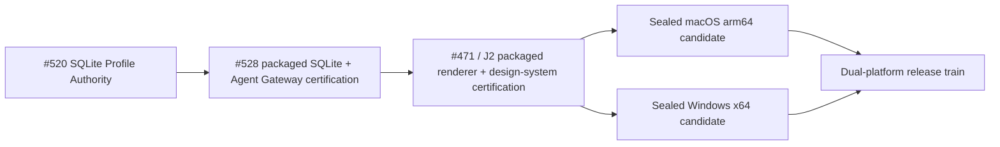
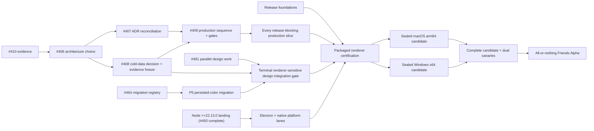

# Cross-Epic Dependency Contract: Friends Alpha Release, Performance, and Design

> **Supersession — 2026-07-22.** The binding hand-off described below is
> historical evidence, not the current release contract. #410, #491, #408, and
> #409 are closed/resolved and no longer gate this release. The SQLite Profile
> Authority (#520) is the live storage engine; legacy pre-Alpha JSON migration
> #464 is retired. Use the toolchain pinned by the repository manifest rather
> than historical toolchain values in this note.

Status: reconciled companion to the canonical [release spec #448](https://github.com/limweili/eido/issues/448).

## Current live cross-epic contract

The live native blocked-by graph is executable truth. The sole live external
tracker dependency for #448 is the SQLite Profile Authority epic **#520**, whose
open packaged certification gate **#528** is the required producer for the
historical renderer/design certification slice **#471** (now J2 in #448's
execution fan-out map). #410 and #491 are delivered, frozen inputs, not live
producers; #408 and #409 are resolved historical evidence only.

### External dependency ledger

### Current ownership boundary

| Concern | Owner | Release-team constraint |
| --- | --- | --- |
| Live storage engine, Profile authority, and Agent Gateway | #520 | Consume #528's exact-candidate-SHA evidence; do not recreate storage or migration work. |
| Packaged SQLite/Agent Gateway certification | #528 under #520 | Must complete before #471/J2; its evidence is bound to the candidate SHA. |
| Packaged renderer + design-system certification | #471 / J2 | Reuse the closed, frozen renderer and design-system inputs after #528. |
| Toolchain | Repository manifest | Workflows and release evidence read the manifest; prose does not duplicate its pins. |
| Shell, packaging, updater, website, and release service | #448 release lanes | Build the release system without reopening delivered renderer, design, or storage scope. |

### Current start and hold matrix

| Work | Start now? | External condition |
| --- | --- | --- |
| Release foundations and release lanes | Yes | No renderer/design-system/storage reimplementation. |
| Work using the toolchain | Yes | Read the toolchain pinned by the repository manifest. |
| Packaged SQLite Profile + Agent Gateway certification | Owned externally | #528 remains open and authoritative under #520. |
| Packaged renderer + design-system certification (#471/J2) | Hold | Requires #528 evidence on the exact candidate SHA. |
| Sealed candidates, update matrices, canaries, and release | Hold | Inherit the #528 → #471/J2 certification chain. |

## Historical 2026-07-18 hand-off evidence (superseded)

External producers:

- [performance epic #410](https://github.com/limweili/eido/issues/410); and
- [design-system epic #491](https://github.com/limweili/eido/issues/491).

Last reconciled: 2026-07-18 (Australia/Sydney)

### The rule future agents were not to simplify

#410 is **not** a blanket blocker for starting the release program. Persistence,
recovery, shell security, updater foundations, signing setup, the public binary
repository, website, founder coaching, and release-state machinery may proceed in
parallel.

#408's completed renderer evidence is parallel context for Node, Electron, and
storage work. It contributes no blocking edge to those lanes absent a concrete
renderer-correctness mechanism.

#491 is also **not** a blocker for starting #448. Design work may proceed in
isolated worktrees and draft PRs alongside #410, but renderer-sensitive changes
to fonts/text metrics, Board/CardShell/card geometry, connections, canvas painter
palettes, theme rendering, camera motion, or performance fixtures must not merge
to `main` before #408 closes and the #410 evidence baseline is frozen.

[#409](https://github.com/limweili/eido/issues/409) is planning only. It emits an
agent-sized production implementation sequence and packaged-performance gates.
Closing #409 does not mean the selected renderer has been implemented. The
packaged-renderer certification ticket, both sealed platform candidates, both
real-device canaries, and final publication wait for **every production issue
that #409 classifies as release-blocking** and the Alpha-required #491 production
design system.

### Historical ownership boundary

| Concern | Owner | Release-team constraint |
| --- | --- | --- |
| Reading-band residency and representation | #410 | Do not select or enable a candidate. |
| Runtime image renditions, warming, decoded-surface residency, and eviction | #410 | Do not implement these as part of the disk blob split. |
| Cold-data loading decision | #408/#410 | Preserve complete logical data; do not preselect lazy loading. |
| Tokens, primitives, fonts, visual/a11y behavior, themes, and painter palette contract | #491 | May develop in parallel; hold renderer-sensitive merges until #408 freezes evidence. |
| P5 assigned on-color mapping | #491 | Specify the deterministic mapping and visual result; do not write save files directly. |
| P5 durable saved-color migration | #448 ticket #464 / Persistence Engine | Apply through the ordered backup-first migration registry under the Save File SOP. |
| P7 Light/Dark/Match-system preference | #491, stored by the desktop settings owner | Keep it device-local; never add it to `SavedBoard` or sync-ready graph identity. |
| Authoritative disk metadata and content-addressed blobs | #448 persistence lane | Keep `SavedBoard` payload-compatible at the renderer boundary. |
| Electron shell, typed bridge, security, signing, updater, website, and release service | #448 release lane | Wrap current main without changing Board Scene behavior. |
| Packaged performance policy | #409 | Consume it only after its required production implementation lands. |

The Board remains the sole saved graph. Renderer caches and representation state
are rebuildable and never become authoritative persistence merely because the
desktop app can write files.

Friends Alpha v1 is the long-term compatibility floor. The current pre-Alpha
`~/.eido/eido-v3-ideas.json` format is the one supported source migration into
that floor because it contains current founder/friends data. Every schema actually
shipped from Alpha v1 onward remains forward-migratable. Removed v1/v2 and other
unidentified abandoned prototype formats have no support promise and must never
be silently normalized into authoritative data.

### Historical dynamic blocker handoff

When #409 is ready to close, its final body or handoff comment must contain:

1. the selected architecture and the exact evidence that selected it;
2. the canonical packaged measurement policy;
3. a list of production implementation issues classified as
   `release-blocking`, `optional`, or `deferred`;
4. a reason for every optional/deferred issue, including an explicit no-change
   result if #408 rejects cold-data work; and
5. the fallback/rollback boundary for each required slice.

The release team then:

1. re-reads #410, #409, their child issues, associated PRs, and exact-head CI;
2. adds every `release-blocking` issue as a native GitHub blocker of the packaged
   renderer certification ticket;
3. records every required and excluded issue in the release manifest's external
   dependency ledger;
4. verifies that each required issue is closed by a merged PR present on the
   exact candidate SHA; and
5. refuses promotable preflight if the list is missing, empty without an explicit
   no-change decision, unresolved, stale, or represented only by prose.

Parent/sub-issue relationships do not propagate blockers. Native blocked-by
edges belong on the actual ticket that cannot start. Do not mark the whole #448
epic blocked by #410: that would incorrectly hide the safe parallel frontier.

#491 itself is a native blocker of #471 now so the release fails closed before
design fan-out exists. When #491 is fanned out, create one terminal
renderer-sensitive design integration issue. That issue is blocked by #408,
every Alpha-required design slice, and the P5 migration issue; P5 is blocked by
#464. Add the terminal issue as another native blocker of #471. Keep the #491
parent edge until its closure semantics and complete child set have been
re-derived from the live tracker.

### Historical toolchain and evidence handoff

The retained #410 comparison artifacts keep the older toolchain provenance with
which they were captured. The repository toolchain then recorded through #450
has since been superseded; consult the repository manifest for the current
authority. Merged #408 completed the renderer-sensitive evidence
gate by keeping eager `SavedBoard` loading and selecting no on-demand payload
seam. Platform-neutral shell work must preserve that frozen result and the
current renderer.

Package manifests, lockfiles, Node configuration, common CI, and performance
workflows remain serialized hotspots with one named owner. Dependency changes
must use the toolchain pinned by the repository manifest and re-run exact-head
gates. Renderer-sensitive
#491 changes to font metrics, Board/card geometry, connections, canvas palettes,
theme-dependent rendering, camera motion, or performance fixtures must preserve
the frozen #408/#410 result or explicitly supersede its evidence.

### Historical merge-hotspot protocol

The following areas require one named owner and serialized merges:

- package manifest, npm lockfile, Node configuration, and shared workflows;
- Board Scene and performance harnesses;
- the design token module, self-hosted fonts, global styles, CardShell/card
  geometry, connection paint/hit geometry, and canvas painter palettes;
- `SavedBoard`, graph, asset, and hydration contracts;
- Electron-builder common configuration versus target-specific Mac/Windows
  adapters;
- release policy, workflow policy, manifest, and release-profile documentation.

Persistence owns on-disk blobs. #410 owns runtime rendition/cache behavior. The
secure Electron-shell ticket owns shared platform-neutral packaging; macOS and
Windows lanes own disjoint target configuration and native workflows. A ticket
touching another lane's hotspot must pause, declare the overlap in its issue, and
agree landing order before editing.

The sealed macOS and Windows jobs are parallel artifact builds from one frozen
source SHA, not separate source-changing branches. Any source, version, lockfile,
dependency-ledger, or selected-renderer change supersedes both candidates and
requires a new never-reused version.

### Historical start and hold matrix

| Work | Start now? | External condition |
| --- | --- | --- |
| Contracts, storage fixtures, binary repository | Yes | None |
| Persistence engine, recovery, blobs, archives | Yes, after their internal blockers | Preserve `SavedBoard`; coordinate shared types |
| Website and founder coach | Yes, after internal blockers | No browser editor; identity actions remain coached |
| #491 non-landing design implementation | Yes | Preserve the frozen #408/#410 result |
| #491 renderer-sensitive landing | Yes, after #408 | Preserve the frozen evidence and satisfy remaining design-lane blockers |
| P5 persisted-color migration | No, until its platform seam exists | #464 migration registry green; backup-first Save File SOP |
| Historical toolchain transition | Complete via #450 | Superseded; use the repository manifest for current toolchain authority |
| Secure Electron shell and native lanes | Yes, after #450 | Treat #408/#410 renderer evidence as parallel context; preserve current renderer behavior without making it a shell blocker |
| Combined packaged certification | No | #409 + #410 + every generated release-blocking renderer issue + #491 + terminal design gate |
| Sealed candidates, update matrices, canaries, final release | No | Inherit packaged-certification join |

### Historical external non-code gates

Release automation cannot replace these founder/provider facts:

- stable Apple publisher identity and Developer ID enrollment;
- Australian-eligible Windows Authenticode provider and stable publisher identity;
- least-privilege GitHub App access to the public binary repository;
- one named real Apple Silicon canary and one named real Windows x64 canary,
  including exact OS versions;
- approved native CI/signing budget; and
- remote performance-provider evidence required by #410.

Internal smoke builds without an Eido publisher identity are allowed only when
mechanically non-promotable: the Windows main executable stays `NotSigned`
without stripping upstream vendor signatures, while macOS may carry only the
ad-hoc seal required after fuse mutation and must have no TeamIdentifier. No
release agent may coach users to bypass Gatekeeper, SmartScreen,
signing, notarization, a missing platform, persistence safety, or renderer gates.

### Historical release-captain fail-closed checklist

Before producing either sealed candidate, the Desktop Release Captain must prove:

- native GitHub blockers match the current #409 classification;
- every required renderer issue is merged into the exact source SHA;
- #491 and its terminal integration gate are closed by merges present on that
  same exact source SHA;
- the selected path is enabled in production and rejected prototypes are inert;
- both packages pass #409's fidelity, accessibility, interaction, image, memory,
  repeated-traversal, and performance gates plus #491's token/painter parity,
  packaged-offline-font, keyboard, screenshot, and performance gates in Light
  and Dark themes, with Match-system behavior verified;
- the exact same frozen source SHA produced both target artifacts;
- pre-#410/#491 Boards retain behavior and data compatibility through the
  supported eido-v3-to-Alpha-v1 path and Alpha-v1-forward migrations;
- P7 remains a device-local preference outside `SavedBoard`;
- ticket-23 combined renderer/design evidence is fresh and bound to both target
  artifacts; and
- missing or stale evidence produces a dual-platform `NO-GO`.

This contract is deliberately stricter than a human reminder. Future agents must
encode it in native issue links, the release manifest, executable preflight, and
the Cross-Epic Dependency and Hotspot SOP.
