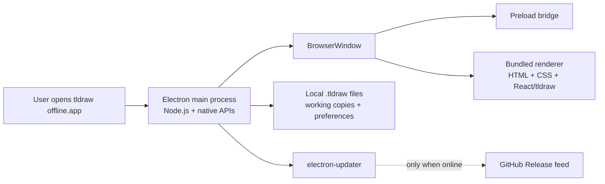
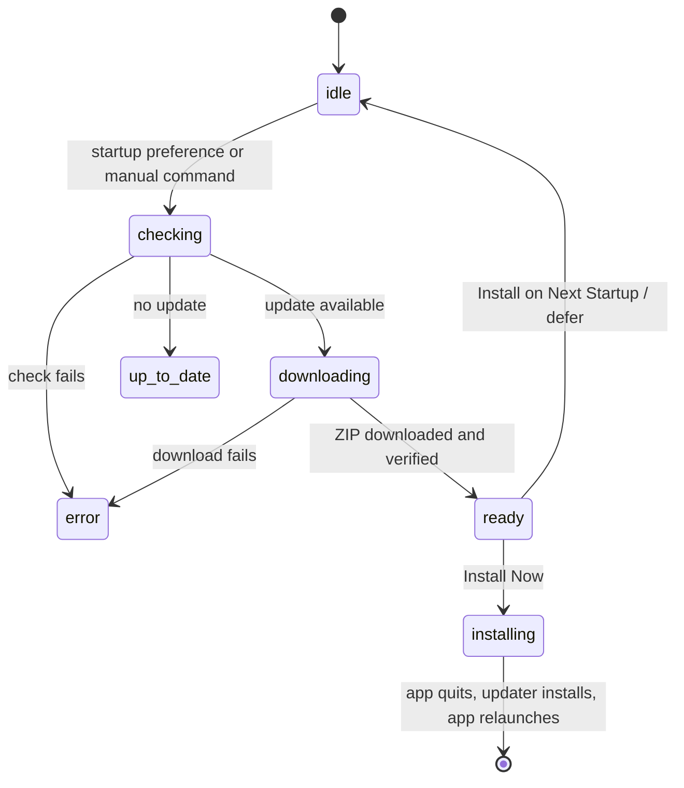
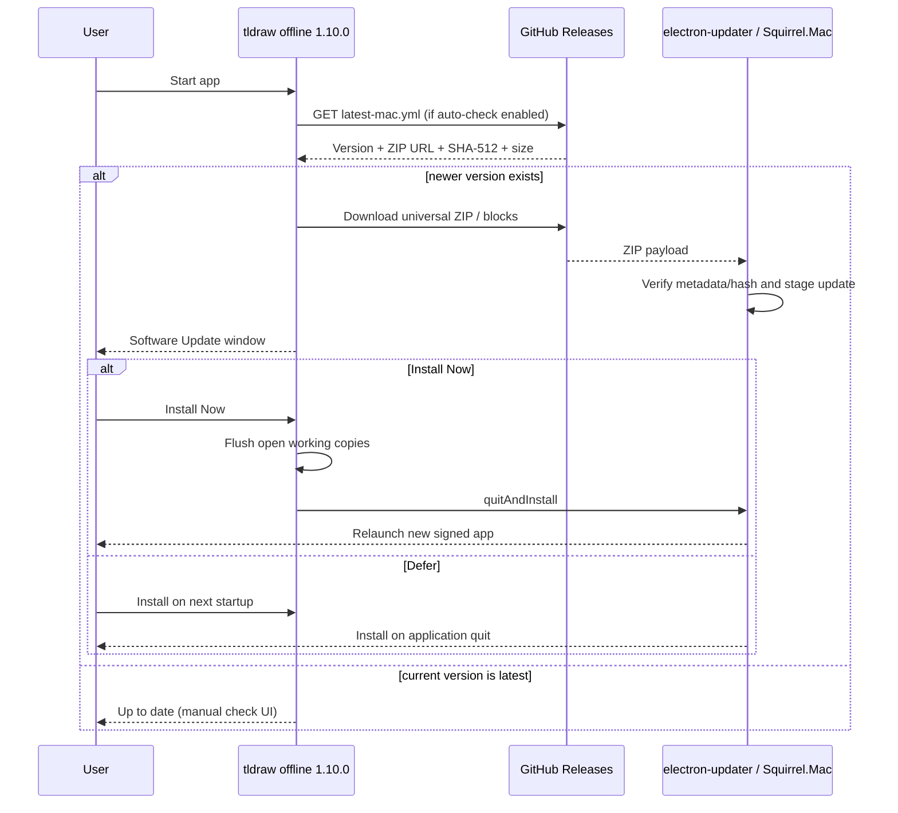
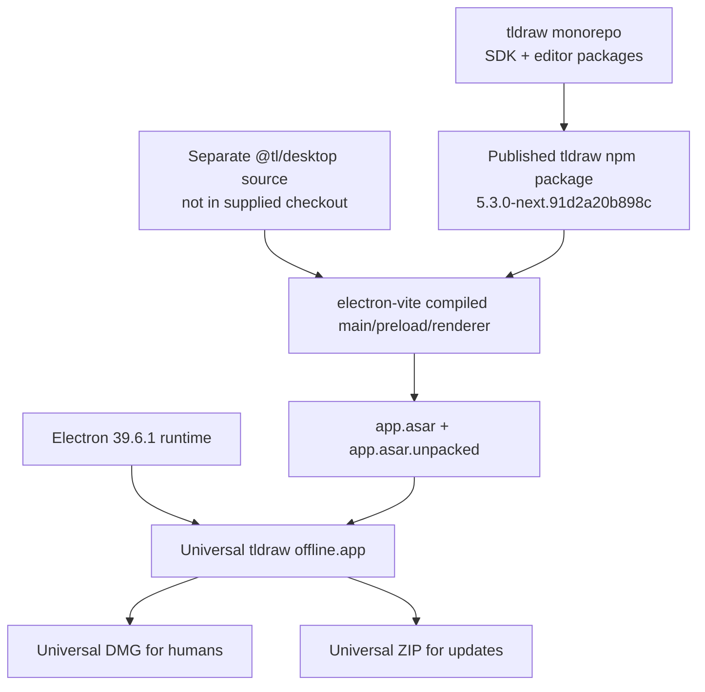
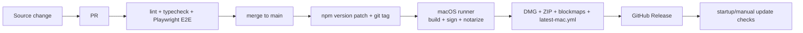

# tldraw offline macOS artifact forensics

**Artifact inspected:** `/Users/weili/Downloads/tldraw-offline-mac-universal.dmg`
**Inspection date:** 2026-07-17 (Australia/Sydney)
**Method:** read-only disk-image mount and static bundle inspection. The application was **not launched**.
**Source checkout supplied for comparison:** `/Users/weili/Documents/Projects/eido/research/repos/tldraw`
**Scope:** macOS packaging, runtime composition, update mechanism, signing/notarization, and what can or cannot be inferred about the release pipeline.

## Executive finding

The downloaded macOS package is a conventional, production-grade Electron direct-download application:

1. The DMG is a compressed, read-only drag-install volume containing a universal `tldraw offline.app` and an `/Applications` shortcut.
2. The app ships its own universal Electron 39.6.1 runtime, compiled main/preload/renderer bundles, production dependencies, and native modules. It loads the renderer from a bundled local HTML file rather than from `tldraw.com`.
3. The web application code is stored in `Resources/app.asar`; native modules and selected resources sit beside it in `app.asar.unpacked`.
4. The app is Developer ID signed, hardened-runtime enabled, notarized, and has a ticket stapled to the **app bundle**. Gatekeeper accepts it as `Notarized Developer ID`.
5. The outer DMG itself is neither code-signed nor stapled. The nested app is the trust-bearing object. This is consistent with the historical tldraw electron-builder configuration (`dmg.sign: false`), but the exact current build configuration is not public.
6. Updates use `electron-updater` 6.6.2. On startup (unless the user disables the preference), the app asks the public `tldraw/tldraw-offline` GitHub Release endpoint for update metadata, downloads a signed ZIP in the background, then lets the user install now or defer until quit/restart. The release also publishes a DMG for humans and blockmaps/metadata for the updater.
7. The supplied `research/repos/tldraw` checkout is the **core tldraw SDK monorepo**, not the desktop-shell source. The packaged app is a separate `@tl/desktop` product which consumes a published `tldraw` package. The current desktop source and current CI workflow are not publicly visible in the distribution repository.
8. A historical public branch in `tldraw/tldraw-offline` contains an older desktop implementation and release workflow. It is useful corroborating evidence for the technology choices, but it must not be presented as the exact v1.10.0 pipeline.

Two security-relevant observations deserve explicit follow-up if Eido emulates this architecture:

- The renderer is configured with `sandbox: false`. Electron recommends renderer sandboxing where compatible.
- Although `ElectronAsarIntegrity` metadata is embedded, the `EnableEmbeddedAsarIntegrityValidation` and `OnlyLoadAppFromAsar` Electron fuses are both disabled, so Electron is not enforcing ASAR integrity at runtime. The macOS code signature still seals the signed bundle, but the additional Electron runtime defense is not active.

These are not reasons to reject Electron. They are examples of why Eido should copy the proven distribution shape while defining a stricter security baseline rather than cloning every tldraw setting.

---

## 1. Evidence discipline

This note uses three labels:

- **Observed:** directly read from the supplied DMG, its mounted app bundle, the extracted ASAR, the official GitHub Release API, or the supplied local checkout.
- **Interpreted:** a conclusion supported by observed facts plus an official framework/vendor source.
- **Unknown:** not recoverable from the artifact or current public repositories; it must not be treated as fact.

No process list or already-installed copy of tldraw was used as evidence. The artifact was mounted read-only at `/tmp/tldraw-offline-mount`; the app was never executed.

---

## 2. Artifact identity and disk-image layout

### 2.1 Download identity

**Observed**

| Property | Value |
| --- | --- |
| Filename | `tldraw-offline-mac-universal.dmg` |
| File size | 232,750,025 bytes (about 222 MiB) |
| SHA-256 | `e15f6534531fee2cf55d3ca811db0fc3939dbc0402075e0d6b2887a4aeef8e1a` |
| Disk image format | UDIF read-only compressed, zlib (`UDZO`) |
| Expanded image size | 635,280,384 bytes |
| Filesystem | HFS+ in a GUID partition map |
| Encrypted | No |
| Checksummed | Yes, CRC32 |
| Download origin xattr | `https://offline.tldraw.com/`, resolving to a GitHub Release asset |
| Quarantine xattr | Present; downloaded by Chrome |

The SHA-256 exactly matches the digest published by GitHub for the v1.10.0 release asset. See the official [v1.10.0 release](https://github.com/tldraw/tldraw-offline/releases/tag/v1.10.0).

This matters because every later observation is tied to the official release byte-for-byte, rather than to an unidentified file with the same name.

### 2.2 Mounted volume

**Observed**

The read-only mount contains:

```text
tldraw offline.app
Applications -> /Applications
.background.tiff
.VolumeIcon.icns
.DS_Store
```

**Interpreted**

This is the standard macOS “drag the app onto Applications” distribution pattern. The DMG is an installer experience/container, not a package installer that runs privileged installation scripts.

The app is about 599 MiB expanded. Roughly 456 MiB is under `Contents/Frameworks` and 143 MiB under `Contents/Resources`. Electron’s bundled Chromium/runtime dominates the installed size; the compressed DMG is much smaller.

---

## 3. App-bundle anatomy

### 3.1 Bundle metadata

**Observed from `Contents/Info.plist`**

| Property | Value |
| --- | --- |
| Product/display name | `tldraw offline` |
| Bundle identifier | `com.tldraw.desktop` |
| App version | `1.10.0` |
| Build version | `1.10.0` |
| Minimum macOS | 12.0 |
| Category | `public.app-category.developer-tools` |
| Main executable | `Contents/MacOS/tldraw offline` |
| File types | `.tldraw` and legacy `.tldr`, both registered as editor documents |
| SDK recorded | macOS 15.5 SDK, Xcode 16.4 build metadata |
| Camera/microphone/documents/downloads declarations | Present |
| ATS | Arbitrary loads allowed, with localhost exceptions also declared |
| ASAR integrity dictionary | Present for `Resources/app.asar` |

The main executable, Electron framework, and all four Electron helper applications contain both `x86_64` and `arm64` Mach-O slices.

**Interpreted**

One universal `.app` runs natively on both Intel and Apple Silicon Macs. electron-builder documents `universal` as a fat binary containing both architectures and notes that macOS Squirrel updates require both DMG and ZIP targets; see [electron-builder macOS targets and universal builds](https://www.electron.build/mac/).

### 3.2 Electron runtime

**Observed**

- Electron Framework version: **39.6.1**.
- Electron Framework binary size: 365,428,992 bytes.
- Bundled frameworks include:
  - `Electron Framework.framework`
  - `Squirrel.framework`
  - `Mantle.framework`
  - `ReactiveObjC.framework`
- Bundled helpers include generic, Renderer, GPU, and Plugin helper apps.

**Interpreted**

The desktop program is not “a website opened in the user’s installed browser.” It brings its own browser engine and native application process. Electron’s official process model has one privileged Node.js main process that owns application lifecycle and windows, plus a web renderer per window and a preload bridge between them. See [Electron’s process model](https://www.electronjs.org/docs/latest/tutorial/process-model).



### 3.3 ASAR payload

**Observed**

`Contents/Resources/app.asar` is 116,368,153 bytes and contains 15,875 listed paths. Its top-level shape is:

```text
package.json
out/main/index.js
out/preload/index.cjs
out/renderer/index.html
out/renderer/assets/*
node_modules/*
resources/*
```

The packaged `package.json` identifies the app as:

```json
{
  "name": "@tl/desktop",
  "version": "1.10.0",
  "productName": "tldraw offline",
  "main": "./out/main/index.js"
}
```

Notable production dependencies include:

- `electron-updater` 6.6.2
- `tldraw` `5.3.0-next.91d2a20b898c`
- `@tldraw/sync-core` at the same version
- React 19.2.6
- `@parcel/watcher` 2.5.6
- `@sentry/electron` 7.15.0
- `zod`, `p-queue`, and local tldraw workspace libraries

`app.asar.unpacked` is about 1.9 MiB. It carries architecture-specific `@parcel/watcher` native `.node` binaries and image resources that need real filesystem paths.

**Interpreted**

Electron treats `app.asar` as a virtual, read-only application directory. Native modules and APIs that need real paths must be unpacked beside it. This is exactly the structure described in Electron’s [application packaging](https://www.electronjs.org/docs/latest/tutorial/application-distribution/) and [ASAR archive](https://www.electronjs.org/docs/latest/tutorial/asar-archives) documentation.

ASAR is packaging, not source-code encryption. The archive was listable and extractable without a secret. It reduces loose-file sprawl and improves loading, but it does not make a semi-open or closed app impossible to inspect.

### 3.4 Production renderer is bundled locally

**Observed from the compiled main bundle**

- In development the app can load `ELECTRON_RENDERER_URL`.
- In production it calls `BrowserWindow.loadFile(...)` for the bundled `out/renderer/index.html`, with an in-app route hash.
- The default window config attaches the bundled preload and explicitly sets `sandbox: false`.
- The preload passes a restricted `MessagePort` into the renderer instead of assigning the full Electron API to `window`.

**Interpreted**

The core editor starts and renders without a web server or live website. “Offline” here means the application and user documents are local. Electron security guidance still matters because the renderer has more potential privilege than a normal browser tab; Electron recommends context isolation, renderer sandboxing, restricted navigation, current Electron versions, sender validation, restrictive IPC, and reviewing fuses. See the official [Electron security checklist](https://www.electronjs.org/docs/latest/tutorial/security).

### 3.5 Additional local runtime service

**Observed**

The app also starts an agent-facing HTTP server on loopback only:

- Preferred address: `127.0.0.1:7236`; falls back to an ephemeral loopback port if occupied.
- A fresh 32-byte random bearer token is required for API routes.
- Connection information is written to `server.json` in the app’s user-data directory with mode `0600` where supported.
- The server is removed/closed on a clean quit.

**Interpreted**

This is not a cloud dependency and does not violate offline operation; it is a local integration surface for coding agents. It does, however, add a network-shaped local attack surface that needs authentication, lifecycle cleanup, and tests. Eido does not need this server merely to package its web UI as Electron.

---

## 4. How the macOS update path actually works

### 4.1 Embedded update configuration

**Observed**

`Contents/Resources/app-update.yml` contains:

```yaml
owner: tldraw
repo: tldraw-offline
provider: github
updaterCacheDirName: '@tldesktop-updater'
```

The compiled `UpdateManager` then explicitly configures the updater as a generic feed at:

```text
https://github.com/tldraw/tldraw-offline/releases/latest/download
```

and sets:

```text
autoDownload = true
autoInstallOnAppQuit = true
```

The app preference `autoCheckUpdates` defaults to `true`. Initialization performs a check when that preference is enabled. Menus also expose “Check for Updates…” and a toggle for automatic checks.

### 4.2 Published release assets

**Observed from the official v1.10.0 GitHub release**

The public release publishes, together:

- Human macOS installer: `tldraw-offline-mac-universal.dmg`
- macOS updater payload: `tldraw-offline-mac-universal.zip`
- `latest-mac.yml`
- DMG and ZIP `.blockmap` files
- Windows x64, Windows Arm64, and combined installers plus blockmaps
- Linux AppImage/Debian artifacts and `latest-linux.yml`

`latest-mac.yml` declares version 1.10.0, a SHA-512 and byte size for both the ZIP and DMG, and chooses the ZIP as its `path`:

```yaml
version: 1.10.0
files:
  - url: tldraw-offline-mac-universal.zip
    sha512: oliP2eKfXDGu5gsY4cPBUxTnFOSr6zUZXfpGaesFPkpfgcKceL0+pW9E4uU1za9fUcaver3+oTxbdEeMUazS3w==
    size: 224184507
  - url: tldraw-offline-mac-universal.dmg
    sha512: +lEmwRLgPzut5HBsVbOP5iffc4A17A+mlCUdTUtUUl4mASO5J99BcPhaCjgcwKC6r+LprQ77vaDK3BzLc1VEJA==
    size: 232750025
path: tldraw-offline-mac-universal.zip
```

electron-builder explains that the ZIP target is required for Squirrel.Mac and that `latest-mac.yml` is generated for update clients; see its [auto-update guide](https://www.electron.build/docs/features/auto-update/) and [macOS target guide](https://www.electron.build/mac/).

### 4.3 User-visible update state machine

**Observed**

The compiled app has an explicit update state machine:



When a release is ready, a dedicated “Software Update” window offers:

- **Install Now**: flushes pending window/document state, arms an exit backstop, calls `quitAndInstall(false, true)`, and restarts the app.
- **Install on Next Startup**: defers the explicit install. Because `autoInstallOnAppQuit` is enabled, the staged update installs as the app exits; the next launch uses the new version.

Download progress is broadcast to renderer windows. Errors and “up to date” are user-visible. Automatic checking can be disabled.

### 4.4 Control-plane diagram



### 4.5 What “offline” does and does not mean

**Observed**

- The editor and files work without an internet connection.
- The app checks GitHub for updates when online unless disabled.
- Packaged production builds initialize Sentry with a hosted DSN.
- The app contains a hosted feedback endpoint and external documentation/community links.
- Optional web embeds can request YouTube.

**Interpreted**

tldraw offline is **offline-capable**, not air-gapped or zero-network. The product data plane is local; the release/telemetry/documentation control plane is online. Eido should use similarly precise language and decide separately whether telemetry is opt-in, opt-out, or absent.

---

## 5. Signing, hardened runtime, Gatekeeper, and notarization

### 5.1 App signature

**Observed**

`codesign -dvvv` reports:

| Property | Value |
| --- | --- |
| Identity | `Developer ID Application: Stephen Ruiz (GA4TBD8ZNW)` |
| Team identifier | `GA4TBD8ZNW` |
| Bundle identifier | `com.tldraw.desktop` |
| Signature hash | SHA-256 |
| Secure timestamp | 17 July 2026 02:46:40 local displayed time |
| Hardened runtime | Enabled (`flags=0x10000(runtime)`) |
| Notarization ticket | Stapled |

The leaf certificate is valid from 2025-01-06 to 2027-02-01. Its SHA-256 fingerprint is:

```text
A2:FD:2D:41:5B:A8:64:D3:E9:74:FD:1A:71:FF:F2:D2:19:BA:DF:D8:52:90:54:9E:AD:3A:62:44:22:F6:18:E6
```

All nested helper apps and frameworks inspected were signed by the same Developer ID team.

Verification results:

```text
codesign --verify --deep --strict: valid on disk; satisfies Designated Requirement
spctl --assess --type execute: accepted; source=Notarized Developer ID
xcrun stapler validate <app>: The validate action worked!
```

Apple states that direct-download software uses a Developer ID signature, hardened runtime, notarization, and optionally a stapled ticket so Gatekeeper can establish identity and malware-check status. Stapling also lets the ticket be found when the Mac is offline. See Apple’s [Developer ID overview](https://developer.apple.com/support/developer-id/), [notarization workflow](https://developer.apple.com/documentation/security/notarizing-macos-software-before-distribution), and [custom notarization/stapling guide](https://developer.apple.com/documentation/security/customizing-the-notarization-workflow).

### 5.2 Entitlements

**Observed**

The main app and helpers carry three hardened-runtime exceptions:

```xml
<key>com.apple.security.cs.allow-jit</key><true/>
<key>com.apple.security.cs.allow-unsigned-executable-memory</key><true/>
<key>com.apple.security.cs.allow-dyld-environment-variables</key><true/>
```

The app is **not** App Sandbox entitled. This is normal for a direct-download Electron app that needs broad local file access; App Sandbox is optional outside the Mac App Store.

**Interpreted**

- JIT is expected for Chromium/V8.
- Unsigned executable memory is a broader exception that Electron builds sometimes require.
- Allowing DYLD environment variables weakens a hardened-runtime boundary and should be retained only if a tested runtime requirement exists. Apple advises using only necessary hardened-runtime exceptions; see [Hardened Runtime](https://developer.apple.com/documentation/Security/hardened-runtime). The historical tldraw entitlements file includes the same three keys, so this appears deliberate rather than accidental.

### 5.3 Outer DMG trust

**Observed**

The outer DMG itself reports:

```text
codesign: code object is not signed at all
stapler: does not have a ticket stapled
spctl --type open --context context:primary-signature: rejected, source=no usable signature
```

The nested app, by contrast, passes all signature, notarization, and Gatekeeper checks.

**Interpreted**

The DMG is a transport/installation shell; the app is the signed execution unit. Apple permits notarizing/stapling apps, disk images, or installer packages. The current artifact’s app-level ticket is enough for offline Gatekeeper verification of the copied app. Signing/notarizing the DMG too would add container-level provenance, but it is not evidence that the app is unsigned or unusable.

The historical tldraw electron-builder configuration explicitly used `dmg.sign: false`, consistent with this result. Whether the v1.10.0 current private builder still has that literal setting is unknown.

### 5.4 ASAR integrity and Electron fuses

**Observed**

`Info.plist` includes an `ElectronAsarIntegrity` SHA-256 header hash. However, a static `@electron/fuses` read of the packaged app reports:

```text
RunAsNode: Enabled
EnableCookieEncryption: Disabled
EnableNodeOptionsEnvironmentVariable: Enabled
EnableNodeCliInspectArguments: Enabled
EnableEmbeddedAsarIntegrityValidation: Disabled
OnlyLoadAppFromAsar: Disabled
LoadBrowserProcessSpecificV8Snapshot: Disabled
GrantFileProtocolExtraPrivileges: Enabled
```

**Interpreted**

The embedded integrity metadata alone does not activate runtime ASAR validation. Electron documents that `EnableEmbeddedAsarIntegrityValidation` must be enabled and recommends pairing it with `OnlyLoadAppFromAsar` so Electron cannot fall back to unvalidated loose code. See [ASAR Integrity](https://www.electronjs.org/docs/latest/tutorial/asar-integrity) and [Electron Fuses](https://www.electronjs.org/docs/latest/tutorial/fuses).

This is a concrete area where Eido can adopt a stronger default than the observed tldraw build:

```text
RunAsNode = disabled (unless proven necessary)
NodeOptionsEnvironmentVariable = disabled
NodeCliInspectArguments = disabled
EmbeddedAsarIntegrityValidation = enabled
OnlyLoadAppFromAsar = enabled
```

Those choices must be tested against Eido’s main-process child-process requirements before release.

---

## 6. Relationship to the supplied tldraw source checkout

### 6.1 What the checkout is

**Observed**

The supplied checkout:

```text
/Users/weili/Documents/Projects/eido/research/repos/tldraw
HEAD 846e39a811fbaa43199d1e7e9a424413225a9f80
packages/tldraw/package.json version 5.1.1
```

It contains the tldraw SDK/monorepo. Searches for `@tl/desktop`, `tldraw-offline`, `electron-updater`, and `app-update.yml` return no desktop wrapper implementation at that checked-out revision.

The packaged desktop app instead declares `tldraw@5.3.0-next.91d2a20b898c`. The npm registry identifies that package’s `gitHead` as `91d2a20b898ce53ae1f8cba68119307ce88136aa`; that commit exists in the local git object database and postdates the checked-out working tree.

**Interpreted**

The dependency relationship is:



tldraw offline is therefore not simply the tldraw website repo passed to a one-command wrapper. It is a separate desktop product that consumes the tldraw SDK and implements desktop-native file lifecycle, recovery, menus, updater UI, agent integration, signing, and packaging.

### 6.2 Public distribution repository versus source repository

**Observed**

The official [tldraw/tldraw-offline](https://github.com/tldraw/tldraw-offline) `main` branch contains only `README.md`. The README explicitly says the app is not open source. The repository has no workflows registered on `main` and no public Actions runs. Its latest release was authored by GitHub App user `tldraw-desktop[bot]`.

The distribution repo’s latest release contains all platform artifacts and metadata, but not the source used to build them.

**Interpreted**

The current architecture likely separates:

- a private source/build repository;
- a public download/update repository (`tldraw/tldraw-offline`);
- a GitHub App/bot credential that publishes finished artifacts to the public repository.

This is supported by the release bot identity, absence of release workflows in the public repo, and a historical publish script that generated a GitHub App installation token. It remains an **inference** because the exact current private workflow is not observable.

---

## 7. Historical public pipeline evidence — corroborating, not current truth

An unmerged public branch named `ci/automated-updates-and-release-improvements` contains an older source tree at desktop version 1.0.7. It is an official tldraw repository branch and is useful primary evidence of the project’s earlier build choices. It is not the v1.10.0 source and not the workflow currently registered on `main`.

Relevant official historical files:

- [electron-builder.yml](https://github.com/tldraw/tldraw-offline/blob/ci/automated-updates-and-release-improvements/electron-builder.yml)
- [release.yml](https://github.com/tldraw/tldraw-offline/blob/ci/automated-updates-and-release-improvements/.github/workflows/release.yml)
- [auto-release.yml](https://github.com/tldraw/tldraw-offline/blob/ci/automated-updates-and-release-improvements/.github/workflows/auto-release.yml)
- [update-tldraw.yml](https://github.com/tldraw/tldraw-offline/blob/ci/automated-updates-and-release-improvements/.github/workflows/update-tldraw.yml)
- [RELEASING.md](https://github.com/tldraw/tldraw-offline/blob/ci/automated-updates-and-release-improvements/RELEASING.md)
- [mac entitlements](https://github.com/tldraw/tldraw-offline/blob/ci/automated-updates-and-release-improvements/build/entitlements.mac.plist)

### 7.1 Historical technology stack

**Observed on that branch**

- `electron-vite` builds the main, preload, and React renderer bundles.
- `electron-builder` turns the compiled output into ASAR, apps, DMGs/ZIPs, NSIS installers, metadata, and blockmaps.
- `electron-updater` implements in-app updates.
- Playwright launches packaged Electron behavior for E2E tests.
- GitHub Actions runs lint/typecheck/E2E and builds release artifacts.
- macOS release jobs receive `CSC_LINK`, `CSC_KEY_PASSWORD`, `APPLE_ID`, `APPLE_APP_SPECIFIC_PASSWORD`, and `APPLE_TEAM_ID` as secrets.
- The configuration enables hardened runtime and notarization, supplies the same three observed entitlements, and disables DMG signing.
- A tag matching `v*.*.*` triggers the release workflow.
- A dependency-update workflow watches for tldraw npm releases, updates `tldraw` packages, runs checks, opens a PR, and enables auto-merge.
- The historical public workflow only implemented macOS builds and left Windows/Linux as TODO, despite an aspirational `RELEASING.md` describing all three platforms.

### 7.2 Historical pipeline shape



### 7.3 What changed by v1.10.0

**Observed differences**

- v1.10.0 now ships one universal macOS build rather than separate arm64/x64 artifacts.
- It ships Windows x64, Windows Arm64, a combined Windows installer, Linux x64/Arm64 AppImages, and a Linux Deb.
- The product name is now `tldraw offline`, package name `@tl/desktop`, and distribution repo `tldraw/tldraw-offline`.
- The current app has more sophisticated update UI, document/recovery behavior, SQLite-backed working-copy code, agent API, and release-state flushing than the older branch.
- The exact current source workflow is private/not public.

**Unknown**

- Which CI provider/runners build v1.10.0.
- The exact current electron-builder version and effective configuration.
- Whether current releases use tag-triggered automation, a manual dispatch, or another orchestrator.
- The current test matrix, release approvals, canary promotion, rollback SOP, secret store, SBOM/provenance generation, or retention policy.
- Whether macOS artifacts are produced by one universal build or by merging separately built x64/arm64 app bundles.
- Whether release publication is fully automatic or bot-assisted after a human/agent approval.

The artifact proves outputs and runtime behavior. It does not prove these hidden process details.

---

## 8. Release cadence observable from public artifacts

**Observed**

Recent public releases include:

| Release | Published UTC |
| --- | --- |
| v1.10.0 | 2026-07-16 16:53 |
| v1.9.0 | 2026-07-16 10:10 |
| v1.8.0 | 2026-07-12 07:17 |
| v1.7.0 | 2026-07-11 23:23 |
| v1.6.1 | 2026-07-10 17:22 |
| v1.6.0 | 2026-07-10 16:05 |
| v1.5.0 | 2026-07-10 11:10 |

Those releases are normal releases, not marked prerelease. Asset names became versionless starting around v1.6.0, which makes `/releases/latest/download/<stable-name>` practical for both downloads and the generic updater feed.

**Interpreted**

The observed distribution supports rapid release iteration and stable “latest” URLs. It does **not** expose a public staged/beta channel. A Friends Alpha can use the same simple single-channel shape, but Eido’s release captain should still gate promotion on exact-SHA macOS/Windows evidence rather than treating “latest” as a test environment.

---

## 9. Concrete lessons for Eido from the macOS artifact

### 9.1 Copy the proven shape

1. Keep the existing web UI as the renderer; add a deliberately small Electron main/preload shell.
2. Load production renderer assets locally from the packaged app.
3. Use ASAR for compiled code and keep only native modules/real-path resources unpacked.
4. Build a universal macOS app for Apple Silicon plus Intel only if Intel remains a stated target; otherwise Eido’s current friends-alpha requirement can use Apple Silicon only and save build size/complexity.
5. Publish a DMG for first install and a ZIP plus `latest-mac.yml` for auto-update.
6. Sign the app with a stable Developer ID identity, enable hardened runtime, submit to Apple notarization, staple the ticket, and fail the release if `codesign`, `spctl`, or `stapler validate` fails.
7. Use a public GitHub Release (or another static host) as the update control plane; no application server or database is required.
8. Check on startup, expose a manual update command, show progress/errors, and flush local data before `quitAndInstall`.
9. Keep the core product functional when GitHub, Sentry, documentation, or all networking is unavailable.

### 9.2 Improve on the observed security baseline

1. Enable renderer sandboxing unless an integration test demonstrates a concrete incompatibility.
2. Explicitly set `contextIsolation: true` and `nodeIntegration: false` even when they are Electron defaults.
3. Flip Electron fuses to disable unused Node/CLI escape hatches and enable ASAR validation plus ASAR-only loading.
4. Use a custom local protocol instead of privileged `file://` if feasible, matching Electron’s security guidance.
5. Avoid `NSAllowsArbitraryLoads: true`; permit only required HTTPS endpoints and localhost behavior.
6. Remove `allow-dyld-environment-variables` unless a packaged, signed test proves it is necessary.
7. Treat every preload/IPC method as a narrow capability and validate the sender.
8. Define whether telemetry exists. “Offline” should never silently imply “no network” if update checks or crash reporting remain enabled.
9. Verify release metadata hashes, code signatures, exact bundle version, architectures, native-module slices, and notarization on the sealed candidate.

### 9.3 Do not copy what is not demonstrated

- Do not assume the tldraw core repo alone contains the desktop wrapper.
- Do not infer that ASAR makes the product meaningfully closed-source.
- Do not infer a current CI workflow from the historical branch.
- Do not infer staged promotion, rollback, provenance, or complete platform testing merely because polished artifacts exist.
- Do not use the existence of an updater as evidence that save-format migrations are safe. Update installation and local-data compatibility are separate release gates.

---

## 10. Command/evidence log

All commands were read-only with respect to the supplied artifact. Temporary extraction went under `/tmp`.

### Artifact and image identity

```bash
stat -f 'size_bytes=%z ...' /Users/weili/Downloads/tldraw-offline-mac-universal.dmg
file /Users/weili/Downloads/tldraw-offline-mac-universal.dmg
shasum -a 256 /Users/weili/Downloads/tldraw-offline-mac-universal.dmg
hdiutil imageinfo /Users/weili/Downloads/tldraw-offline-mac-universal.dmg
xattr -l /Users/weili/Downloads/tldraw-offline-mac-universal.dmg
```

### Read-only mount and bundle layout

```bash
hdiutil attach -readonly -nobrowse -noautoopen \
  -mountpoint /tmp/tldraw-offline-mount \
  /Users/weili/Downloads/tldraw-offline-mac-universal.dmg
find '/tmp/tldraw-offline-mount/tldraw offline.app/Contents' -maxdepth 3 -print
du -sh '/tmp/tldraw-offline-mount/tldraw offline.app/Contents/'{Frameworks,Resources}
plutil -p '/tmp/tldraw-offline-mount/tldraw offline.app/Contents/Info.plist'
```

### Architectures and runtime metadata

```bash
file '<app>/Contents/MacOS/tldraw offline'
lipo -archs '<app>/Contents/MacOS/tldraw offline'
otool -L '<app>/Contents/MacOS/tldraw offline'
plutil -p '<app>/Contents/Frameworks/Electron Framework.framework/Versions/A/Resources/Info.plist'
file '<app>/Contents/Frameworks/Electron Framework.framework/Versions/A/Electron Framework'
```

### Signing/notarization

```bash
codesign -dvvv --entitlements :- '<app>'
codesign --verify --deep --strict --verbose=4 '<app>'
spctl --assess --type execute --verbose=4 '<app>'
xcrun stapler validate '<app>'
codesign -d --extract-certificates=/tmp/tldraw-cert- '<app>'
openssl x509 -inform DER -in /tmp/tldraw-cert-0 -noout \
  -subject -issuer -serial -dates -fingerprint -sha256

spctl --assess --type open --context context:primary-signature --verbose=4 '<dmg>'
xcrun stapler validate '<dmg>'
codesign -dvvv '<dmg>'
```

### ASAR and fuses

```bash
npx @electron/asar@3.4.1 list '<app>/Contents/Resources/app.asar'
npx @electron/asar@3.4.1 extract '<app>/Contents/Resources/app.asar' /tmp/tldraw-asar-extracted
file '<app>/Contents/Resources/app.asar.unpacked/node_modules/'**/*.node
node '<temporary @electron/fuses package>/dist/bin.js' read --app '<app>'
```

### Official public distribution metadata

```bash
gh api repos/tldraw/tldraw-offline
gh api repos/tldraw/tldraw-offline/releases/latest
curl -fsSL https://github.com/tldraw/tldraw-offline/releases/latest/download/latest-mac.yml
gh api repos/tldraw/tldraw-offline/actions/workflows
gh api 'repos/tldraw/tldraw-offline/actions/runs?per_page=20'
gh api 'repos/tldraw/tldraw-offline/git/trees/main?recursive=1'
```

### Supplied core source checkout

```bash
git -C /Users/weili/Documents/Projects/eido/research/repos/tldraw rev-parse HEAD
node -e "console.log(require('./packages/tldraw/package.json').version)"
rg -n 'tldraw-offline|@tl/desktop|electron-updater|app-update.yml' \
  /Users/weili/Documents/Projects/eido/research/repos/tldraw
npm view 'tldraw@5.3.0-next.91d2a20b898c' name version gitHead dist.integrity
```

---

## 11. Primary sources

### Direct vendor/project sources

- [tldraw offline distribution repository and README](https://github.com/tldraw/tldraw-offline)
- [tldraw offline v1.10.0 release](https://github.com/tldraw/tldraw-offline/releases/tag/v1.10.0)
- Supplied tldraw core checkout: `/Users/weili/Documents/Projects/eido/research/repos/tldraw`
- Packaged artifact and extracted compiled app under `/tmp/tldraw-offline-mount` and `/tmp/tldraw-asar-extracted` during this audit
- Historical official branch files linked in section 7

### Electron and electron-builder

- [Electron application packaging](https://www.electronjs.org/docs/latest/tutorial/application-distribution/)
- [Electron process model](https://www.electronjs.org/docs/latest/tutorial/process-model)
- [Electron ASAR archives](https://www.electronjs.org/docs/latest/tutorial/asar-archives)
- [Electron ASAR integrity](https://www.electronjs.org/docs/latest/tutorial/asar-integrity)
- [Electron fuses](https://www.electronjs.org/docs/latest/tutorial/fuses)
- [Electron security checklist](https://www.electronjs.org/docs/latest/tutorial/security)
- [Electron code signing](https://www.electronjs.org/docs/latest/tutorial/code-signing)
- [electron-builder macOS targets](https://www.electron.build/mac/)
- [electron-builder auto update](https://www.electron.build/docs/features/auto-update/)
- [electron-builder publishing](https://www.electron.build/publish/)
- [electron-builder macOS signing](https://www.electron.build/docs/features/code-signing/code-signing-mac/)
- [electron-builder macOS notarization](https://www.electron.build/docs/notarization/)

### Apple

- [Developer ID](https://developer.apple.com/support/developer-id/)
- [Notarizing macOS software before distribution](https://developer.apple.com/documentation/security/notarizing-macos-software-before-distribution)
- [Customizing the notarization workflow and stapling](https://developer.apple.com/documentation/security/customizing-the-notarization-workflow)
- [Hardened Runtime](https://developer.apple.com/documentation/Security/hardened-runtime)
- [Resolving common notarization issues](https://developer.apple.com/documentation/security/resolving-common-notarization-issues)

---

## 12. Bottom line for the parent report

tldraw validates the broad Eido direction—Electron, local bundled renderer, GitHub Release assets, platform installers, signed/notarized macOS distribution, NSIS-style Windows distribution, and `electron-updater` metadata—while correcting one oversimplification: a production offline desktop app is not merely the web repo in a wrapper. It is a separate release product with native lifecycle, local file/recovery contracts, security boundaries, cross-platform packaging, signing identities, update state, exact release artifacts, and operational automation.

For macOS specifically, the strongest directly evidenced model is:

```text
web/React editor
  + small Electron desktop product
  + local file/recovery layer
  + universal Electron runtime
  + ASAR/native module packaging
  + Developer ID signing
  + hardened runtime + reviewed entitlements
  + Apple notarization + stapled app ticket
  + DMG for first install
  + ZIP + latest-mac.yml + blockmap for update
  + GitHub Release feed
  + startup/manual updater UI
  + data flush before quit-and-install
```

Eido should preserve that shape, add stricter Electron fuses/sandbox/ATS defaults, and keep the existing exact-SHA release certification and save-migration gates. The macOS artifact does not justify weakening either gate.
