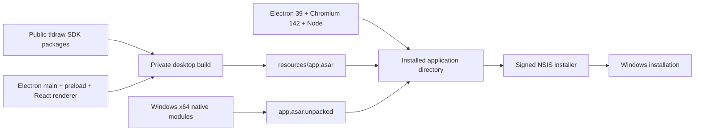
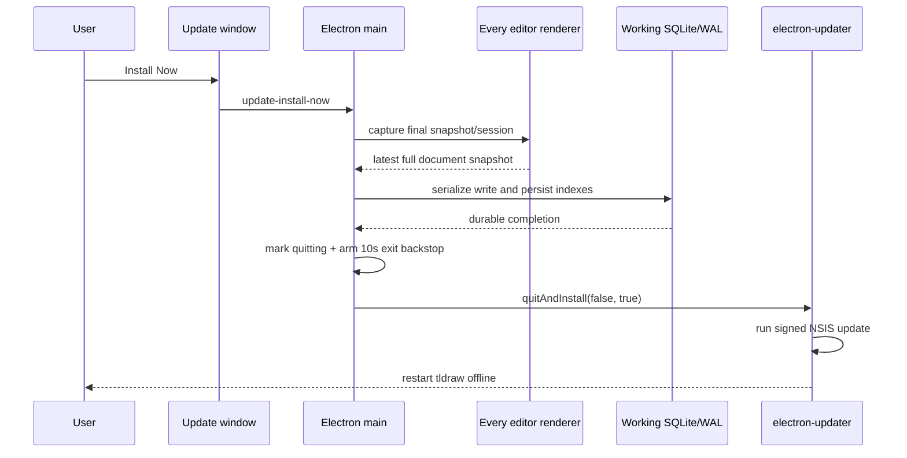

# tldraw offline v1.10.0 — Windows Artifact Forensics

Status: evidence log for the adversarial review of Eido release epic
[#448](https://github.com/limweili/eido/issues/448)

Artifact inspected:
`/Users/weili/Downloads/tldraw-offline-win-x64.exe`

Inspection date: 2026-07-17 (Australia/Sydney)

Safety boundary: **static inspection only**. The Windows installer, its extracted
application executable, and all bundled JavaScript were never executed. Archive
readers, PE metadata readers, hash functions, OpenSSL ASN.1 readers, and the
Electron fuse reader were used against copies or read-only inputs.

## Executive finding

The downloaded file is a conventional, production-grade Electron distribution:

1. a 32-bit NSIS bootstrap installer carries a 64-bit Electron application;
2. Electron and Chromium provide the local browser runtime, so the user does not
   need a system browser or a local web server;
3. the product's main process, preload, renderer, and JavaScript dependencies are
   bundled in `resources/app.asar`, while the native Windows file-watcher module is
   kept in `app.asar.unpacked`;
4. both the outer installer and inner application executable carry Authenticode
   signatures for `tldraw GB Limited`, issued under Microsoft's ID Verified public
   trust chain and timestamped by Microsoft;
5. `electron-updater` checks a static GitHub Releases URL, reads `latest.yml`,
   chooses the installer whose filename contains `process.arch`, verifies its
   SHA-512 and publisher signature, and can use the adjacent blockmap for a
   differential download;
6. tldraw checks automatically on startup by default, lets the user disable that
   behavior or check manually, auto-downloads an available update, and offers
   “Install Now” or “Install on Next Startup”;
7. update installation is coupled to an explicit durability barrier: renderer
   snapshots are captured, SQLite state is persisted, and only then does the app
   invoke `quitAndInstall`; a ten-second forced-exit backstop prevents a wedged
   updater from hanging forever;
8. “offline” means the editor and documents work without a connection, **not**
   that the binary is network-silent. The packaged artifact contains GitHub update
   checks, enabled Sentry reporting for packaged builds, a user-triggered feedback
   endpoint, external documentation links, and network-capable embeds; and
9. the public `tldraw/tldraw-offline` repository contains the manual and release
   assets but explicitly says the desktop application is not open source. The
   exact CI workflow, electron-builder configuration, signing job, and desktop
   source revision therefore cannot be audited from public source. The artifact
   itself is the evidence for those areas.

This is strong validation for Eido's core Electron + NSIS + GitHub Releases +
`electron-updater` direction. It also exposes four things Eido should do more
deliberately than this artifact can publicly prove: reproducible source-to-binary
provenance, hardened Electron fuses/sandboxing, explicit network/privacy policy,
and release certification against the exact update manifest and signed binaries.

## Evidence labels used below

- **Observed** — read directly from the supplied artifact, its extracted payload,
  the matching GitHub release, or the checked-out primary source.
- **Source-backed interpretation** — conclusion supported by observed evidence and
  official Electron/electron-builder/Microsoft documentation.
- **Unknown** — cannot be proven without executing the app on Windows, accessing
  tldraw's private desktop source/CI, or obtaining its signing/build records.

## 1. Identity and chain of custody

### Observed

| Property | Value |
| --- | --- |
| Local filename | `tldraw-offline-win-x64.exe` |
| Local size | 112,827,816 bytes (about 108 MiB) |
| Local SHA-256 | `27c78e3afaf69f3d80c2172f2bd5d64accccbb0fa3f88da82dae5b1601a23186` |
| GitHub release | [`v1.10.0`](https://github.com/tldraw/tldraw-offline/releases/tag/v1.10.0) |
| Release publication | 2026-07-16 16:53:08 UTC |
| GitHub-reported asset digest | the same SHA-256 as the local file |
| `latest.yml` SHA-512 | `QS2uLusVYxlhP3PgRbIPshYgeQEIts54PzNOsMiSD/eI7chY4lpJsbvEC6EQjX3l1w7b5L+Tjpv4Zn/cdx2K2w==` |
| Locally calculated SHA-512 | the same Base64 digest |
| Download origin recorded by macOS | GitHub release-asset CDN, initiated from `https://offline.tldraw.com/` |

The exact bytes supplied by the user match the digest published by GitHub for the
current v1.10.0 asset. This removes ambiguity about accidentally inspecting a
different version or a renamed installer.

The packaged application declares:

```json
{
  "name": "@tl/desktop",
  "version": "1.10.0",
  "productName": "tldraw offline",
  "main": "./out/main/index.js",
  "license": "UNLICENSED"
}
```

It depends on `tldraw`, `@tldraw/sync-core`, and `@tldraw/utils` version
`5.3.0-next.91d2a20b898c`. Commit
[`91d2a20b898ce53ae1f8cba68119307ce88136aa`](https://github.com/tldraw/tldraw/commit/91d2a20b898ce53ae1f8cba68119307ce88136aa)
exists in the supplied public checkout at
`/Users/weili/Documents/Projects/eido/research/repos/tldraw` and is dated
2026-07-15 09:30:24 UTC. This establishes the public SDK lineage embedded by the
desktop app; it does **not** establish the private desktop shell's source commit.

### Unknown / provenance limitation

The public [`tldraw/tldraw-offline`](https://github.com/tldraw/tldraw-offline)
repository currently exposes only `README.md` and release/tag objects. Its README
states “tldraw offline is not open source. All rights reserved.” There is no public
workflow, lockfile, electron-builder configuration, desktop source tree, SBOM, or
attestation. Moreover, the `v1.9.0` and `v1.10.0` tags currently point at the same
README-only repository commit. A tag in that repository is therefore a release
label, not public proof of the application source used for the binary.

For Eido, this is a useful counterexample: a working updater does not by itself
prove release provenance. Eido's release ledger should bind source SHA, workflow
run, dependency lock, signed artifact digests, update metadata digests, and canary
evidence together.

## 2. Installer format and Windows application payload

### Observed: outer installer

`file` identifies the artifact as:

```text
PE32 executable (GUI) Intel 80386, for MS Windows,
Nullsoft Installer self-extracting archive
```

The embedded manifest identifies `Nullsoft.NSIS.exehead` and “Nullsoft Install
System v3.04”. It requests `asInvoker`, meaning the bootstrap itself does not
unconditionally demand administrator elevation at process launch.

This 32-bit PE header is the small NSIS installer runtime, **not** evidence that
the installed application is 32-bit. Static archive extraction yields the real
application executable:

```text
tldraw offline.exe: PE32+ executable (GUI) x86-64, for MS Windows
```

Its size is 210,919,680 bytes and SHA-256 is
`e635b76174f4d043606d4f87bd94291bb09a05292d289e8da4ead317b5f4c6a6`.

The installer includes `resources/elevate.exe`. electron-builder's official
[`NsisOptions`](https://www.electron.build/docs/api/electron-builder.interface.nsisoptions/)
explains that this helper is packed by default and is required for per-machine
update/install scenarios. Its presence proves support infrastructure for
elevation, not that this specific installer always installs per-machine.

### Unknown: exact NSIS interaction mode

Static extraction does not expose tldraw's private electron-builder `nsis`
configuration. Therefore these details remain unproven:

- one-click versus assisted installer UI;
- the final per-user/per-machine selection and install path;
- shortcut choices;
- uninstall data-retention behavior; and
- custom NSIS hooks.

The `asInvoker` manifest is consistent with an installer that can run without
elevation; it is not sufficient to infer the complete mode. Official
electron-builder documentation confirms that NSIS supports both per-user and
per-machine modes and uses `elevate.exe` when needed:
[`NSIS`](https://www.electron.build/nsis/) and
[`NsisOptions`](https://www.electron.build/docs/api/electron-builder.interface.nsisoptions/).

### Observed: extracted application layout

Static extraction produced approximately 500 MiB across 207 files:

```text
tldraw offline.exe                     210,919,680 bytes
resources/app.asar                     116,379,306 bytes
resources/app.asar.unpacked/...         native @parcel/watcher files
resources/app-update.yml                       131 bytes
resources/elevate.exe                      123,136 bytes
locales/*.pak                           Chromium locale packs
chrome_*.pak, resources.pak             Chromium resources
icudtl.dat                              ICU internationalization data
ffmpeg.dll                              media runtime
libEGL.dll, libGLESv2.dll, Vulkan DLLs  graphics runtime
LICENSE.electron.txt
LICENSES.chromium.html
```

The installed app is therefore self-contained: the Electron executable embeds
Chromium 142, Node/Electron APIs, graphics/media libraries, and the product code.
It does not “open the normal browser”; it creates native windows whose contents
are Chromium-rendered HTML/CSS/React.

The Electron runtime reports these embedded versions in static strings:

```text
Electron/39.6.1
Chrome/142.0.7444.265
```

Electron's official
[`Application Packaging`](https://www.electronjs.org/docs/latest/tutorial/application-distribution/)
guide describes this exact Windows layout: a renamed Electron executable plus
`resources/app.asar`. Its
[`ASAR Archives`](https://www.electronjs.org/docs/latest/tutorial/asar-archives)
guide explains that Electron treats the archive like a read-only virtual
directory.

### Observed: ASAR contents

The `app.asar` SHA-256 is
`7b78817883ff1416b089775cc66519226af7bc0eda52297c9d4a75c763ff1f56`.
Its relevant structure is:

```text
package.json
out/main/index.js              main/OS process bundle
out/preload/index.cjs          narrow renderer transport bootstrap
out/renderer/index.html        local browser document
out/renderer/assets/*.js       code-split React UI
out/renderer/assets/*.css      product styling
node_modules/**                production JS dependencies
resources/**                   icons and product assets
```

The native `@parcel/watcher` `.node` binary and build files are placed under
`app.asar.unpacked`, as Electron recommends for native modules that require a real
filesystem path. This is directly analogous to Eido's future native dependency
handling: every native module must be rebuilt and packaged per target OS/CPU; a
single JavaScript bundle is not enough.

### Source-backed interpretation

The packaging boundary is:



This supports the architecture already proposed for Eido: keep the web renderer
as the product UI, add a small privileged Electron main process and typed preload
bridge, then package both with a platform-native installer.

## 3. Update system, exactly as shipped

### 3.1 Static update configuration

The packaged `resources/app-update.yml` contains:

```yaml
owner: tldraw
repo: tldraw-offline
provider: github
updaterCacheDirName: '@tldesktop-updater'
publisherName:
  - tldraw GB Limited
```

The bundled main process then explicitly configures `electron-updater` with a
generic static feed:

```js
autoUpdater.autoDownload = true
autoUpdater.autoInstallOnAppQuit = true
autoUpdater.setFeedURL({
  provider: 'generic',
  url: 'https://github.com/tldraw/tldraw-offline/releases/latest/download',
})
```

This means there is no tldraw application server involved in updates. GitHub
Releases is both the download host and the stable “latest” URL.

Official electron-builder documentation confirms this standard model: the build
emits `latest.yml` and artifacts, the application queries the publish location,
and `electron-updater` supports NSIS, signature validation, progress, blockmap
differential downloads, and generic HTTP/GitHub hosting:
[`Auto Update`](https://www.electron.build/docs/features/auto-update/) and
[`electron-updater`](https://www.electron.build/docs/api/electron-updater/).

### 3.2 Published v1.10.0 update set

The public release publishes all of these Windows artifacts together:

- `tldraw-offline-win-x64.exe` and `.blockmap`;
- `tldraw-offline-win-arm64.exe` and `.blockmap`;
- a combined `tldraw-offline-win.exe` and `.blockmap`; and
- `latest.yml`.

The same release publishes macOS DMG + ZIP + blockmaps and Linux AppImage/DEB +
`latest-linux.yml`. One release is therefore a multi-platform update transaction.

The current `latest.yml` declares version `1.10.0`, release date
`2026-07-16T16:51:52.649Z`, and three Windows installer URLs with SHA-512 and size.
For x64 it declares exactly the digest and size verified above.

The bundled `electron-updater` selection function filters `.exe` entries and
prefers the first pathname containing `process.arch`. On a Windows x64 runtime,
`process.arch` is `x64`, so it selects `tldraw-offline-win-x64.exe` rather than the
top-level ARM64 fallback path in the YAML.

### 3.3 Differential update evidence

The x64 blockmap is 118,642 bytes, has SHA-256
`b2ec746f62f46ecc5afd6770185ef1e49a71a72ed1291329b407e1b877fc720d`
(matching the GitHub asset digest), and is gzip-compressed blockmap schema v2.
After decompression it is 177,382 bytes and describes one file in 5,390 blocks.

The bundled `NsisUpdater` contains the expected sequence:

1. resolve the architecture-specific `.exe` from `latest.yml`;
2. request old/new blockmaps;
3. attempt a differential installer download;
4. fall back to the full installer if differential download is disabled or fails;
5. validate the declared content digest; and
6. reject an installer whose Authenticode signer does not match
   `publisherName`, with `ERR_UPDATER_INVALID_SIGNATURE`.

The blockmap is an optimization, not the trust root. The manifest digest and code
signature remain the integrity/identity controls.

### 3.4 User-visible update behavior

The packaged preferences default `autoCheckUpdates` to `true`. During app
initialization, tldraw reads the preference and checks automatically if enabled.
The native menu includes both:

- `Check for Updates…`; and
- a checked-by-default `Check for Updates Automatically` toggle.

The bundled update state machine exposes:

```text
idle → checking → downloading(progress) → ready → installing
                    ↘ up-to-date
                    ↘ error
```

`autoDownload = true`, so an available installer starts downloading without a
second user confirmation. When the download completes, the app opens a Software
Update window. It offers:

- **Install Now** — persist state, quit, install, and force the application to
  run again; or
- **Install on Next Startup** — close the update window and leave the staged
  installer ready; because `autoInstallOnAppQuit = true`, it installs when the
  application next exits, so the following startup uses the new version.

The shipped UI copy says the deferred path installs “the next time you start the
app.” Technically the staged update is applied on the intervening quit, before the
next launch.

### 3.5 Durability barrier before replacement

This artifact does more than call `quitAndInstall` directly. The exact Install Now
path is:



Directly observed safeguards:

- renderer updates normally persist via a debounced full-snapshot push (500 ms
  idle / 2 s maximum);
- update install explicitly captures the final renderer snapshot so the last
  sub-debounce edits are not lost;
- each window has a serialized owner lane, preventing save/close/update races;
- the live SQLite database uses WAL mode;
- quit/update paths checkpoint and persist before updater handoff;
- if `quitAndInstall` throws synchronously, the app clears its “quitting” state
  and remains usable; and
- after a successful handoff attempt, a ten-second timer force-exits if the
  process fails to terminate, preventing the installer from waiting forever.

This is highly relevant to Eido. “Updater works” must be certified together with
“last edits survive updater replacement.” Eido's updater ticket should retain a
pre-install durability barrier and test it with unsaved/sub-debounce changes.

### Unknown: operational release controls

The following cannot be proven from the binary/public release repository:

- who or what increments the version;
- whether releases are manually dispatched or tag-triggered;
- whether stable and nightly channels use separate credentials/repos;
- how signing identity approval is protected;
- whether GitHub environments require a human approval;
- whether tldraw stages rollouts or always exposes 100% immediately;
- the complete CI test/canary matrix; and
- rollback/revocation SOPs.

Release history proves that this mechanism is actively maintained: public releases
exist from the macOS-only v1.0.x line through multi-platform v1.10.0, and several
July 2026 releases were published hours apart. It does not prove how those releases
were certified.

## 4. Windows signing and publisher identity

### Observed: both executable layers are signed

The PE Security Directory exists in both:

| Executable | WIN_CERTIFICATE offset | Size | Type |
| --- | ---: | ---: | --- |
| outer NSIS installer | `0x06b960a8` | 15,616 bytes | PKCS#7 signed data (`0x2`) |
| inner `tldraw offline.exe` | `0x0c922400` | 15,616 bytes | PKCS#7 signed data (`0x2`) |

OpenSSL successfully parsed both embedded certificate sets. Both carry the same
publisher chain:

```text
Leaf subject:
  C=GB, L=London, O=tldraw GB Limited, CN=tldraw GB Limited

Leaf issuer:
  C=US, O=Microsoft Corporation, CN=Microsoft ID Verified CS AOC CA 04

Intermediate:
  Microsoft ID Verified Code Signing PCA 2021

Root:
  Microsoft Identity Verification Root Certificate Authority 2020

Leaf validity:
  2026-07-15 15:36:23 UTC through 2026-07-18 15:36:23 UTC

File digest algorithm:
  SHA-256

RFC 3161 signingTime observed in the countersignature:
  2026-07-16 16:51:45 UTC

Timestamp chain:
  Microsoft Public RSA Timestamping CA 2020 /
  Microsoft Public RSA Time Stamping Authority
```

The leaf also carries Code Signing EKU and a Microsoft identity EKU beginning
`1.3.6.1.4.1.311.97.*`.

### Source-backed interpretation

This certificate shape is consistent with Microsoft Artifact Signing (formerly
Trusted Signing), not a long-lived exportable PFX. Microsoft's official
[`Artifact Signing trust models`](https://learn.microsoft.com/en-us/azure/artifact-signing/concept-trust-models)
document identifies the Identity Verification Root 2020 chain as its Public Trust
model for public Win32 distribution. Microsoft's
[`Artifact Signing FAQ`](https://learn.microsoft.com/en-us/azure/artifact-signing/faq)
explains the three-day Authenticode leaf lifetime. The trusted RFC 3161 timestamp
preserves the signature's validity proof after that short-lived leaf expires.

electron-builder officially supports this through `win.azureSignOptions`, where
`publisherName` must exactly match the certificate common name:
[`Code Signing for Windows`](https://www.electron.build/docs/features/code-signing/code-signing-win/).
The observed certificate CN and packaged updater `publisherName` match exactly:
`tldraw GB Limited`.

### Verification limitation

macOS does not provide Windows `WinVerifyTrust`. This inspection parsed the
embedded Authenticode structures, certificate identities, algorithms, and
timestamp, but did not execute Windows trust-chain validation or SmartScreen.
The authoritative release certification still needs `Get-AuthenticodeSignature`
or `signtool verify /pa /all /v` on a clean Windows machine, followed by a real
install/update test. The GitHub and local hashes matching is strong byte-level
chain-of-custody evidence, not a substitute for Windows policy validation.

## 5. Local documents and crash-recovery persistence

### What the artifact directly proves

Unlike the private build pipeline, the shipped JavaScript reveals the storage
implementation in detail.

The user-facing format is a portable `.tldraw` ZIP archive with format version 1.
On save, the app packs only:

```text
metadata.json       archive version, display name, creator, document clock,
                    and optional script digest/metadata
db.sqlite           board records and schema
session.json        view/session snapshot when present
assets/**           content-addressed image/media blobs
script/**           optional document script bundle
```

Before packing, it:

1. updates `metadata.json` with the current storage clock;
2. checkpoints the SQLite WAL with `PRAGMA wal_checkpoint(TRUNCATE)`;
3. rejects packing if `db.sqlite-wal` still contains uncheckpointed data;
4. verifies board metadata, database snapshot consistency, and asset SHA-256
   references; and
5. writes the ZIP atomically.

Opening a `.tldraw` file extracts it into a fresh locked working directory. The
live document is a SQLite database in WAL mode. The default working root is:

```text
Electron userData / working / wd-<pid>-<sequence>
```

The packaged Windows guidance identifies userData as `%APPDATA%\tldraw`, so the
normal working root is `%APPDATA%\tldraw\working`. Open-file and recent-file
indexes are also stored under userData. Working directories contain a `.lock`
with PID and acquisition time, and stale/live locks are distinguished.

The app writes full renderer snapshots through one serialized writer into SQLite.
It retains working directories across process exit so a later launch can re-adopt
the SQLite database and WAL, recovering changes made since the last explicit
`.tldraw` pack. A user-closing a document releases and garbage-collects that
working directory; a crash leaves it for recovery.

Legacy `.tldr` JSON is read-only imported into a fresh working directory. The
original is never changed; first save targets a sibling `.tldraw` archive.

### What is and is not proven

**Proven from the v1.10.0 artifact:** portable `.tldraw` archives and a separate
same-disk SQLite/WAL working-copy recovery layer both exist, with locks, atomic
archive packing, verification, schema migration hooks, and update-time final
flushes.

**Not proven without behavioral tests:** every crash/power-loss boundary works on
real NTFS; antivirus/cloud-sync interference is handled safely; every historical
archive version migrates correctly; external replacement/merge behavior is free
of races; and backups protect against physical device loss. The README itself
warns that recovery is not a backup and that externally replacing an open file is
not merged automatically.

### Relevance to Eido

tldraw's solution is more sophisticated than “save one JSON file”: it separates a
portable user artifact from a crash-recovery working database. Eido need not copy
SQLite or `.tldraw` ZIP internals for Friends Alpha, but the production principles
are strong evidence for #448:

- one authoritative, versioned user export;
- one app-owned, transactional working store;
- explicit schema/version validation before accepting data;
- atomic replacement rather than in-place partial writes;
- a recovery copy that survives process crashes;
- pre-update durability; and
- clear warnings that same-disk recovery does not cover device loss.

## 6. Offline capability versus network silence

### Observed

The product's core renderer loads local `out/renderer/index.html` from the ASAR,
and document reads/writes use local files and SQLite. The README's claim that it
works without an internet connection is consistent with the artifact.

However, packaged v1.10.0 also contains:

| Network capability | Trigger/evidence |
| --- | --- |
| GitHub release checks/downloads | automatic at startup by default; manual menu option |
| Sentry | initialized in every packaged, non-test build with a production DSN |
| Feedback | user submission POST to `crm-dashboard-api.tldraw.workers.dev` with app/OS/runtime diagnostics |
| External links | user manual, tldraw.com, Discord, X, GitHub |
| Embeds | YouTube embed request handling and a permissive renderer `connect-src *` CSP |

### Source-backed interpretation

“Offline-capable” and “air-gapped/network-silent” are different product promises.
tldraw implements the first. Eido's issue #448 should use precise language:

- core work and local saves require no server;
- updater access to GitHub is optional but needed for automatic updates;
- any telemetry/feedback must be separately disclosed and should default according
  to the founder's privacy decision; and
- certification should include a network-denied run proving that core app startup,
  editing, restart, recovery, import/export, and help fallbacks still work.

## 7. Security posture visible in the artifact

### Positive observations

- The outer installer and inner executable are signed by the same publisher.
- The updater declares and enforces that publisher name.
- Update metadata carries SHA-512; GitHub additionally exposes SHA-256 digests.
- New windows are denied and external URLs are handed to the OS browser.
- Main/renderer communication uses a small preload that transfers MessagePorts
  rather than exposing all Electron APIs directly.
- The renderer HTML has a Content Security Policy and loads its own assets.
- Unsafe ZIP traversal paths are rejected when opening `.tldraw` archives.
- Assets and document scripts have content digests and explicit trust prompts.

### Material hardening gaps observed

The Electron fuse reader reports:

```text
RunAsNode                              Enabled
EnableCookieEncryption                 Disabled
EnableNodeOptionsEnvironmentVariable   Enabled
EnableNodeCliInspectArguments          Enabled
EnableEmbeddedAsarIntegrityValidation  Disabled
OnlyLoadAppFromAsar                    Disabled
LoadBrowserProcessSpecificV8Snapshot   Disabled
GrantFileProtocolExtraPrivileges       Enabled
```

The common BrowserWindow configuration explicitly sets `sandbox: false`. The CSP
also allows `'unsafe-eval'` and `connect-src *`, apparently to support document
scripts/embeds.

These may be intentional trade-offs for tldraw's local agent and document-script
features, but they are not a default for Eido to imitate blindly. Eido's #448
already proposes a hardened Electron shell; this evidence strengthens that choice:

- disable RunAsNode, NODE_OPTIONS, and CLI inspector fuses in production;
- enable `OnlyLoadAppFromAsar` and embedded ASAR integrity where compatible;
- keep context isolation explicit;
- enable renderer sandboxing unless a documented feature requires otherwise;
- use a narrow, typed preload bridge;
- bound CSP/network destinations; and
- add a packaged security assertion test so a later build-tool upgrade cannot
  silently reset fuses or window preferences.

Electron documents ASAR integrity in its official
[`Glossary`](https://www.electronjs.org/docs/latest/glossary/) and ASAR packaging
guides. The relevant point for Eido is not that tldraw is “wrong”; it is that a
real product can carry deliberate local-code-execution features that change the
appropriate threat model.

## 8. Adversarial conclusions for Eido #448

### The current direction is validated

| Eido concept | tldraw v1.10.0 evidence | Judgment |
| --- | --- | --- |
| Electron wraps a browser UI | local React renderer in Electron/Chromium | validated |
| macOS + Windows from one product codebase | same release publishes both platform sets | validated |
| Windows NSIS installer | supplied EXE is signed NSIS | validated |
| GitHub Releases can host updates | static latest URL + YAML + assets | validated |
| no custom update server required | updater uses GitHub directly | validated |
| signed publisher identity matters | outer/inner EXEs and updater publisher match | validated |
| architecture-specific builds | x64 and ARM64 installers plus native modules | validated |
| differential updates | real `.blockmap` published and consumed | validated |
| update UX needs product code | custom state machine/window/menu, not “free” packaging | validated |
| pre-update save barrier | explicit snapshot/persist/quit sequence | strongly validated |
| local recovery must exceed a casual JSON write | SQLite/WAL working copy + portable archive | strongly validated |

### Required pivots or reinforcements

1. **Treat update code as a product subsystem.** electron-updater supplies the
   transport and platform installer handoff, but tldraw still implements a state
   machine, preferences, progress/error UI, manual check, deferred install,
   durability preparation, recovery from synchronous failure, and quit backstop.
2. **Certify the update path, not only clean installs.** Tests must cover old signed
   candidate → new signed candidate, partial/offline download, restart, deferred
   install, stale blockmap/fallback, publisher mismatch, and last-edit survival.
3. **Preserve Eido's exact-build ledger.** tldraw's public release repository does
   not expose a source/build attestation. Eido should because autonomous agents
   otherwise cannot safely answer “what exact code did we ship?”
4. **Separate offline capability from privacy claims.** Declare update, crash,
   telemetry, feedback, and external-link behavior independently.
5. **Do not inherit loose Electron fuses by accident.** Make hardened production
   fuses and BrowserWindow settings release-gate assertions.
6. **Keep a portable export and a transactional recovery store.** Eido can start
   simpler than tldraw's archive format, but an atomic, versioned, validated
   persistence boundary plus same-disk recovery is the minimum credible shape.
7. **Build and sign on native hosted runners.** The x64 payload includes a native
   Windows `.node` module and platform executables. Cross-platform JavaScript does
   not eliminate native packaging/certification lanes.

## 9. Exact commands and reproducibility notes

The following representative commands produced this log. They are included so a
future agent can re-run the inspection against a later release.

```bash
# Identity
ls -lh /Users/weili/Downloads/tldraw-offline-win-x64.exe
shasum -a 256 /Users/weili/Downloads/tldraw-offline-win-x64.exe
file /Users/weili/Downloads/tldraw-offline-win-x64.exe

# PE and certificate-directory metadata
objdump -x /Users/weili/Downloads/tldraw-offline-win-x64.exe

# Static NSIS listing/extraction (never executes installer)
bsdtar -tf /Users/weili/Downloads/tldraw-offline-win-x64.exe
bsdtar -xf /Users/weili/Downloads/tldraw-offline-win-x64.exe \
  -C /tmp/tldraw-win-forensics

# ASAR inspection
npx --yes @electron/asar@4.0.1 list \
  /tmp/tldraw-win-forensics/resources/app.asar
node <cached-asar-cli> extract-file \
  /tmp/tldraw-win-forensics/resources/app.asar package.json
node <cached-asar-cli> extract-file \
  /tmp/tldraw-win-forensics/resources/app.asar out/main/index.js

# Electron fuse inspection
npx --yes @electron/fuses read \
  --app '/tmp/tldraw-win-forensics/tldraw offline.exe'

# GitHub release identity and metadata
gh api repos/tldraw/tldraw-offline/releases/latest
gh api repos/tldraw/tldraw-offline/contents/README.md \
  -H 'Accept: application/vnd.github.raw+json'

# Authenticode certificate structure: read PE Security Directory bytes,
# remove the eight-byte WIN_CERTIFICATE header, then parse the DER PKCS#7.
openssl pkcs7 -inform DER -in /tmp/installer-authenticode.p7b \
  -print_certs -text -noout
openssl asn1parse -inform DER -in /tmp/installer-authenticode.p7b -i
```

Temporary extraction paths are not project inputs and can be deleted after the
review. No downloaded/private application bytes were added to Git.

## 10. Evidence-source index

Primary sources used:

- supplied v1.10.0 Windows installer (direct static observation);
- checked-out public tldraw source at commit
  [`91d2a20b898c`](https://github.com/tldraw/tldraw/commit/91d2a20b898ce53ae1f8cba68119307ce88136aa);
- [`tldraw/tldraw-offline` README](https://github.com/tldraw/tldraw-offline/blob/main/README.md);
- [`tldraw offline v1.10.0 release`](https://github.com/tldraw/tldraw-offline/releases/tag/v1.10.0);
- Electron's official
  [`Application Packaging`](https://www.electronjs.org/docs/latest/tutorial/application-distribution/)
  and [`ASAR Archives`](https://www.electronjs.org/docs/latest/tutorial/asar-archives)
  documentation;
- electron-builder's official
  [`Auto Update`](https://www.electron.build/docs/features/auto-update/),
  [`electron-updater`](https://www.electron.build/docs/api/electron-updater/),
  [`NSIS`](https://www.electron.build/nsis/),
  [`NsisOptions`](https://www.electron.build/docs/api/electron-builder.interface.nsisoptions/),
  and
  [`Windows Code Signing`](https://www.electron.build/docs/features/code-signing/code-signing-win/)
  documentation; and
- Microsoft's official
  [`Artifact Signing trust models`](https://learn.microsoft.com/en-us/azure/artifact-signing/concept-trust-models)
  and [`Artifact Signing FAQ`](https://learn.microsoft.com/en-us/azure/artifact-signing/faq).

No secondary blog posts or reverse-engineering databases were used.
