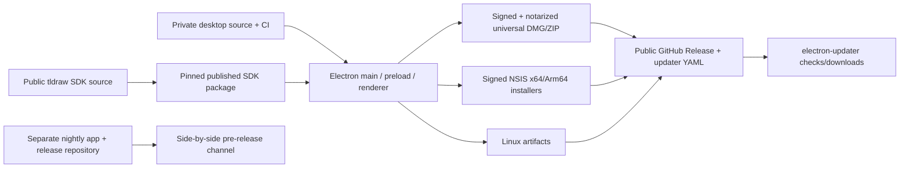
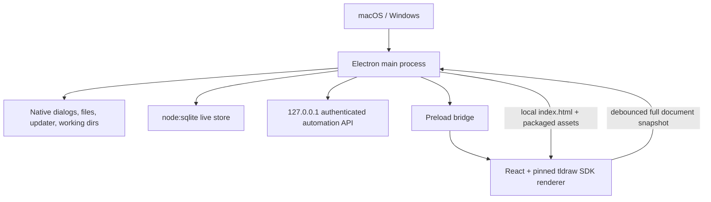
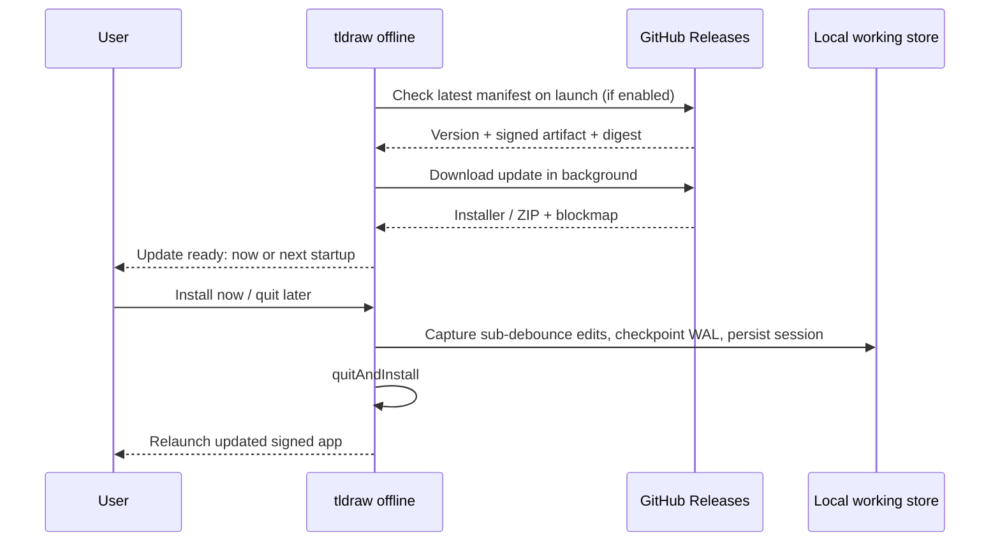
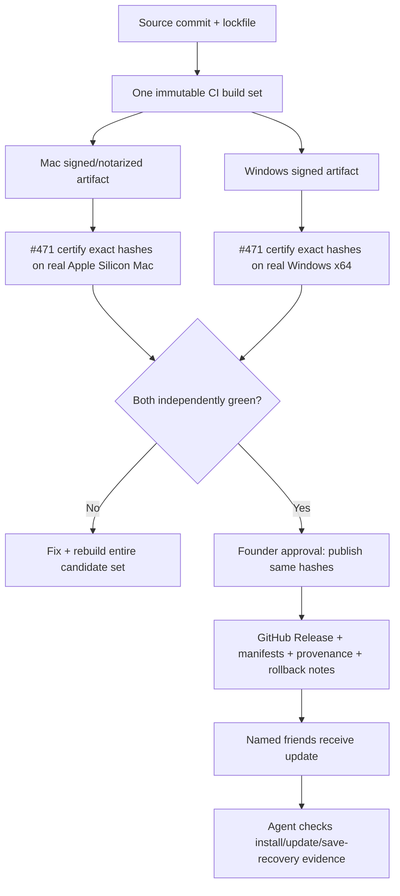

# tldraw Offline: Source, Packaging, Release, Update, and Persistence Pipeline

**Research lane:** source/release pipeline audit
**Evidence cut:** 2026-07-17
**Shipped build inspected:** tldraw offline `1.10.0` (macOS universal and Windows x64)
**Purpose:** establish what tldraw actually ships around its canvas code, distinguish current facts from historical implementation and inference, and extract the parts Eido should or should not copy.

## 1. Evidence rules and headline conclusion

This investigation uses four evidence classes:

| Mark | Meaning |
|---|---|
| **Current—direct** | Directly observed in the exact downloaded `1.10.0` artifacts, their signed bundle, embedded `app.asar`, updater manifests, or current official release repositories. |
| **Current—declared** | Stated in a current official tldraw README or GitHub Release, but not independently observable inside the binary. |
| **Historical** | Present in the formerly public desktop source before it moved to tldraw's private monorepo. Useful for lineage, not proof of the current build pipeline. |
| **Unknown / inference** | The public evidence does not establish it. It must not be promoted to fact in Eido's plan. |

### Headline conclusion

tldraw does **not** turn the public `tldraw/tldraw` SDK repository directly into a DMG and EXE. It maintains a separate Electron desktop product which consumes a pinned published version of the tldraw SDK. The desktop source and current CI live in a private repository; a small public repository is used as the download page and `electron-updater` artifact feed.

The production shape is:



This validates Eido's core Electron/GitHub Releases direction. It does **not** validate copying every current tldraw subsystem. In particular, tldraw's SQLite live store solves a much larger problem than “an offline Alpha needs safe saves”: multiple documents and windows, executable document scripts, a local authenticated automation API, portable archives with media blobs, concurrent external-file replacement, and sub-second crash recovery. Eido should adopt the **durability properties** now, but should not make SQLite a release blocker unless its existing single-document JSON mechanism cannot meet those properties with substantially less code.

## 2. What source actually becomes the desktop app

### 2.1 The supplied checkout is the SDK, not the desktop wrapper

The supplied source checkout at `research/repos/tldraw` is the public SDK monorepo, inspected at commit `846e39a811fbaa43199d1e7e9a424413225a9f80` (2026-06-14). Its package identifies itself as `@tldraw/monorepo`; its workspaces cover packages, assets, apps, examples, templates and tooling. Its root scripts expose examples, docs, dotcom and test/build tasks, but no Electron entrypoint or desktop packaging target ([package.json, lines 2–35](https://github.com/tldraw/tldraw/blob/846e39a811fbaa43199d1e7e9a424413225a9f80/package.json#L2-L35), [lines 36–81](https://github.com/tldraw/tldraw/blob/846e39a811fbaa43199d1e7e9a424413225a9f80/package.json#L36-L81)). The public README describes an SDK for React/browser applications, not a desktop product ([README, lines 15–17 and 23–62](https://github.com/tldraw/tldraw/blob/846e39a811fbaa43199d1e7e9a424413225a9f80/README.md#L15-L62)).

The public SDK release instructions publish npm packages and SDK releases. They are a different lifecycle from desktop releases ([RELEASES.md, lines 3–62](https://github.com/tldraw/tldraw/blob/846e39a811fbaa43199d1e7e9a424413225a9f80/RELEASES.md#L3-L62)).

### 2.2 Current desktop source is private; the public repository is a release feed

The formerly public desktop repository was gutted on 2026-02-20. The change explicitly says the active source moved to `tldraw-internal/apps/public/desktop/` and the public repository remained the GitHub Releases / updater surface ([source-removal commit `8cd7315`](https://github.com/tldraw/tldraw-offline/commit/8cd731529edfb6bd0fae609268aa5d8e4ccf7b44)). A later change deleted the stale public release workflow and says releases had been cut from a private `release-desktop.yml` since `v1.2.3` ([workflow-removal commit `342121c`](https://github.com/tldraw/tldraw-offline/commit/342121c5251d26548672a38aa5ada9329f08d1bb)).

Therefore these remain **unknown** publicly:

- the exact current CI job DAG and runner images;
- current build commands and `electron-builder` configuration;
- the Windows signing backend and secret-management mechanism;
- test gates and approval rules before stable publication;
- whether stable is promoted from the same immutable nightly build or rebuilt;
- rollback automation and release incident procedures.

The artifacts prove that those outputs exist. They do not prove how the private workflow created them.

### 2.3 The shipped desktop pins a published SDK build

The exact `1.10.0` macOS app contains `app.asar!/package.json` with:

- desktop package `@tl/desktop`, version `1.10.0`, product name `tldraw offline`;
- Electron runtime dependencies, `electron-updater 6.6.2`, `@sentry/electron`, and `@parcel/watcher`;
- `tldraw` and `@tldraw/sync-core` both pinned to `5.3.0-next.91d2a20b898c`.

The npm package metadata for that SDK build records public tldraw commit `91d2a20b898ce53ae1f8cba68119307ce88136aa`. This is direct evidence that the desktop wrapper consumes a pinned SDK artifact; it is not an Electron packaging mode inside the supplied checkout.

**Eido implication:** keep the desktop boundary explicit. Eido may keep the wrapper in the same repository for founder simplicity, but it should remain a separate package with a narrow main/preload/renderer seam. A “desktop build” should assemble an exact web/editor build plus native shell code, never quietly point at a mutable hosted website.

## 3. Exact `1.10.0` release artifacts

The user-supplied files match the official `v1.10.0` GitHub Release byte-for-byte ([release page](https://github.com/tldraw/tldraw-offline/releases/tag/v1.10.0)).

| Artifact | Direct observation |
|---|---|
| `tldraw-offline-mac-universal.dmg` | 232,750,025 bytes; SHA-256 `e15f6534531fee2cf55d3ca811db0fc3939dbc0402075e0d6b2887a4aeef8e1a`; universal `x86_64` + `arm64`. |
| `tldraw-offline-win-x64.exe` | 112,827,816 bytes; SHA-256 `27c78e3afaf69f3d80c2172f2bd5d64accccbb0fa3f88da82dae5b1601a23186`; NSIS self-extracting installer. |
| macOS identity | Bundle ID `com.tldraw.desktop`; version `1.10.0`; hardened runtime; Developer ID Application signature for Stephen Ruiz; Apple notarization ticket stapled; Gatekeeper accepted it as Notarized Developer ID. |
| Windows identity | PE signature exists. Embedded Authenticode certificate subject is `tldraw GB Limited`, issued by `Microsoft ID Verified CS AOC CA 04`. The signing provider/workflow is not publicly established. |
| Update metadata | `latest-mac.yml`, `latest.yml`, and `latest-linux.yml`, plus installer/ZIP blockmaps, are release assets. Manifests include version, file names, sizes and SHA-512 digests. GitHub also exposes SHA-256 asset digests. |

The release contains Mac universal DMG and ZIP, Windows x64, Arm64 and combined installers, and Linux artifacts. The Mac ZIP is important: `electron-updater`'s macOS flow uses a ZIP/update manifest even though humans normally download the DMG ([electron-builder auto-update documentation](https://www.electron.build/docs/features/auto-update/)).

The public stable tag points at a README-only public commit, not the private source revision. Consequently the stable release is reproducibly identifiable by artifact digests, but its public page does **not** provide source-to-binary provenance. Nightly release notes do expose a private source commit. Eido can improve on this by putting the source commit, lockfile digest, CI run, builder versions, checksums and SBOM in every stable release manifest.

## 4. Desktop wrapper architecture

### 4.1 Electron process split

The last public desktop source (commit `5d86e6ffa41c376ecf6215001b0eb6b100d3d9eb`, 2026-01-11) used Electron, `electron-vite`, `electron-builder`, React and a pinned pre-release tldraw SDK ([package.json, lines 2–78](https://github.com/tldraw/tldraw-offline/blob/5d86e6ffa41c376ecf6215001b0eb6b100d3d9eb/package.json#L2-L78)). Its build config created distinct main, preload and renderer bundles ([electron.vite.config.mts, lines 6–49](https://github.com/tldraw/tldraw-offline/blob/5d86e6ffa41c376ecf6215001b0eb6b100d3d9eb/electron.vite.config.mts#L6-L49)).

The current artifact still has that architecture:



The packaged app loads its local renderer, not a hosted site. Historical source made this explicit by loading `renderer/index.html` when packaged ([historical `WindowManager.ts`, lines 480–491](https://github.com/tldraw/tldraw-offline/blob/5d86e6ffa41c376ecf6215001b0eb6b100d3d9eb/src/main/managers/WindowManager.ts#L480-L491)). The current app ships `out/main`, `out/preload`, and `out/renderer` inside ASAR.

### 4.2 Historical builder lineage, not current config

The last public `electron-builder.yml` configured:

- ASAR packaging and explicit included files;
- macOS hardened runtime, notarization and DMG output;
- Windows NSIS x64 and Arm64 output with an assisted installer and retained app data;
- GitHub Releases as the publisher ([historical builder config, lines 1–55](https://github.com/tldraw/tldraw-offline/blob/5d86e6ffa41c376ecf6215001b0eb6b100d3d9eb/electron-builder.yml#L1-L55)).

The current artifacts are consistent with this lineage, but exact settings may have changed privately. The current Windows EXE identifies as NSIS; the current Mac is signed/notarized and has ASAR integrity metadata. Do not cite the historical YAML as the current production configuration.

## 5. Release, channels, and automatic updates

### 5.1 Stable publication and client update flow

The current app's embedded `app-update.yml` points to GitHub owner `tldraw`, repository `tldraw-offline`, provider `github`. The shipped main bundle then configures `electron-updater` against public GitHub latest/download URLs. Direct static inspection of `v1.10.0 app.asar!/out/main/index.js:25498–25702` shows:

1. automatic checking is controlled by a stored user preference;
2. `autoDownload` is `true`;
3. `autoInstallOnAppQuit` is `true`;
4. a downloaded update changes app state to ready and opens the update UI;
5. the user can install now or defer;
6. before `quitAndInstall`, the app captures pending renderer snapshots and persists state;
7. update failures are surfaced/reset rather than silently wedging the state machine.



This differs from the old public updater, which set `autoDownload` to false and prompted before download ([historical `UpdateManager.ts`, lines 10–49](https://github.com/tldraw/tldraw-offline/blob/5d86e6ffa41c376ecf6215001b0eb6b100d3d9eb/src/main/managers/UpdateManager.ts#L10-L49)). The artifact is the authority for current behavior.

`electron-builder` documents the same primitives: signed/notarized macOS app, NSIS Windows target, update manifests and platform artifacts published to a provider such as GitHub Releases ([auto-update](https://www.electron.build/docs/features/auto-update/), [code signing](https://www.electron.build/docs/features/code-signing/), [notarization](https://www.electron.build/docs/notarization/)). Apple separately documents Developer ID notarization for software distributed outside the Mac App Store ([Apple notarization guide](https://developer.apple.com/documentation/security/notarizing-macos-software-before-distribution)).

### 5.2 A physically separate nightly channel

The official nightly repository describes a separate application that can run side by side with stable. It uses a different app identity, icon and user-data directory, releases every day at 07:00 UTC if source changed, supports on-demand builds, and checks/downloads updates in the background ([nightly README at `8bb63a1`, lines 1–25](https://github.com/tldraw/tldraw-offline-nightly/blob/8bb63a1354cb5853a53ebf5e02af76a5d3a51253/README.md#L1-L25)).

Its release versions use timestamp-and-commit prerelease identifiers. The inspected latest nightly was `v1.10.0-202607161623.977c656`; its release notes identify private source commit `977c656cdbf…`. Stable `v1.10.0` was published shortly afterwards. That sequence is consistent with canary-before-stable, but the public stable release does not prove it reused the identical nightly binaries or source commit.

No current stable updater manifest contains `stagingPercentage`. Therefore there is no public evidence of percentage rollout inside the stable channel. tldraw appears to obtain blast-radius reduction with a separate nightly population, then publish stable to the whole stable channel.

**Eido implication:** for a friends Alpha, a separate nightly application is optional overhead. A simpler first version is one signed Alpha channel with named Mac and Windows canaries and a manual promotion gate. Introduce a side-by-side canary app only when testers need stable and experimental builds simultaneously or release frequency makes it worthwhile. Regardless, publish an immutable build once and promote the **same digests**; do not rebuild between certification and release.

### 5.3 Historical maintenance automation

The old public repository had automation that checked a latest/next SDK version, updated dependencies, created a PR, and enabled auto-merge ([historical `update-tldraw.yml`, lines 1–17 and 37–135](https://github.com/tldraw/tldraw-offline/blob/5d86e6ffa41c376ecf6215001b0eb6b100d3d9eb/.github/workflows/update-tldraw.yml#L1-L135)). Its lint/typecheck steps were `continue-on-error`, so it is evidence of dependency-bump automation, not a model for a fail-closed release gate. Historical release documentation also described version bump/tag, draft release review, platform artifacts, updater manifests and local dry runs ([historical `RELEASING.md`, lines 36–125](https://github.com/tldraw/tldraw-offline/blob/5d86e6ffa41c376ecf6215001b0eb6b100d3d9eb/RELEASING.md#L36-L125)).

The current private implementation may differ. Eido should automate dependency PRs but require release certification to be green on both day-one platforms before publishing their shared release.

## 6. Modern persistence: exactly what tldraw ships

This section is based on the exact `1.10.0` app bundle, not the historical public store.

### 6.1 The SQLite implementation and files directly observed

The shipped main bundle imports `DatabaseSync` from Node's built-in `node:sqlite`, plus `SQLiteSyncStorage`, `NodeSqliteWrapper`, and `loadSnapshotIntoStorage` from `@tldraw/sync-core` (`v1.10.0 app.asar!/out/main/index.js:1–23`). It opens `<working directory>/db.sqlite`, enables WAL mode, and wraps the connection in tldraw's sync storage (`:227–247`). There is no direct evidence here of `better-sqlite3`, IndexedDB, SQLite WASM, or an external database server.

The schema validation in the shipped code requires three SQLite tables (`:370–475`):

| Table | Directly observed columns | Purpose |
|---|---|---|
| `documents` | `id TEXT` primary key, `state BLOB`, `lastChangedClock INTEGER` | tldraw document-scope records; each BLOB is JSON-decoded and checked against its row ID. |
| `tombstones` | `id TEXT` primary key, `clock INTEGER` | deletion history used by sync storage. |
| `metadata` | migration version, document clock, tombstone-history clock, serialized schema | storage/schema evolution and freshness clocks. |

Every open board has an ephemeral per-window directory under Electron's `userData/working`, named like `wd-<pid>-<sequence>` (`:5210–5239`). Directly observed live contents are:

```text
db.sqlite              live document store; source of truth while open
db.sqlite-wal / -shm   transient SQLite WAL sidecars
assets/                content-addressed image/media blobs
script/                document script source bundle
metadata.json          archive format, creator, document clock, script digest
session.json           view/session state when present
.lock                  single-process working-directory ownership
README.txt             human warning/instructions for the live directory
.script-workspace/     generated script tooling/logs; not archive payload
```

The first five descriptions are stated by the app-generated working-directory README (`:5023–5050`). `session.json`, `.lock`, and `.script-workspace/` are established by the implementation (`:133–196`, `:2579–2630`, `:5208–5213`, `:5607–5618`).

### 6.2 What a user-visible `.tldraw` file contains

A current `.tldraw` file is a ZIP archive, atomically produced via a temporary file and rename (`:2433–2505`). The pack allowlist is exact (`:2692–2715`):

- `metadata.json`;
- `session.json`, when present;
- checkpointed `db.sqlite`;
- `assets/` and descendants;
- `script/` and descendants.

It excludes `.lock`, `README.txt`, `.script-workspace/`, and WAL/SHM sidecars. Before packing, the app settles writes, stamps the current storage clock into metadata, performs `PRAGMA wal_checkpoint(TRUNCATE)`, validates the database/schema, asset hashes, script digest and metadata/database clock agreement, and only then atomically replaces the output archive (`:507–591`, `:2728–2744`). ZIP extraction rejects absolute and parent-traversal paths (`:2539–2577`).

One small internal documentation inconsistency is worth noting: the generated `README.txt` says only `db.sqlite`, `assets/`, `script/`, and `metadata.json` travel in the archive, but the actual allowlist also packs `session.json`. Code is authoritative here.

Assets are stored by SHA-256 content hash and document asset records use `asset:<sha>` references. Opening verifies that referenced blobs exist and hash correctly (`:86–131`). Scripts are a file bundle rooted at `script/main.js`; metadata contains the bundle SHA-256 and optional author/description/target SDK version. Opening verifies the digest before a script is eligible to run (`:197–367`, `:540–567`).

### 6.3 Authority: archive versus live crash working copy

There are two deliberately different durability surfaces:

```mermaid
stateDiagram-v2
  [*] --> PackedArchive: user opens .tldraw
  PackedArchive --> LiveWorkingDir: unzip + lock + mount db.sqlite WAL
  LiveWorkingDir --> LiveWorkingDir: renderer snapshots every 500ms idle / 2s max
  LiveWorkingDir --> PackedArchive: explicit save checkpoints WAL + verifies + atomic ZIP replace
  LiveWorkingDir --> RestoredWorkingDir: crash or normal app quit retains working dir
  RestoredWorkingDir --> LiveWorkingDir: next launch re-adopts if archive unchanged
  RestoredWorkingDir --> PackedArchive: external archive clock changed; disk archive wins
```



- **While the document is open**, `db.sqlite` plus its WAL in the locked working directory is the live persistent source of truth. The renderer is the sole logical writer. It pushes a full document snapshot, debounced at 500 ms idle / 2 s maximum, and main clear-and-loads that snapshot into SQLite in one WAL-durable transaction (`:5467–5518`).
- **The user-visible `.tldraw` archive** is the last explicit packed save and is the portable/shareable file. It is not rewritten on every keystroke.
- **On crash or app quit**, the working directory is retained and its SQLite handle is cleanly checkpointed/closed where possible. The next launch prefers re-adopting that working copy because it may contain edits newer than the archive (`:5242–5280`, `:5567–5588`, `:27077–27101`).
- **If the archive changed externally while the app was closed**, the archive is treated as authoritative and the stale working directory is discarded, even if that sacrifices unsaved working-copy edits. If the changed archive cannot be opened, the app falls back to the working copy rather than a staler JSON mirror (`:26867–26884`, `:27126–27147`).
- **While open, an external replacement** uses a two-phase flow: mount the incoming archive into a fresh working dir, reconcile it with local unsaved edits, write the merged state, then swap handles. Failure keeps the intact old live directory (`:5370–5410`).
- **Legacy `.tldr`** is imported copy-first. The original is read but never locked or modified; the user receives a suggested sibling `.tldraw` path and the converted file is only created on save (`:5322–5352`).

The save/update boundary is carefully coordinated. Before update installation or quit, tldraw asks every renderer for sub-debounce edits, writes them to the working directory, persists session state, checkpoints WAL, closes native SQLite connections, and only then exits (`:26890–27045`). This is a strong pattern Eido should copy irrespective of storage engine.

### 6.4 Does this mean Eido needs SQLite for Friends Alpha?

**No—not from this evidence alone.** tldraw's implementation demonstrates requirements, not a universal storage mandate.

tldraw's SQLite design is shaped by features that exceed Eido's immediate Alpha release problem:

- multiple open documents/windows with independently serialized ownership;
- a portable multi-file archive containing records, binary assets and scripts;
- executable document scripts and a watched local script workspace;
- a localhost automation API that reads/writes the live document;
- deletion tombstones and sync-oriented logical clocks from `@tldraw/sync-core`;
- external file edits/replacements while a document remains open;
- high-frequency full snapshot durability and recovery of sub-save edits.

For Eido Alpha, the decision should be capability-based:

| Required property | SQLite required? | Lean alternative |
|---|---|---|
| Never truncate/half-write a save | No | write temp file, `fsync` where practical, atomic rename, retain previous generation. |
| Detect format and migrate forward | No | envelope with `formatVersion`, app version, schema version; validated sequential migrations. |
| Recover a crash newer than explicit save | No | separate autosave journal/snapshot plus explicit export/save; generation clock. |
| One-click portable backup/export | No | deterministic ZIP/JSON export with manifest and hashes. |
| Preserve assets and future unknown fields | No | manifest + content-addressed blobs; copy-first migrations and round-trip fixtures. |
| Multiple concurrent writers, incremental queries, tombstones/sync clocks | Often yes | SQLite becomes attractive once these are real requirements. |

**Recommendation:** do not add “adopt SQLite” as a prerequisite for issue #448 merely because tldraw uses it. Make the Alpha gate a storage contract and destructive-failure test suite: atomic primary write, last-known-good recovery, schema/version envelope, migration fixtures, corruption detection, export/import verification, updater-before-quit flush, and real historical-save tests where available. If Eido's current JSON store cannot satisfy that contract locally and simply, then adopt SQLite behind a storage adapter. Otherwise defer engine migration until sync, multi-board scale, assets, or concurrent automation makes its extra machinery pay for itself.

This avoids coupling the release shell to a risky persistence rewrite while still blocking the dangerous failure modes.

## 7. Offline behavior, local API, security, and telemetry

### 7.1 “Offline” means local-first, not air-gapped

The current product README says documents are local `.tldraw` files and no account/server is required ([current README, lines 8–12 and 28–44](https://github.com/tldraw/tldraw-offline/blob/2fbf3c8fdbc5daeac95265d22532b79b8a25cbf3/README.md#L8-L44)). Core editing can operate without a network. The shipped app nevertheless has deliberate network surfaces:

- GitHub update checks/downloads when automatic updates are enabled;
- Sentry initialized in packaged stable builds with a public DSN (`v1.10.0 app.asar!/out/main/index.js:27687–27702`);
- explicit user-submitted feedback to a Cloudflare Worker, with app/OS/architecture/locale/Electron/Chromium diagnostics (`:6178–6225`);
- web embeds and registered YouTube referrer behavior (`:27724–27735`).

The exact Sentry payload filtering, retention, consent and privacy policy are not established by public source. Therefore tldraw should be described as **offline-capable/local-first**, not zero-network or air-gapped.

**Eido implication:** define the promise precisely. “Your work stays local; no Eido account or hosted database; updates require internet” is defensible. If Alpha telemetry exists, disclose it and make it opt-in. If the promise is strictly offline, omit telemetry/crash upload entirely and make update checks manually controllable.

### 7.2 Authenticated loopback API

Nightly documentation describes a local Canvas API ([nightly README, lines 27–47](https://github.com/tldraw/tldraw-offline-nightly/blob/8bb63a1354cb5853a53ebf5e02af76a5d3a51253/README.md#L27-L47)). The exact stable bundle confirms it:

- bind to `127.0.0.1`, prefer port `7236`, fall back to a random port;
- generate a random 32-byte token per launch;
- write port/token/PID/timestamp/log paths to `server.json` with mode `0600`;
- delete discovery metadata on clean shutdown;
- leave only the README unauthenticated; protect API routes with Bearer authentication and timing-safe token comparison (`v1.10.0 app.asar!/out/main/index.js:8577–8699`).

This is a tldraw-specific automation feature, not required for a desktop wrapper or auto-updates. Eido should not add a localhost server merely to ship offline. If future agent automation requires one, use loopback-only binding, a per-launch capability token, restrictive file permissions, a small API, origin/request validation and an explicit threat model.

### 7.3 Renderer hardening gap not to copy

The exact stable bundle creates editor windows with a preload but explicitly sets `sandbox: false` (`v1.10.0 app.asar!/out/main/index.js:26761–26778`). Electron's guidance recommends context isolation, process sandboxing, narrow IPC exposure, careful navigation/window controls and avoiding Node integration for untrusted content ([Electron security checklist](https://www.electronjs.org/docs/latest/tutorial/security), [context isolation](https://www.electronjs.org/docs/latest/tutorial/context-isolation), [sandboxing](https://www.electronjs.org/docs/latest/tutorial/sandbox/)).

The preload uses `contextBridge`; current Electron defaults make context isolation likely, but the exact BrowserWindow snippet does not explicitly establish every security flag. The sandbox disablement is direct. It may be motivated by tldraw's document-script system, but it materially expands the consequence of a renderer exploit. Eido should default to `sandbox: true`, `contextIsolation: true`, `nodeIntegration: false`, a minimal typed preload API, deny navigation/new windows except allowlisted external links, and validate every IPC payload. Any later need to relax a control should require an ADR and threat-model test.

Current tldraw also warns users that document scripts can change the canvas and should run only for trusted documents ([README, lines 46–50](https://github.com/tldraw/tldraw-offline/blob/2fbf3c8fdbc5daeac95265d22532b79b8a25cbf3/README.md#L46-L50)). The artifact hashes script bundles and maintains a machine-local trust store, but script safety is a separate product/security subsystem. It should not enter Eido's Alpha release scope by accident.

## 8. Licensing and openness

The public SDK has its own licensing terms and commercial-license model. The desktop application's current README explicitly says the offline app is **not open source** and is all rights reserved ([README, lines 59–61](https://github.com/tldraw/tldraw-offline/blob/2fbf3c8fdbc5daeac95265d22532b79b8a25cbf3/README.md#L59-L61)); its embedded package is `UNLICENSED`.

The shipped app includes third-party notices and packaged dependency licenses. This is a useful release practice, but it does not make the desktop app open source.

**Eido implication:** “friends-only semi-open source” needs an explicit license and access model. GitHub source visibility, downloadable binaries, ability to fork, and redistribution rights are separate decisions. A public GitHub Releases feed is discoverable even if the source is private. If access must genuinely be friends-only, public Releases is distribution convenience, not access control; use a private repository or authenticated artifact location, while checking whether the updater can authenticate without embedding a reusable secret. Do not embed a personal access token in the client.

## 9. What the historical implementation can and cannot teach us

The old public source remains valuable because it shows the desktop product's lineage:

- Electron + React + pinned tldraw package;
- `electron-vite` for main/preload/renderer;
- `electron-builder` for native artifacts and GitHub publication;
- macOS signing/notarization and Windows NSIS configuration;
- update manifests consumed by `electron-updater`;
- automated SDK dependency bumps;
- a local store, migration and recovery layer.

But several historical details are already stale:

| Historical fact | Current evidence |
|---|---|
| Updater prompted before downloading (`autoDownload=false`). | `1.10.0` downloads automatically and prompts when ready. |
| Public release workflow was visible and primarily Mac-oriented. | That workflow was stale and deleted; current multi-platform workflow is private. |
| Recovery store was JSON/per-file with temp+rename. | `1.10.0` uses per-open-board Node SQLite WAL working dirs and ZIP archives. |
| Windows signing was described as optional; unsigned builds warned. | Current Windows installer is Authenticode-signed to verified organization `tldraw GB Limited`. |
| Desktop source was public. | Current README states the desktop app is not open source. |

The correct lesson is not “copy the old YAML.” It is “keep release mechanics explicit, reproducible and independently testable while treating shipped artifacts as the truth.”

## 10. Adversarial findings and Eido release requirements

### 10.1 What tldraw validates in Eido issue #448's direction

1. **Electron is a realistic cross-platform shell for a browser-first editor.** One codebase can produce Mac and Windows apps while retaining the browser renderer model.
2. **GitHub Releases can be both download shelf and updater feed.** No Eido application server or hosted database is required.
3. **Mac and Windows still need platform-specific trust work.** Apple signing/notarization and Windows Authenticode are not bypassed by being offline.
4. **Update installation must coordinate with persistence.** The updater cannot be bolted on without a flush/save/shutdown contract.
5. **A separate canary population is more legible than percentage rollout for a small team.** Named humans can certify exact artifacts before stable publication.
6. **Portable user files and crash recovery are different concerns.** A shareable save should not be the only recovery mechanism.

### 10.2 Where Eido should deliberately diverge

1. **Keep source-to-binary provenance public and machine-readable.** tldraw stable releases expose artifact digests but not the private source SHA. Eido should publish both.
2. **Do not disable the renderer sandbox.** Eido lacks a demonstrated feature that justifies it.
3. **Do not add Sentry or a local HTTP API by default.** They complicate the offline promise and threat model.
4. **Do not force SQLite into the critical path without a measured storage requirement.** First require durability behavior and tests.
5. **Avoid a second side-by-side nightly app until it buys real operational safety.** Named canaries and immutable promotion are enough for Friends Alpha.
6. **Do not auto-merge dependency bumps through soft-failing quality checks.** Release dependencies must pass both-platform certification.

### 10.3 Gaps a production Eido pipeline must plug



Required release evidence should include:

- source SHA, dependency-lock digest, SDK/editor build SHA and builder/toolchain versions;
- SHA-256 and platform-native signature verification for every artifact;
- Mac notarization/stapling/Gatekeeper verification and Windows Authenticode verification;
- updater manifest validation and an installed-old → update-new test on both platforms;
- fresh install, upgrade install, offline launch, save/edit/relaunch, crash recovery, export/import and rollback drills;
- explicit network inventory and user-facing privacy wording;
- storage format compatibility matrix, migrations and golden fixtures;
- release notes, known issues, backup warning and founder-facing approve/reject question;
- a rule that certification attaches to artifact hashes and is invalidated by any rebuild.

## 11. Recommended implementation decision for Eido

### Decision

Proceed with issue #448 now as an Electron wrapper and autonomous release system for simultaneous Apple Silicon Mac and Windows x64 Friends Alpha. Keep #410 renderer and the design-system work as external dependencies whose outputs are integrated before certification. Run #471 only after those inputs are frozen, on the exact signed build set intended for release.

For storage, add a release-blocking **durability contract**, not an immediate SQLite mandate. The app must:

1. identify every on-disk format with explicit versions;
2. validate before accepting writes/imports;
3. write atomically and retain a last-known-good generation;
4. separate portable export from crash/autosave recovery;
5. migrate copy-first and never modify the only source file;
6. flush pending editor state before update/quit;
7. verify export/import round trips and corruption recovery;
8. preserve unknown/future fields where the format contract requires it;
9. keep real user data out of CI and Git;
10. test an upgrade from the previous released build on both target OSes.

Adopt SQLite behind a storage adapter later—or during #448 only if a short spike proves the current save layer cannot meet this contract without comparable complexity. This is the grounded interpretation of tldraw: SQLite is a strong implementation for its live multi-document runtime, not a prerequisite for putting a browser app into a trustworthy DMG and EXE.

### Founder-facing rollout

1. Agents build unsigned development shells and exercise all storage/update flows locally.
2. Agents coach the founder through Apple Developer identity and Windows verified signing enrollment only when credentials are required; credentials remain in platform/CI secret stores.
3. CI produces one candidate set for Mac and Windows with provenance and digests.
4. A named Apple Silicon friend and Windows x64 friend install and update from the prior candidate; agents collect structured pass/fail evidence.
5. #471 certifies both exact hashes. One failed platform blocks the shared day-one release.
6. Founder answers one bounded question: **publish this certified build set, yes or no?**
7. Agents publish the same files, verify public update manifests/signatures/downloads, and monitor canaries.
8. If a release is bad, agents stop promotion/update metadata where possible, publish a fixed higher version (never reuse a version), and coach recovery/export.

## 12. Open questions left by public tldraw evidence

These are questions for Eido to decide, not facts tldraw can answer publicly:

1. Will Eido's Friends Alpha releases live in a public or private GitHub repository? Public Releases are easiest for updates but are not access control. **Recommendation:** private source is fine; use public binary releases only if discoverability is acceptable.
2. Does “offline” permit user-controlled update checks and strictly opt-in diagnostics? **Recommendation:** update checks yes, opt-in diagnostics only, no silent telemetry for Alpha.
3. Must users manage named portable project files, or is one local application state plus export sufficient? **Recommendation:** keep one robust local state plus one-click versioned export for Alpha; do not invent a multi-document archive unless product behavior requires it.
4. Is there any true requirement for concurrent agent writes or a localhost API in Alpha? **Recommendation:** no API until a scoped automation feature demands it.
5. What is the maximum acceptable loss window after a crash? **Recommendation:** zero acknowledged edits where feasible; in practice, a bounded autosave under two seconds plus final flush and recovery tests.
6. When a user externally replaces a save while Eido is closed, should external disk state or newer autosave win? **Recommendation:** never silently discard either; preserve both and ask the user if the system cannot prove which is intended.

## 13. Evidence index

### Current official repositories and releases

- [tldraw offline README at `2fbf3c8`](https://github.com/tldraw/tldraw-offline/blob/2fbf3c8fdbc5daeac95265d22532b79b8a25cbf3/README.md)
- [tldraw offline `v1.10.0` release](https://github.com/tldraw/tldraw-offline/releases/tag/v1.10.0)
- [tldraw offline nightly README at `8bb63a1`](https://github.com/tldraw/tldraw-offline-nightly/blob/8bb63a1354cb5853a53ebf5e02af76a5d3a51253/README.md)
- [source moved private, commit `8cd7315`](https://github.com/tldraw/tldraw-offline/commit/8cd731529edfb6bd0fae609268aa5d8e4ccf7b44)
- [stale public release workflow removed, commit `342121c`](https://github.com/tldraw/tldraw-offline/commit/342121c5251d26548672a38aa5ada9329f08d1bb)

### Supplied SDK source

- [SDK root package at `846e39a`](https://github.com/tldraw/tldraw/blob/846e39a811fbaa43199d1e7e9a424413225a9f80/package.json)
- [SDK README at `846e39a`](https://github.com/tldraw/tldraw/blob/846e39a811fbaa43199d1e7e9a424413225a9f80/README.md)
- [SDK release process at `846e39a`](https://github.com/tldraw/tldraw/blob/846e39a811fbaa43199d1e7e9a424413225a9f80/RELEASES.md)

### Historical desktop source (lineage only)

- [package and scripts at `5d86e6f`](https://github.com/tldraw/tldraw-offline/blob/5d86e6ffa41c376ecf6215001b0eb6b100d3d9eb/package.json)
- [electron-vite config at `5d86e6f`](https://github.com/tldraw/tldraw-offline/blob/5d86e6ffa41c376ecf6215001b0eb6b100d3d9eb/electron.vite.config.mts)
- [electron-builder config at `5d86e6f`](https://github.com/tldraw/tldraw-offline/blob/5d86e6ffa41c376ecf6215001b0eb6b100d3d9eb/electron-builder.yml)
- [release instructions at `5d86e6f`](https://github.com/tldraw/tldraw-offline/blob/5d86e6ffa41c376ecf6215001b0eb6b100d3d9eb/RELEASING.md)
- [historical updater at `5d86e6f`](https://github.com/tldraw/tldraw-offline/blob/5d86e6ffa41c376ecf6215001b0eb6b100d3d9eb/src/main/managers/UpdateManager.ts)
- [historical SDK bump automation at `5d86e6f`](https://github.com/tldraw/tldraw-offline/blob/5d86e6ffa41c376ecf6215001b0eb6b100d3d9eb/.github/workflows/update-tldraw.yml)

### Exact artifact static evidence

The following citations refer to the exact extracted `v1.10.0` macOS app whose DMG digest is recorded in section 3:

- `app.asar!/package.json:2–34` — desktop identity and exact runtime dependencies.
- `app.asar!/out/main/index.js:1–591` — Node SQLite storage, archive schema and verification.
- `app.asar!/out/main/index.js:2433–2920` — atomic ZIP, traversal guard, metadata, pack allowlist, migrations, legacy import and trust store.
- `app.asar!/out/main/index.js:5023–5625` — working-directory contract, ownership, save, WAL snapshot and restore primitives.
- `app.asar!/out/main/index.js:8577–8699` — authenticated loopback server.
- `app.asar!/out/main/index.js:25498–25702` — updater state machine and feed.
- `app.asar!/out/main/index.js:26761–26778` — BrowserWindow/preload and `sandbox: false`.
- `app.asar!/out/main/index.js:26867–27148` — restore authority and update/quit flush.
- `app.asar!/out/main/index.js:27687–27735` — Sentry initialization and packaged app startup.

These are direct observations of a shipped binary, but the private original TypeScript file paths, commit and CI inputs are not publicly recoverable from the release page.
