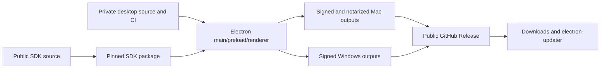
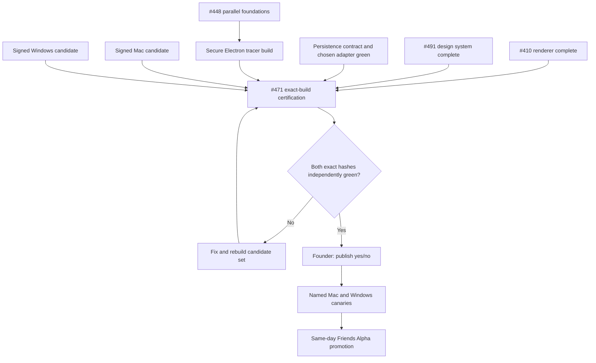

# tldraw offline benchmark: synthesis and #448 decision record

**Evidence cut:** 2026-07-17
**Benchmark:** tldraw offline `v1.10.0` on macOS universal and Windows x64
**Eido target:** simultaneous Apple Silicon macOS and Windows x64 Friends Alpha in [epic #448](https://github.com/limweili/eido/issues/448)

This document synthesizes the artifact, source-lineage, update, persistence, and release-operations investigations in reports 07–09. It is deliberately narrower than those evidence logs: it records the decision that should change implementation planning.

## Verdict

> **Resolution — 2026-07-22.** The adapter choice recorded below is no longer
> open: SQLite won. The landed SQLite Profile Authority (#520; ADR 0025/0029)
> is Eido's live storage engine. Keep this benchmark's JSON-versus-SQLite
> reasoning as historical evidence, not an implementation decision.

**Proceed with #448. The central architecture is grounded in a real shipping product and remains the right one. Apply targeted amendments; do not copy tldraw wholesale.**

tldraw proves that an offline-capable browser editor can ship as one Electron product on Mac and Windows, with a locally bundled renderer, OS-native signed installers, GitHub Releases as the download/update shelf, and no application database server. Its current desktop source is private, while its public repository distributes binaries and updater metadata. That is almost exactly Eido's intended private-source/public-binary model.

Eido should retain its stronger controls: a sandboxed renderer, narrow validated IPC, hardened Electron fuses, no silent telemetry, explicit update consent, exact-build certification, same-day dual-platform promotion, and a save-health gate before restart.

At this evidence cut, one decision was proposed for reopening rather than silent
inheritance: **the physical live-storage adapter**. tldraw evolved from a
JSON/temp-rename store to SQLite WAL working copies plus portable ZIP archives.
That historical reasoning is resolved by the dated SQLite decision above.

## What the exact artifacts prove

The supplied files match the official `v1.10.0` release byte-for-byte.

| Platform | Human install artifact | Updater artifact contract | Trust evidence |
|---|---|---|---|
| macOS | Universal DMG, SHA-256 `e15f6534531fee2cf55d3ca811db0fc3939dbc0402075e0d6b2887a4aeef8e1a` | ZIP + blockmap + `latest-mac.yml`; manifest selects the ZIP | Nested app is Developer ID signed, hardened, notarized, stapled, and Gatekeeper-accepted. The outer DMG is not the executable trust boundary. |
| Windows | x64 NSIS EXE, SHA-256 `27c78e3afaf69f3d80c2172f2bd5d64accccbb0fa3f88da82dae5b1601a23186` | EXE + blockmap + `latest.yml` | Installer and installed app are Authenticode signed to `tldraw GB Limited` with a Microsoft timestamp. |

Both ship Electron `39.6.1`, a local renderer in `app.asar`, `electron-updater 6.6.2`, and native modules. Electron 39 was already end-of-life at this evidence cut. The lesson is not to pin those versions; it is to automate supported-major refreshes and include the runtime version in certification evidence.

## The real product boundary

The supplied `research/repos/tldraw` checkout is the public tldraw SDK monorepo, not the desktop wrapper. The current desktop wrapper lives in a private tldraw repository and consumes a pinned published SDK. The public `tldraw-offline` repository is primarily a release feed and download page.

For Eido, the shell may remain in the same private repository as the web editor for solo-founder simplicity. It should still be a deep boundary: main owns native capabilities and persistence; preload exposes a small typed interface; renderer remains browser-shaped and never loads a mutable hosted app.

## Release and update mechanics

tldraw's stable app checks a public GitHub feed, automatically downloads by default, presents install/defer UI, and can install on normal quit. Before replacement it captures sub-debounce state, persists session/document state, checkpoints/closes SQLite, and then invokes the updater.

Eido should copy the **persistence barrier**, not the exact consent policy:

1. discover an available update;
2. show version, notes, and choices;
3. download only with consent by default during Friends Alpha;
4. before restart, flush the current logical revision and verify save health;
5. refuse restart if that barrier cannot be proven;
6. install only after an explicit restart action;
7. reopen through compatibility inspection and recovery gates.

tldraw also uses a physically separate nightly application/repository. That is useful at its scale, but unnecessary for Eido's first friends. Eido's simpler equivalent is immutable candidate artifacts, one named canary per platform, and manual promotion of the exact certified hashes.

## Persistence benchmark

tldraw `v1.10.0` uses `node:sqlite` `DatabaseSync` with WAL for each open working copy. A user-visible `.tldraw` file is a portable ZIP containing a checkpointed `db.sqlite`, metadata, optional session data, content-addressed assets, and optional scripts. The working copy remains after a crash and may be newer than the portable archive.

The architecture separates three concerns that Eido should also separate:

| Concern | tldraw implementation | Required Eido property |
|---|---|---|
| Live edit authority | locked SQLite WAL working directory | one serialized logical writer with monotonic revisions |
| Crash recovery | retained working directory, checkpointed where possible | autosave/recovery generation newer than last export |
| Portable transfer | validated, atomically packed `.tldraw` archive | one-click versioned `.eido` export with integrity metadata |

The proposed decision at this evidence cut was a release-blocking **durability
contract**, followed by a short adapter proof:

- explicit format/schema/app versions;
- validate before accepting or migrating;
- copy-first migrations and preservation of the original;
- serialized writes, monotonic revision acknowledgement, and retryable dirty state;
- atomic primary commit and retained last-known-good generation;
- crash recovery distinct from portable export;
- corruption detection and verified export/import round trips;
- final renderer-to-main flush before quit/update;
- historical fixtures and previous-release-to-candidate tests on both OSes.

Test the planned canonical JSON metadata + content-addressed blobs against the same contract as Electron's bundled SQLite WAL + external blobs. Prefer JSON if it passes fault injection, large-save performance, and overlapping-write tests with materially less machinery. Prefer SQLite behind the same storage port if whole-snapshot rewrites, concurrency, or recovery logic become equivalent complexity. In either case, do not expose the live raw database as the user's backup format.

> **Resolution — 2026-07-22.** This proposed comparison is closed. SQLite Profile
> Authority (#520; ADR 0025/0029) is the selected engine; Portable Export remains
> distinct from raw SQLite/WAL files.

## Adversarial comparison with #448

| #448 decision | tldraw evidence | Judgment for Eido |
|---|---|---|
| Electron wrapper around browser renderer | Exactly how the shipped product works | Keep |
| Private source, public binary/update repository | Current tldraw product uses this split | Keep; call it private-source/public-binary, not semi-open source |
| GitHub Releases update feed | Proven on Mac and Windows | Keep |
| Same-day Apple Silicon Mac + Windows x64 | Technically feasible; tldraw added Windows after Mac and now ships both | Keep Eido's stricter all-or-nothing founder requirement |
| Signed/notarized platform installers | Proven and necessary for ordinary OS trust | Keep |
| Sandboxed renderer, narrow preload, hardened fuses | tldraw has `sandbox:false` and weaker fuse settings | Keep Eido's stronger posture; assert it in packaged builds |
| Prompt before download/restart | tldraw auto-downloads and installs on quit | Keep Eido's more conservative Alpha policy |
| No telemetry | tldraw initializes Sentry and exposes feedback/network surfaces | Keep; publish an explicit network inventory |
| Exact-SHA build and certification | tldraw artifacts have hashes, but stable public release lacks private source SHA | Strengthen Eido provenance; certify immutable hashes |
| Historical JSON metadata + blobs; SQLite later proposal | tldraw now uses SQLite WAL + archive | Superseded: SQLite Profile Authority is the landed decision |
| Named canaries and manual promotion | tldraw has separate nightly population | Keep simpler Eido design until scale justifies another app/channel |

## Required amendments to #448

These were proposed amendments at the evidence cut, not a rewrite or a reason to
pause the then-current implementation frontier. The canonical #448 issue body
now owns current amendments.

1. **Artifact contract.** Mac human download is DMG, while updater requires ZIP, blockmap, and `latest-mac.yml`. Windows requires signed NSIS x64 EXE, blockmap, and `latest.yml`.
2. **Provenance manifest.** Record the true private source SHA, renderer/design-system input SHAs, lockfile digest, Electron/builder/updater versions, CI run, target, artifact SHA-256/SHA-512, signing identity, and certification status.
3. **Runtime lifecycle.** Pin an actively supported Electron major and automate security-major/minor refresh PRs with packaged both-platform certification.
4. **Packaged hardening assertions.** Test `sandbox:true`, `contextIsolation:true`, `nodeIntegration:false`, restrictive navigation/window behavior, ASAR integrity, and production fuses against the packaged app—not source configuration alone.
5. **Native lifecycle matrix.** Add file associations/open-with, Unicode and long paths, single instance, upgrade install, uninstall-data preservation, background-process exit, and only-required macOS entitlements.
6. **Network contract.** Inventory updater and every other outbound surface. State plainly: editing and data are local; updates require internet; no silent telemetry for Alpha.
7. **Historical persistence adapter proof.** The proposed JSON+blobs versus
   SQLite WAL+blobs comparison is resolved in favor of #520's SQLite Profile
   Authority; keep the portable-export boundary.
8. **Update durability proof.** Certify a last-edit-below-the-debounce-window scenario before update restart on both exact packaged candidates.
9. **Human release notes.** Publish changes, compatibility, known issues, backup warning, and rollback/recovery instructions; do not rely on nearly empty release descriptions.

## Dependency and rollout decision

> **Resolution — 2026-07-22.** The diagram and rollout framing below preserve
> pre-decision evidence. Storage no longer waits on an adapter choice: #520's
> open #528 packaged certification is the live external dependency and feeds
> #471/J2 on the exact candidate SHA.

Issue #448 may start now. The safe parallel frontier remains architecture/contracts, persistence fixtures and acceptance criteria, public binary repository policy, shell contracts, and founder-coaching SOPs. The final renderer/design-system outputs are external inputs, not reasons to leave release architecture idle.

One failed platform blocks the shared day-one release. A rebuild invalidates certification. Recovery is a higher-version forward fix; never reuse or mutate an already published version.

## Founder decisions still needed

> **Resolution — 2026-07-22.** The storage-adapter founder decision below was
> resolved in favor of the landed SQLite Profile Authority (#520; ADR 0025/0029).
> The remaining entries are historical recommendations and defer to #448's
> current canonical specification.

None blocks the immediate #448 frontier.

1. **Storage-adapter decision (resolved).** SQLite was selected and landed through
   #520; no JSON-versus-SQLite proof remains to approve.
2. **Supported OS floors?** Recommendation: Apple Silicon on macOS 13+ and Windows 11 x64 for Friends Alpha unless a nominated Windows canary is Windows 10. A higher floor reduces near-term runtime churn and test combinations.
3. **Primary product document model?** Recommendation: one app-managed local Eido state plus verified versioned export for Alpha. Do not copy tldraw's multi-document archive semantics unless the product needs named project files.
4. **Update consent?** Recommendation: keep #448's prompt-first/manual restart default; allow opt-in background download later; never install merely because the user quit during Alpha.
5. **Network promise?** Recommendation: “works offline; your work stays local; internet is used only for user-controlled updates.” Keep telemetry absent for Alpha.

## Primary evidence

- [tldraw offline public distribution repository](https://github.com/tldraw/tldraw-offline)
- [tldraw offline v1.10.0 release](https://github.com/tldraw/tldraw-offline/releases/tag/v1.10.0)
- [source removal from the public desktop repository](https://github.com/tldraw/tldraw-offline/pull/54)
- [current multi-platform release note and Windows signing discussion](https://github.com/tldraw/tldraw-offline/pull/55)
- [maintainer response on private desktop source](https://github.com/tldraw/tldraw-offline/issues/57)
- [electron-builder auto-update contract](https://www.electron.build/docs/features/auto-update/)
- [Electron security checklist](https://www.electronjs.org/docs/latest/tutorial/security)
- [Apple notarization guidance](https://developer.apple.com/documentation/security/notarizing-macos-software-before-distribution)
- [Node SQLite API](https://nodejs.org/download/release/latest-v24.x/docs/api/sqlite.html)

Detailed evidence and reproducible inspection logs:

- `07-tldraw-macos-artifact-forensics.md`
- `08-tldraw-windows-artifact-forensics.md`
- `09-tldraw-source-release-pipeline.md`
