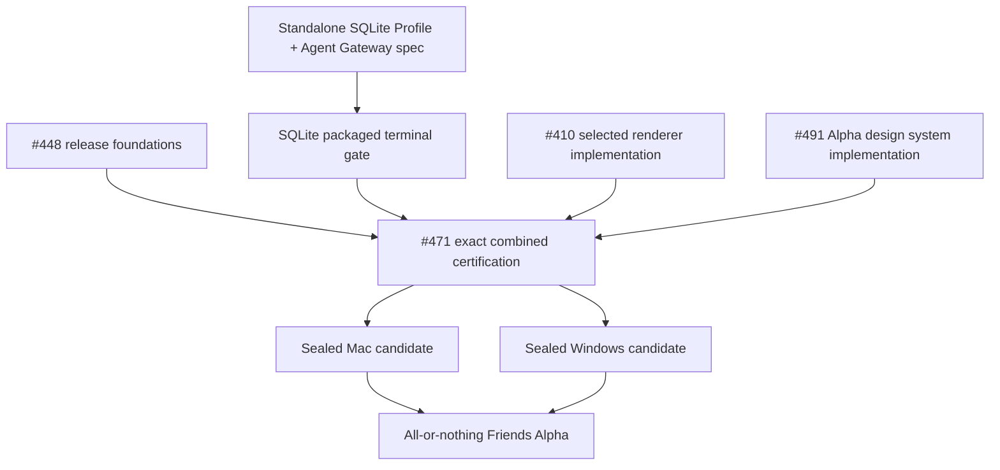

# Friends Alpha #448 amendment draft: consume SQLite Profile Authority

Status: applied. SQLite spec [#520](https://github.com/limweili/eido/issues/520) and ticket DAG #458–#465/#521–#528 are published. The conflicting JSON-first sections of #448 were rewritten, affected release tickets carry binding SQLite amendment blocks, #520 is a native blocker of #448, and terminal gate #528 is a native blocker of #471.

> **Reconciliation — 2026-07-22.** “Applied” above describes the tracker and
> #448 issue body, not the repository research docs at the time this draft was
> written. Those docs were not fully rewritten then; docs-repair #669 remedies
> that gap. See the now-reconciled `04-adversarial-synthesis-and-spec.md`,
> `05-ticket-fanout.md`, and `06-cross-epic-dependency-contract.md` in this
> track for their dated supersession banners and current-status framing. The
> historical proposal content below is preserved as evidence of what was proposed
> and later applied to the tracker.

## Decision

Friends Alpha remains an Electron, private-source/public-binary, simultaneous Apple Silicon macOS and Windows x64 release. The release architecture, updater policy, signing, exact-build promotion, canaries, #410/#491 convergence, no-telemetry policy, and founder-coaching system remain unchanged.

The persistence implementation changes materially:

- replace “versioned JSON metadata plus content-addressed blobs; SQLite later” with the standalone SQLite Profile Authority specification;
- make the SQLite spec's terminal packaged gate a required producer for #471;
- preserve the Persistence Port and current renderer-facing Board hydration semantics;
- make Electron main the SQLite/Profile authority and prohibit packaged IndexedDB/Vite fallback;
- include Mod Library migration and future-ready data-only Mod records;
- include the local Agent Gateway through JSON CLI and stdio MCP over the same validated command service;
- keep Portable Export independent from raw SQLite/WAL files;
- keep content-addressed authoritative blobs separate from #410-owned runtime image renditions; and
- explicitly defer vector implementation under ADR 0027.

## Required #448 body edits

1. Replace the JSON-first Solution paragraphs, Persistence diagram nodes, canonical-metadata-generation language, implementation decisions, testing decisions, Out-of-Scope SQLite wording, and adversarial summary with the accepted SQLite Profile Authority dependency.
2. Add the Local Profile Service as the shared renderer/CLI/MCP seam and explain that agents never receive raw SQL, filesystem, or Electron IPC.
3. Add the public-binary/source-secrecy clarification: the private repository remains private; production bundles omit source maps/internal files but offline binaries remain reverse-engineerable and must contain no secrets.
4. Add tldraw's exact artifact contract: human DMG plus updater ZIP/blockmap/YAML on Mac; signed NSIS plus blockmap/YAML on Windows; packaged hardening and provenance are verified from artifacts.
5. Add the SQLite terminal issue to the cross-epic dependency diagram before #471.
6. Keep vector implementation in Out of Scope and link ADR 0027/future backlog.
7. Update the published execution graph to distinguish #448 release tickets from the standalone SQLite epic and its reused #458–#465 issues.

## Existing ticket rewrites

- **#449:** freeze the new standalone SQLite dependency, Local Profile Service seam, agent boundary, Mod-ready storage, Portable Export boundary, and vector deferral.
- **#451:** expand synthetic fixtures to SQLite corruption/WAL/locks, current JSON migration, Mod templates/future-shaped records, agent commands, and Portable Export; no real saves.
- **#453:** record SQLite schema/command/export versions and the standalone terminal evidence in release planning/status.
- **#457:** prove the secure shell can host the supported SQLite runtime without weakening sandbox/preload boundaries.
- **#458–#465:** reuse under the standalone SQLite spec according to its approved fan-out; remove JSON-generation assumptions and duplicate scope.
- **#466:** add Agent Gateway and Profile data to the packaged network/credential boundary; no local listener and no secrets in command output.
- **#468:** update restart requires SQLite transaction/flush/checkpoint/backup safety and captures edits below the debounce window.
- **#471:** add the standalone SQLite terminal gate; certify exact packaged SQLite/Mod/CLI/MCP behavior alongside #410 renderer and #491 design system on one SHA.
- **#472/#473:** extend release-captain and incident SOPs for database integrity, migrations, Profile ownership, agent command versions, Portable Export, and forward repair.
- **#475–#479:** include the complete platform artifact contract and previous-build SQLite migration/update path.
- **#480/#481:** canary scripts include Profile migration/recovery/export and one agent inspection/mutation scenario.
- **#482:** all-or-nothing GO requires both platform results and the SQLite terminal evidence on identical release hashes.

## Dependency shape

The standalone SQLite work may run in parallel with renderer/design implementation. It joins at #471 only after the selected renderer, Alpha design system, SQLite Profile, Mod readiness, Agent Gateway, and native packaging lanes are all independently green on the exact source/build set.
