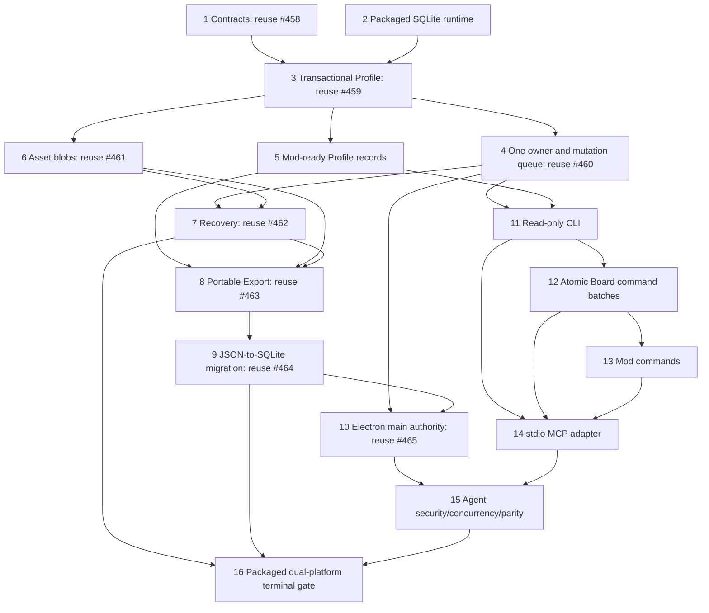

# Ticket fan-out: SQLite Profile Authority and Local Agent Gateway

Status: published under [SQLite spec #520](https://github.com/limweili/eido/issues/520) with native GitHub sub-issue and blocked-by relationships.

The published fan-out reuses and rewrites Friends Alpha persistence tickets #458–#465 instead of creating duplicate storage implementations, then adds focused Mod/Agent Gateway slices under the new SQLite parent spec. Existing #448 foundation, toolchain, shell, and native packaging issues remain external producers.

## Published issue map

| Slice | Issue |
| --- | --- |
| 1. Executable contracts | #458 |
| 2. Packaged SQLite runtime | #521 |
| 3. Transactional Profile revision | #459 |
| 4. One mutable owner | #460 |
| 5. Mod-ready Profile records | #522 |
| 6. Content-addressed blobs | #461 |
| 7. Verified recovery generations | #462 |
| 8. Portable Export/import/restore/Duplicate | #463 |
| 9. Copy-first JSON and Mod migration | #464 |
| 10. Electron main Profile authority | #465 |
| 11. Read-only JSON CLI | #523 |
| 12. Atomic Board command batches | #524 |
| 13. Mod agent commands | #525 |
| 14. stdio MCP adapter | #526 |
| 15. Agent Gateway security and parity | #527 |
| 16. Dual-platform terminal gate | #528 |

## Published dependency graph

External blockers attach where they genuinely gate implementation:

- #449 Friends Alpha contracts and #451 storage fixtures block ticket 1.
- #450 supported Node toolchain and #457 secure Electron shell block ticket 2.
- #457 also blocks packaged-authority ticket 10.
- #469 macOS arm64 and #470 Windows x64 packaging/signing lanes block terminal ticket 16.
- Ticket 16 becomes a native blocker of #471 exact combined release certification.

## Published tickets

### 1. Freeze the SQLite Profile and Agent Gateway executable contracts — reuse #458

**Blocked by:** #449 and #451.

**What it delivers:** The Persistence Port becomes an executable Local Profile Service contract covering stable records, Profile revisions, transactions, Mod-ready data, one mutable owner, recovery, migration, Portable Export, agent queries/commands, and explicit vector deferral without changing runtime Board meaning.

### 2. Prove SQLite WAL in packaged Apple Silicon and Windows x64 shells — new

**Blocked by:** #450, #457, and ticket 1.

**What it delivers:** One non-promotable proof package per platform opens the supported built-in SQLite runtime, enables WAL/defensive settings, commits/checkpoints/reopens a disposable synthetic proof database, survives process termination, and records exact runtime/native evidence without adding a vector extension. The Windows main executable is `NotSigned` while upstream vendor signatures remain intact; macOS proof uses only the ad-hoc seal required after fuse mutation, with no Eido identity or TeamIdentifier.

### 3. Commit and reload one transactional Profile revision — reuse/rewrite #459

**Blocked by:** tickets 1 and 2.

**What it delivers:** A real Idea/Board edit atomically persists independently addressable records, logical revision, associated Intent Log events, and compatibility metadata; acknowledged state reopens identically and an injected failure leaves the prior revision plus retryable dirty work.

### 4. Serialize every Profile mutation and enforce one mutable owner — reuse/rewrite #460

**Blocked by:** ticket 3.

**What it delivers:** Create, edit, rename, delete, active-Idea, UI save, restore, and overlapping operations all route through one ownership/transaction queue; a second process or stale revision routes safely or fails explicitly and never wins by last-write timing.

### 5. Persist the Mod Library and future-ready Mod records in the Profile — new

**Blocked by:** ticket 3.

**What it delivers:** Built-in and user Mod templates are app/Profile-level versioned records; stamped instances remain self-contained Board data; future-shaped optional wires, presets, faces, permissions, layout, and provenance round-trip through validation without implementing the redesigned Mod UI or executable code.

### 6. Move immutable assets into content-addressed blobs — reuse #461

**Blocked by:** ticket 3.

**What it delivers:** Current inline assets migrate to verified content-addressed blobs with distinct logical IDs, deduplication, integrity/refcount closure, and unchanged renderer hydration; runtime image renditions and cold loading remain #410-owned.

### 7. Recover and retain verified SQLite generations — reuse/rewrite #462

**Blocked by:** tickets 4 and 6.

**What it delivers:** Crash, corrupt database/WAL, failed checkpoint, disk-full, and interrupted blob/transaction cases open the newest verified state or explicit recovery; bounded backups preserve reachable blobs and restore quarantines current state before creating a new revision.

### 8. Provide verified Portable Export, import, restore, and Duplicate as new — reuse/rewrite #463

**Blocked by:** tickets 5, 6, and 7.

**What it delivers:** A database-independent archive contains complete logical Profile/Board/Mod data, assets, compatibility metadata, and digests; fresh import preserves identity, Duplicate remaps the full closure, and WAL/locks/caches/credentials/derived indexes stay excluded.

### 9. Migrate current JSON and browser Mod data copy-first into SQLite — reuse/rewrite #464

**Blocked by:** ticket 8.

**What it delivers:** The supported current `eido-v3` store plus browser-local Mod library/settings classification migrates deterministically into a verified SQLite Profile, keeps the source untouched, resumes safely after interruption, reports repairs/refusals, and establishes Friends Alpha v1 as the forward-migration floor.

### 10. Make Electron main the only packaged Profile authority — reuse/rewrite #465

**Blocked by:** tickets 4 and 9, plus #457.

**What it delivers:** The packaged renderer can load/edit/flush/migrate/recover only through the typed bridge to Electron main; IndexedDB/Vite fallback is impossible, Profile ownership is enforced, and SQL/filesystem details never cross the bridge.

### 11. Inspect a Profile safely through the JSON CLI — new

**Blocked by:** tickets 4 and 5.

**What it delivers:** A local CLI discovers versions/capabilities and performs bounded, consistent, read-only inspection of Profiles, Ideas, Cards, Connections, Mods, Outputs, Runs, revisions, and compatibility state with stable JSON/errors and no raw SQL/path/credential access.

### 12. Apply one optimistic atomic Board command batch through the CLI — new

**Blocked by:** tickets 4 and 11.

**What it delivers:** An agent can dry-run and atomically create/update Cards and Connections through admitted versioned commands with expected revision, actor/client transaction IDs, idempotent retry, validation, Intent Log attribution, and complete rollback on any invalid/stale operation.

### 13. Inspect, create, update, and stamp Mods through agent commands — new

**Blocked by:** tickets 5 and 12.

**What it delivers:** The CLI can manage admitted Mod template/instance operations without breaking the library/stamp boundary; future-shaped data remains declarative, references validate, stamping remaps IDs, and agent changes receive the same revision/provenance protections as Board commands.

### 14. Expose the Agent Gateway through a local stdio MCP adapter — new

**Blocked by:** tickets 11, 12, and 13.

**What it delivers:** Codex/Claude MCP hosts receive versioned resources/tools that are behaviorally equivalent to the CLI, use stdio only, return bounded structured results, and introduce no localhost listener, arbitrary patches, duplicate command logic, or hidden mutation.

### 15. Certify Agent Gateway ownership, security, attribution, and CLI/MCP parity — new

**Blocked by:** tickets 10 and 14.

**What it delivers:** Adversarial tests prove consistent snapshots, write scoping, read/write separation, stale/busy/conflict behavior, idempotency, atomicity, redaction, no SQL/filesystem/IPC escape, no network listener, GUI/headless ownership safety, durable attribution, and normalized CLI/MCP equivalence.

### 16. Certify the complete SQLite Profile and Agent Gateway on both packaged targets — new terminal gate

**Blocked by:** tickets 2, 7, 9, and 15, plus #469 and #470.

**What it delivers:** The exact packaged Apple Silicon macOS and Windows x64 build set passes current-JSON migration, edit/restart, immediate-edit update flush, crash recovery, Portable Export/import, Mod library/instance round-trip, CLI/MCP inspection and mutation, Unicode paths, ownership contention, uninstall/reinstall, offline relaunch, and provenance-manifest checks. Exact hashes and evidence become consumable by #471; vector implementation is absent.

## Published tracker changes

- Created the `ready-for-agent` SQLite specification as #520.
- Reparented and rewrote #458–#465 under #520 without duplicating their implementation scope.
- Created #521–#528 for the eight new packaged-runtime, Mod, CLI, MCP, security, and terminal-certification slices.
- Applied native blocked-by relationships for the DAG while preserving #449/#450/#451/#457/#469/#470 as external producers.
- Added #528 as a native blocker of #471.
- Added #520 as a native blocker of #448 so Friends Alpha cannot complete against the superseded JSON-first authority.
